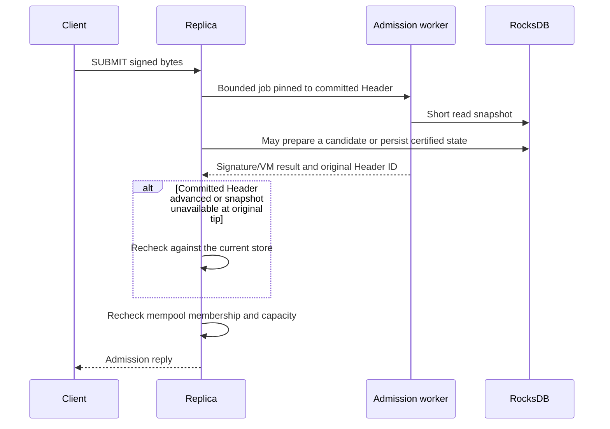

# Inter-block execution pipeline

Jolteon already pipelines consensus and reuses speculative execution on an uncommitted parent. The proposer, follower preparation and certified commit still run synchronously from the Replica event loop. The admission experiment moves client verification to a separate bounded worker. The later execution, commitment and durability experiments each have their own equivalence criteria. [Observed queue overlap](../../storage/queue-attribution/README.md) · [Prior same-tip batch experiment](../../../BENCHMARKS.md#bounded-parallel-admission-experiment)

## Version-pinned client admission

Build the prototype with `--features jolteon-admission-pipeline`. It gives each node one additional dedicated thread. The Replica loop still receives submissions, deduplicates complete signed wire hashes, applies the mempool limit, inserts verified transactions, issues acknowledgments and relays the accepted transaction. Peer-relayed admission continues to use the existing serial path.



The worker checks `TIP` within a short RocksDB snapshot before validating. Its native state and header lookups use the same snapshot. The per-Header Live Cell and stake-input caches are private to the worker views. The existing VM cache stays shared and keys reuse by its resolved inputs and execution context. A committed Header change invalidates both positive and negative background verdicts. The main loop performs a fresh serial check when needed. An exact wire hash already present in the mempool follows the existing duplicate path. Concurrent copies of a pending wire hash share one check and have independently bounded response slots. The queue holds at most 128 waiting replies and 4 MiB of unique transaction bytes.

Only the owning Replica thread mutates the mempool or replies with success. Vote signing, journal persistence, finality verification and the durable atomic commit keep their existing order. The prototype reports dispatches, coalesced requests, queue refusals, misses when acquiring the requested snapshot and final checks repeated on the live store. A check can reach the snapshot successfully yet need a repeat because the tip advanced before its completion was handled.

A deterministic store test commits a new block while holding a read snapshot. It reads the previous Header through that snapshot and verifies that acquiring another snapshot with the old Header fails. A queue test exercises both bounds. The integration suite also resubmits concurrent copies and an unsigned variant with the same transaction body. Four replicas confirm the full signed identity once. The locked release workspace passed 512 tests in the stock build and 514 with the prototype. Both had 25 ignored tests. [Workspace results](https://github.com/a19q3/stem/blob/12338f2fea73c8df437694da473d08e950a0938b/research/admission/pipeline/workspace-checks.json.xz)

## Mixed-version control

Two reference and two prototype validators certified 96 signed payments. One scheduled leader was disconnected during the run. All four agreed after it returned at certified height 17. Each database was reopened using the other executable. A new transaction spent a previously finalized output and reached height 19. WASM independently authenticated the initial finality, the before and after Cell proofs, and the new execution. [Signed proof bundle](https://github.com/a19q3/stem/blob/12338f2fea73c8df437694da473d08e950a0938b/research/admission/pipeline/mixed.json.xz) · [Reopen procedure](../../storage/patricia-finishing/README.md#reopening-stores-across-versions)

## Four-validator payment trials

Two pairs ran in serial, background, background, serial order. Each fresh network received all 90,000 byte-identical signed payments over a 30-second offer at 3,000 scheduled writes per second, with 20 seconds of drain. Every payment was acknowledged and commonly confirmed by the drain deadline in all four runs. Four RocksDB validators shared twelve physical cores and their SMT siblings on a Ryzen 9 7950X3D workstation. The ready-sender driver used two other physical cores. The topology used a 100 ms proposal interval, two VM workers per node and limits of 2,048 transactions and four billion cycles per block. A prototype node had one additional dedicated admission thread within the same CPU affinity. [Paired results](results.json) · [Independent replay output](https://github.com/a19q3/stem/blob/12338f2fea73c8df437694da473d08e950a0938b/research/admission/pipeline/replays.json.xz)

| Run | Common in 30 s | Common TPS | Write-to-common p99 | Mean transport-to-Replica queue | Committed-tip rechecks |
| --- | ---: | ---: | ---: | ---: | ---: |
| [Serial A1](https://github.com/a19q3/stem/blob/12338f2fea73c8df437694da473d08e950a0938b/research/admission/pipeline/a1/payments.json.xz) | 78,769 | 2,625.63 | 7.339 s | 41.02 ms | — |
| [Background B1](https://github.com/a19q3/stem/blob/12338f2fea73c8df437694da473d08e950a0938b/research/admission/pipeline/b1/payments.json.xz) | 84,247 | 2,808.23 | 3.790 s | 33.46 ms | 3,856 |
| [Background B2](https://github.com/a19q3/stem/blob/12338f2fea73c8df437694da473d08e950a0938b/research/admission/pipeline/b2/payments.json.xz) | 81,644 | 2,721.47 | 3.798 s | 34.18 ms | 3,804 |
| [Serial A2](https://github.com/a19q3/stem/blob/12338f2fea73c8df437694da473d08e950a0938b/research/admission/pipeline/a2/payments.json.xz) | 87,411 | 2,913.70 | 3.068 s | 40.33 ms | — |

Background verification reduced the mean transport-to-Replica queue by 18.4% and 15.2%. That timer ends when the event loop first takes the request. It excludes waiting for the background result. Common throughput increased by 182.60 TPS in the first pair and decreased by 192.23 TPS in the second. The write-to-common p99 moved by −3.549 and +0.731 seconds. The two prototype runs repeated 4.28% and 4.23% of their initial client checks against a newer committed tip. B2 missed the requested Header on snapshot acquisition 24 times. Neither prototype run hit the dedicated queue limits. CPU accounting began 8.65 seconds into A1, so its offer CPU is unavailable. In the second pair the validator CPU intervals were 104.37–105.14 seconds for B2 and 103.50–104.68 seconds for A2.

The prototype remains opt-in. The transport queue reduction was repeatable in these pairs. The changes in common throughput and p99 reversed across the two comparisons. The short same-host trials measure overlap and wasted rechecks. They establish no cross-host throughput target.

## Reproduction

For the published runs, retrieve the linked inputs and put them at their listed paths before running `analyze.py`. [Archive retrieval](../../../benchmarks/README.md)

Build the reference at `5ee8502` and the prototype at `29be156` with the release toolchain and identical locked dependencies. Build the prototype and the driver harness with `--features jolteon-admission-pipeline` so the driver retains the new counters. Use a separately built stock verifier with the same signed workload. Collect a fresh run directory with per-node process ticks and the driver report. Use the name `stem` for each node executable and preserve the `native_store-…` Cargo filename for the driver when sampling with the shared CPU script. [Node and driver setup](../../storage/external/README.md#prepare-the-trial) · [CPU sampler](../../storage/submission-sessions/cpu.py)

```sh
external=research/storage/external
study=research/admission/pipeline
python3 "$external/drive.py" --harness "$driver" --contracts "$contracts" prepare \
  --topology research/storage/proposal-cadence/100ms-peers.json --trial "$trial" \
  --rate 3000 --seconds 30 --drain 20 --senders 256 --ready-senders \
  --reuse-submissions --complete-volume --block-transactions 2048 --block-cycles 4000000000
python3 research/storage/queue-attribution/collect.py "$run" "$destination" "$node"
python3 "$study/counters.py" --report "$report" --cpu "$process_ticks" --output "$destination"
python3 "$external/drive.py" --harness "$stock_verifier" --contracts "$contracts" verify \
  --trial "$trial" --report "$destination/payments.json.xz"
python3 "$study/analyze.py"
```

## Follow-on pipeline experiments

| Stage | Candidate to test | Verification required |
| --- | --- | --- |
| Resolved transaction execution | Expand the dispatch window for immutable resolved jobs and quantify work stealing across the current worker-sized wave boundary. | Apply resource charges, fees and receipts in canonical transaction order. Stop at dynamic Lineage, Keeper and dependency boundaries. Match exact cycles, errors, receipt bytes and execution Headers under exhausted budgets. [Resolved-job scheduling study](../../scheduling/README.md) |
| State commitment | Split a sorted Patricia update at an existing branch with edits on both sides. Run independent subtree calculations, merge in canonical order, and compress the result at the original branch. | Match roots, proof bytes and stored nodes across mixed insertions and deletions, a collapsed branch, changes sharing a prefix, and committed and speculative parents. Compare bytes and memory as well as wall time. [Sequential batched path](../../storage/patricia-finishing/README.md) |
| Certified commit | Allow a future prepare job on a contiguous speculative overlay while the previous certified batch is being written. | Bind results to their full parent chain. Publish the new visible tip only after RocksDB acknowledges the atomic batch. Preserve the vote journal's durability barrier and test restart on both sides of the write. Verify reorg or recovery discards obsolete prepared work. [Mixed-version archive](../../storage/patricia-finishing/README.md#reopening-stores-across-versions) |

Cross-host performance has a separate acceptance test. Admission and commitment measurements should retain actual socket writes, acknowledgments, common confirmations, stale-work counts, CPU and duration on each participant. [Sustainable and overload profiles](../../storage/external/qualification.md)
