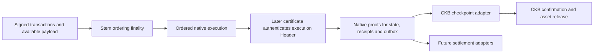

# Native execution finality and a CKB settlement adapter

Stem V1 retains execution-bound Jolteon and uses the CKB settlement adapter. The bounded delayed execution model and its tests are archived for long-term research. Its protocol changes are deferred from V1. [V1 release research priorities](../../STEM-EVOLUTION.md#stem-v1-执行路线)

Stem's active Jolteon protocol certifies the execution Header. A leader prepares the proposal before signing it, a follower verifies the resulting Header before voting, and certified commit writes execution and the journal in one durable batch. A CKB checkpoint can already publish sparsely. Ordinary Stem transactions and a configured local committee can finalize without a CKB bridge. These observations locate the immediate dependency in the native voting rule. [Jolteon execution and voting](../../src/jolteon.rs) · [CKB checkpoint operation](../../OPERATIONS.md#run-a-sparse-ckb-checkpoint-publisher)

## What the adapter consumes

The no-std CKB adapter is now under `stem_stake::settlement::ckb`. It owns the CKB Type arguments, consumer genesis and Type ID binding, canonical checkpoint advance witness, pinned roster, sparse history extension, fee policy and CKB-specific liability proof. The native execution authenticator accepts a two-chain execution proof or a terminal handoff and yields a verified execution Header with an optional successor roster. The Rust/WASM light client and CKB adapter use that authenticator. Existing witness bytes, signing domains, roster commitments and checkpoint Cell data retain their encodings.

The ledger and WASM verifier build with the adapter feature disabled. Current Stem deployments with a CKB bridge and the CKB Jolteon guests enable `ckb-settlement` explicitly. The older Rust checkpoint module name remains a compatibility export when enabled. The release node still includes CKB tooling. The current CKB-backed stake, inbound guardian attestation, outbound custody and refund policies still apply on networks that enable them. [Core authentication](../../stake/src/jolteon.rs) · [CKB adapter](../../stake/src/settlement/ckb.rs) · [WASM light client](../../ledger/src/light.rs)



The diagram describes the research target. The active v1 protocol combines ordering and execution certification. A CKB settlement needs a verified execution Header and the relevant state or outbox proof, followed by settlement-chain confirmation. An ordering acknowledgment provides no receipt or withdrawal authority. Committee membership is independently pinned by each network. The standalone devnet used a configured committee. The funded route exercised the existing CKB Stake Registry and guardian attestations. A future economic-security provider must supply a verifiable next roster with an exact activation boundary and a trust rule for the current roster. Transfer semantics, amounts, replay protection and L1 reorganization policy remain responsibilities of the chosen adapters.

## Bounded delayed execution experiment

The model derives a distinct signing network from the Stem network, genesis Header and a three-height delay. An ordered block binds its parent ordering ID, height, timestamp and Merkle commitment to complete signed transaction bytes. At ordering height `h`, its certificate also commits to the already ordered block and native execution Header at height `h−3`. The first three heights carry the pinned genesis execution marker. Two consecutive weighted certificates finalize the ordering block and authenticate that delayed commitment. The proof cursor checks the exact earlier payload root, order ID, timestamp, number and previous execution Header before it releases an execution commitment. It retains at most three finalized ordering blocks awaiting their execution commitment. [Signed model and controls](model.rs)

The fixture executes seven real signed Cell spends through the native Store. A four-member fixed committee supplies three Ed25519 signatures per certificate. The verifier advances ordering independently during startup, blocks a deadline advance without the required execution Header, rejects changed state roots and commitments to a different ordered block, and verifies paired native transaction and receipt proofs after the delayed commitments. Existing v1 proof and checkpoint validation accept a native execution certificate for the same fixture and reject the experimental ordering QCs. The model uses valid-only blocks. As a control, two individually valid transactions spending the same Cell cause the current full-block prepare path to reject the pair. A live delayed protocol needs a deterministic signed outcome for invalid attempts, and distinct commitments for ordered attempts and applied transactions.

Monad supplies a primary reference for putting earlier execution commitments in later ordering proposals. Its error accounting and reserve-balance rules apply to its own state model. Stem still needs to specify Cell admission reservations, attempted-transaction resource charges and expiry semantics. [Monad asynchronous execution documentation](https://docs.monad.xyz/monad-arch/consensus/asynchronous-execution)

## Acceptance before changing the live protocol

| Boundary | Required evidence |
| --- | --- |
| Data availability and execution deadline | A validator verifies canonical payload availability and bounded preliminary resource declarations before voting. It stops at the declared execution lag when an earlier result is unavailable. Verify deadline stalls and restart when a node has finalized ordering beyond its executed height. |
| Ordered outcomes | Replaying a signed prefix produces identical successes, rejected attempts, fees, native state, receipts and outbox. Include two spends of one OutPoint, same-block successors, Keeper execution, dynamic Lineage and L1-dependent transactions under the pinned execution context. |
| Voting and recovery | Persist ordering votes before broadcast and persist the execution prefix independently. Recover both cursors and their certified ancestry after process failure. Check finalized order, execution and CKB settlement API responses individually. |
| Committee and upgrade | Pin proof versions in the trust roots. Define the transition when the execution cursor reaches a certified committee boundary. Exercise a drained handoff before considering pipelining across epochs. |
| CKB and other consumers | Add explicit support for a delayed execution proof version through the adapter. Verify its order-to-execution commitment and history extension, then check the existing state proof, replay and asset-release rules. Use a planned migration when existing CKB Cells pin an earlier contract code hash. |

The experiment covers authenticated ordering and delayed proof binding under one committee. A future live delayed execution experiment would require an ordering pacemaker, deterministic failed-attempt accounting, endogenous reconfiguration and throughput measurements.

## Verification and reproduction

A four-replica Stem devnet finalized 48 payments without a CKB bridge. Its height-15 checkpoint was subsequently built and accepted on CKB through two-node P2P, with 18,377,024 estimated CKB cycles. A separate funded devnet published the two terminal committee handoffs at heights 10 and 20 and the current execution checkpoint at height 25. The RISC-V contract rejected a changed execution root and a replayed handoff. Offline WASM replay re-authenticated all four native Headers and checked that the signed CKB transactions used those exact Header bytes. It also rejected post-handoff finality from the original trust without the handoffs. [Committed CKB transactions and native proofs](ckb-replay.json.xz) · [Archive collector](collect.py)

```sh
cargo test --release --locked -p stem-stake --no-default-features
cargo test --release --locked --test native_store delayed_execution
cargo tree --locked -p stem-wasm -e features -i stem-stake
sdk/wasm/build.sh "$sdk_directory"
node research/delayed-execution/replay.mjs "$sdk_directory"
```

Use the published CKB devnet commands to reproduce the live P2P route and funded handoffs. The CKB guests build from `contracts/Cargo.toml` with the repository's RISC-V flags. The adapter-disabled stake crate passed 12 tests. The locked release workspace passed 513 tests, with 25 marked ignored. The legacy no-default-features stake, checkpoint and vault guests built independently. [Build and test output](checks.json.xz) [P2P and committee fixture commands](../../OPERATIONS.md#exercise-a-full-funded-committee-handoff)
