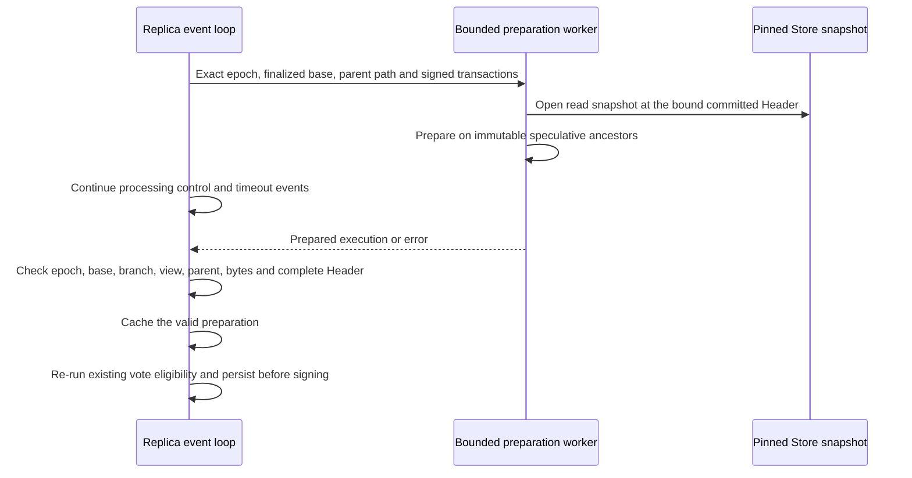

# Non-blocking Jolteon candidate preparation

The candidate feature moves follower preparation off the Replica event loop. A dedicated dispatch thread uses the replica's existing Rayon VM pool. The Replica continues handling peer messages, advancing the pacemaker and writing its journal. It schedules only the earliest unprepared candidate on the requested branch, with one slot for the whole job and its result. The existing branch horizon, frame size and native resource budgets also apply. Leader construction, certified RocksDB commit and admission ran synchronously in the original Follower comparison. [Implementation](../../src/jolteon/candidate_pipeline.rs) · [Admission experiment](../admission/pipeline/README.md)



The worker has no journal, signer or mutable consensus state. It reads an exact committed snapshot with already-prepared immutable ancestors. The Replica discards a result whose epoch or finalized base changed, whose exact candidate or path changed, or whose branch the replica no longer needs. After a view change a verified result can remain useful for an identical ancestor of the live high QC, recovery target or current preferred proposal. Completion never dispatches a vote. The normal tick checks current membership, view, lock, vote, local timeout and timestamp, persists the same journal record, and only then signs. The current Header encoding, Jolteon proof domains and CKB checkpoint witnesses carry through the experiment.

## Regression controls

| Control | Observed outcome |
| --- | --- |
| Exact branch binding | The unit test changes the epoch, finalized point, committed Header, exact parent branch and ordered wire bytes separately. Each mismatch rejects the completion. |
| Concurrent Store snapshot | Commit a new Header while holding the old snapshot. The snapshot still reads the old Header and a fresh snapshot for that stale base is refused. |
| Timeout recovery | Two four-node runs used a leader clock offset of +120 or −120 seconds. Both recovered from view 1 and certified a new payment at height 6. |
| Committee handoff | A funded CKB devnet completed two handoffs. The CKB verifier accepted checkpoints at heights 10, 20 and 25. |
| Mixed versions and restart | Two reference and two background replicas agreed on 96 signed payments after one scheduled leader was stopped and restarted. All four RocksDB stores reopened with the other implementation. The next payment spent an earlier output. WASM verified finality and the original, spent and successor Cell proofs to height 19. |

The locked release suite passed 512 tests with the default build and 515 with both pipeline features enabled. Both runs marked 25 tests ignored. The regression controls exercise independent failure boundaries. Interleavings of completion, timeout and process failure still need fault injection. The synchronous reference CLI also reproduced the two clock recovery proofs and all three execution or handoff proofs from the funded run. A checkpoint for the mixed run at height 17 also entered two CKB node pools over P2P and committed using a previously built checkpoint ELF. [Clock and committee evidence](faults.json.xz) · [Mixed-version restart proof](mixed.json.xz) · [Build and test output](https://github.com/a19q3/stem/blob/12338f2fea73c8df437694da473d08e950a0938b/research/execution-pipeline/checks.json.xz)

## Leader proposal construction

`jolteon-proposal-pipeline` runs one Leader construction job per replica, using the existing VM pool. It captures the ordered mempool entries, proposed timestamp, committed Header and prepared parent branch. The Replica rechecks the epoch, view, parent certificate, exact branch, vote lock, vote and timeout journal, and deadline before publishing. An epoch seal uses the existing publication path. The Replica persists the signed proposal and its voting decision before broadcast, then signs the vote. The worker does neither. [Implementation](../../src/jolteon/proposal_pipeline.rs)

| Control | Observed outcome |
| --- | --- |
| Pinned Store | A speculative child built from a pinned snapshot matched serial execution. A job submitted against an old committed Header returned no proposal. |
| Mixed versions and process restart | Two synchronous and two background replicas finalized 96 signed payments. One replica stopped and then caught up. All four agreed at height 11 and the synchronous verifier authenticated the finality proof. |
| Completion after timeout | A two-second delay on the first job of each Leader worker exceeded the 350 ms view timeout. Each worker recorded one discarded result and five published proposals. All four replicas finalized 96 payments and agreed at height 13. |
| Native workload and restart | Four replicas verified Polytype, sponsored OTX, atomic Lineage and Keeper batches. The same run exercised restart and verified scheduled execution proofs. |
| CKB-backed handoff | A funded CKB devnet accepted the existing Checkpoint witness at both handoffs, heights 10 and 20, and the follow-on execution checkpoint at height 25. |

The release workspace passed 517 tests with the Leader, Follower, Admission, certificate reuse and Work Stealing features enabled. The late-completion control uses the [worker-delay shim](delay-proposal.c), built with `cc -shared -fPIC delay-proposal.c -o delay-proposal.so -ldl -pthread`. Run the four-validator `tools/jolteon_localnet.py` fixture with `--cadence 50 --timeout 350 --offline-blocks 8 --transactions 96 --offered 250`. Set `--alternate-binary` to a wrapper that sets `LD_PRELOAD` to the compiled shim and executes the Leader build. The normal `--binary` is the synchronous reference. The report's `execution.proposal_jobs` counters distinguish started, published and stale work.

Leader construction remains selectable. The fault run demonstrates the deadline and journal boundary. Shared worker contention and throughput belong to the combined ablation after State Commitment, with stage timings, stale work and tail latency measured separately.

### Proposal scan counters

`execution.proposal_scan` reports cumulative `inspected`, `selected`, `spent_in_parent` and `spent_in_proposal` counts from both Leader paths. The denominator counts transactions actually visited by selection. It includes transactions filtered by a resource limit. The two spent-input fields count the first missing resolved OutPoint when it is an explicit input of the transaction. A matching deletion in the speculative branch is separate from one caused by earlier work in the current proposal. Missing committed records, dependencies and other validation errors contribute to the inspected count only. These are selection attempts, so a transaction can contribute in more than one proposal. The background path records completed work even when the Replica discards a stale result.

A signed regression spends one input in the parent and spends a second input during the child, then attempts both again along with a third input absent from committed state. The selected transaction, executed Header and receipts match serial execution. The scan reports four inspected attempts, one selected transaction and one rejection in each spent-input category.

### Leader-only payment comparison

Two `61aef4e5f3bddbcb990a3c9c96822b00e0f159d6` builds both enabled Admission, Follower via Commit and concurrent commitments. Only the background build enabled `jolteon-proposal-pipeline`. Four same-host validators used four VM workers and shared logical CPUs `2-7,10-15,18-23,26-31` with the driver. The offer was 49,500 independent signed payments through 128 persistent senders at 3,300/s for 15 seconds with 20 seconds of drain. The cadence was 100 ms with four billion cycles and 2,048 transactions per block and 256 retained heights. Run order was synchronous, background, background, synchronous.

| Run | Leader | Common TPS during offer | Write-to-common p99 | Mean control wait | Mean proposal time | Validator CPU | Parent-spent / inspected |
| --- | --- | ---: | ---: | ---: | ---: | ---: | ---: |
| A1 | Synchronous | 3,134.20 | 0.817 s | 2.216 ms | 11.808 ms | 61.86 s | 28,740 / 78,240 |
| B1 | Background | 3,029.73 | 1.643 s | 1.507 ms | 11.993 ms | 61.59 s | 27,193 / 76,693 |
| B2 | Background | 3,123.53 | 0.973 s | 2.807 ms | 12.971 ms | 61.20 s | 27,210 / 76,710 |
| A2 | Synchronous | 3,155.07 | 0.934 s | 1.824 ms | 11.643 ms | 62.35 s | 27,738 / 77,238 |

Each run wrote and acknowledged all 49,500 payments during the offer and confirmed every payment by drain. Common finality and history-index checks passed. A read-only archive audit authenticated transaction and receipt roots for 774 observed blocks. No run recorded a local timeout. Both background runs published every dispatched job, 205 and 184 respectively. One reached the 2,048 count cap.

Window TPS and p99 favored synchronous construction in both pairs, and mean control wait moved in opposite directions. Keep the Leader worker opt-in. Across the four runs, 35.5–36.7% of visits were rejected because the parent branch had already consumed an input. No visited transaction was rejected on the in-proposal spent path. The frequency shows repeated selection work with both Leader implementations. Time attributable to these visits and their prevalence under cross-host load remain to be measured.

Both binary hashes are pinned. The synchronous build was `b6b753d81fb87bb21f08ddbde55d3b4e393ebaf735e2ba78e6ac4089fd06be89` and the background build was `8e39cfc23e11446f8ece06785c00dec169b2813a21f9071660bbb0387d5aeab5`. The genesis and signed workload SHA-256 values were `5c5f49c6e78e9d8add2ba38c51c3fa327d72719f5f63c7874dbab4252c341cbc` and `56a708be1d261e414f316980d3e11965da8b602b403840ea6eaa297fe514a6c9`.

## Concurrent state commitments

`native-commitment-pipeline` prepares the Cell tree, System tree and execution/receipt record concurrently after ordered execution. It uses the existing pool for blocks with at least 256 execution items when the pool has at least two workers. It joins the results in the existing Cell, System, Header and execution-write order. The durable certified write remains a single batch.

A direct test compared the ordered batch key and value bytes and the Header bytes against serial finishing. A separate integration test prepared 768 signed payments in blocks of 255, 256 and 257 transactions. Serial replay, the Leader and the Follower produced identical Headers and receipts. After reopening RocksDB, the regression checked signed execution bytes, fee accounting and the encoded Cell and fee proofs.

An all-enabled four-replica smoke run offered 26,400 payments at 2,200/s for 12 seconds. All were jointly confirmed within the drain window. Of 87 measured blocks, 36 contained at least 256 payments. The largest contained 1,195. The independent finality verifier and history index check agreed at height 94. This run exercises the threshold on live validators. It supplies no isolated throughput estimate.

The Cell tree recursion is still serial inside its namespace. Stage timing in the planned ablation can show whether Patricia subtree parallelism helps once receipt and System work overlap.

### Commitment-only mixed-script comparison

Both builds of `6260bc569da037d2748b0389055b98f8f44e1612` enabled Admission and Commit, including Follower. Both used synchronous Leader construction and fixed verification waves. The candidate added `native-commitment-pipeline`. Four same-host validators and the driver shared logical CPUs `2-7,10-15,18-23,26-31`. Each validator used four VM workers, a 100 ms cadence, an 8B cycle cap, a 2,048 transaction cap and 256 retained heights.

The [mixed Type Group fixture](../scheduling/README.md#mixed-type-groups-with-the-native-pipeline) used 64 persistent senders to offer the same 46,000 signed transactions at 2,300/s for 20 seconds, followed by 25 seconds of drain. The run order was serial, concurrent, concurrent, serial. All transactions were written and acknowledged within the offer and confirmed by drain. Finality and history-index checks passed, and the read-only audit rebuilt the two roots for 931 observed blocks.

| Run | Commitments | Common TPS during offer | Write-to-common p99 | Mean control wait | Mean Follower prep | CPU | Blocks with at least 256 items |
| --- | --- | ---: | ---: | ---: | ---: | ---: | ---: |
| A1 | Serial | 2,239.20 | 5.037 s | 7.749 ms | 34.243 ms | 94.60 s | 58 |
| B1 | Concurrent | 2,230.55 | 0.845 s | 6.863 ms | 33.544 ms | 93.29 s | 76 |
| B2 | Concurrent | 2,202.40 | 0.944 s | 4.988 ms | 31.524 ms | 92.44 s | 73 |
| A2 | Serial | 2,209.65 | 0.876 s | 9.404 ms | 33.288 ms | 91.62 s | 75 |

Both candidate runs exercised the 256-item threshold. The candidate reduced mean Follower preparation and control wait in both pairs. Window TPS changed by less than 0.4% in each pair. The large forward p99 improvement did not repeat, and only the first serial run filled the transaction budget. The recorded timings cover complete stages including work outside the commitment calculation. Keep the feature opt-in and attribute time inside Cell, System and receipt commitment work before selecting a subtree optimisation.

The serial and concurrent binary SHA-256 values were `75a3899438c82994594f51235f9b15048efd5da76557c6344eb7496ad863d1ad` and `b6b753d81fb87bb21f08ddbde55d3b4e393ebaf735e2ba78e6ac4089fd06be89`. The genesis was `d16c1038a4f652341ae3b9b162e5c6beec3876d782330928ddeced7f7b847803` and the signed workload was `cc6ac4f00fdf9d79bb5dca848d3181c08a6df90028f1c0f9ad9854dceff60240`.

### Cost of selecting and committing ordinary payments

The `execution` status reports `proposal_scan.selection_us`, `proposal_commitments` and `candidate_commitments`. Selection time covers the provisional block scan, including input resolution, budget checks and VM invocation. The commitment histograms cover successfully constructed batches, including completed background work that is later discarded. Total commitment time includes the Cell and System state updates, execution record encoding and receipt root, Header and history construction, and batch and pruning preparation. Component elapsed times can overlap. The separate `execution.commit` histogram measures application and publication of the certified batch.

The serial build and the build with only `native-commitment-pipeline` ran on the [single-host profile placement](../storage/external/README.md#single-host-v1-profile-rehearsal). Each run used two VM workers per replica, fresh stores, a 4B cycle and 2,048-transaction limit, and the 4,096-entry success cache. Both wrote and acknowledged the same 90,000 signed payments. All became common by the end of the 25-second drain. Independent finality and workload replay verified 498 archived blocks across the pair. No classified block-cycle rejections or local timeout votes occurred.

| Timing or outcome | Serial commitments | Concurrent commitments |
| --- | ---: | ---: |
| Common window TPS | 2,628.97 | 2,635.07 |
| Write-to-common p99 | 10.104 s | 8.926 s |
| Mean complete proposal | 38.169 ms | 33.857 ms |
| Selection share of proposal wall time | 62.0% | 56.9% |
| Mean total proposal commitments | 14.219 ms | 14.280 ms |
| Mean Cell portion of proposal commitments | 13.912 ms | 14.206 ms |
| Mean complete Follower preparation | 51.419 ms | 49.186 ms |
| Mean total Follower commitments | 15.359 ms | 15.267 ms |
| Mean Cell portion of Follower commitments | 15.106 ms | 15.201 ms |

Commitments used 37–42% of total Leader time and 30–31% of total Follower time. The Cell path alone accounted for about 98% of the serial commitment elapsed time for both roles. System and receipt work accounted for only a small fraction of serial commitment time. Their elapsed times under concurrency can include scheduling and shared-resource delays. Concurrent namespaces changed common throughput by 0.23% in this 30-second pair. Partitioning the Cell tree itself is the useful next commitment experiment. Keep proposal selection and VM reuse in the cost comparison. Preserve exact roots and write ordering across any Cell subtrees and run the full 180-second profile before adopting performance defaults.

Newer status reports break `proposal_commitments.cells` and `candidate_commitments.cells` into three phase histograms alongside the original totals. `cell_keys` covers record keys and value hashes and sorting the changes. `cell_tree` covers Patricia traversal, reads, node hashing and the ordered node journal. `cell_batch` covers compact encoding and adding node edits to the pending RocksDB batch. Disk persistence is tracked separately. Subtract `before` from `after` for each field and divide total elapsed microseconds by the corresponding bucket count. Older binaries leave these phase counts absent or zero. [Subtree write results](../patricia/README.md#single-host-sustained-payment-comparison)

Reproduce with `drive.py prepare --rate 3000 --seconds 30 --drain 25 --senders 256 --block-transactions 2048 --block-cycles 4000000000 --reuse-submissions --ready-senders --complete-volume` and the same topology and trial for both binaries. Toggle only `native-commitment-pipeline`. Use the standard `measure` and `verify` commands. Subtract `before.statuses` from `after.statuses` for each counter and sum over all validators. Divide histogram elapsed microseconds by the sum of its bucket counts for the reported means. [Driver and replay procedure](../storage/external/README.md#measure-and-replay)

The node SHA-256 fingerprints were `85105ccc1f4bb862e9347aa7fb9adf0ad275d311666f1c86999497beb0504e31` and `76d08219df1b8a914e8e8d03376478e7fe01c3cbc54cee7c1c19dfb020de67a8`. The shared driver and verifier SHA-256 was `20c7588d97674a79e5c14a45d9c67ac4190780ea6f0ea2bfa946be3a754ad7c2`, genesis SHA-256 was `5cb75903f55eb47dbbabe87a9c11f8769136085ce29cb35b542d4eab1a57d9b7`, and the signed corpus BLAKE2b digest was `40f951bb7266fbf694ecaa42c32956818cc3dd76f39f5c3f5d3352e2161b812a`.

### Lineage materialization across conflicts

The candidate `native-lineage-ready-prefix` checks up to one worker-sized window of consecutive Lineage commands. It materializes the leading independent commands against the same immutable view, then stages their effects in transaction order before inspecting the next window. It tracks each fee input, current Head OutPoint, possible output, and direct Cell Dep in both read/write directions. A conflicting command or a Dep Group ends that window. The serial path handles the first command when no prefix is available. Planning still requires full transaction cycle budgets for the inspected window.

Replica status records `execution.candidate_lineage` for successfully prepared follower artifacts. The counters distinguish access-analysis time, concurrent materialization time, parallel waves and commands on each path. They include successful background preparations later discarded. These counters measure preparation work, which can include the same transaction on more than one replica or branch. [Lineage runtime and proof acceptance](https://github.com/a19q3/stem/issues/27)

The dependency regression signs a fixed nine-command block. A repeated Head uses the next Exact version, a command reads a fee output created earlier in the block, another reads a later fee input, and a Dep Group reads a member consumed by a later command. The fee-only rejection of a two-Head command leaves both Head versions intact. A stale Exact command and an exhausted read budget reject as in serial preparation. The committed serial and parallel Cell and System proof paths, Live Cell records, execution receipts and Headers match byte for byte.

The fixed Store comparison alternated reference and candidate in ABBA order with 2, 4 and 8 workers. Each fixture prepares and commits 31 blocks and checks each Header and receipt against a separately committed serial Store. The four workloads are eight independent commands, eight single-Head hotspot commands, one atomic eight-Head command and eight commands mixing shared and independent Heads. Times below are the median of the two run medians for each scheduler.

| Workers | Mixed fixed waves | Mixed independent prefixes | Hot Head fixed waves | Hot Head independent prefixes |
| ---: | ---: | ---: | ---: | ---: |
| 2 | 3.105 ms | 3.200 ms | 3.302 ms | 3.541 ms |
| 4 | 3.583 ms | 3.204 ms | 3.334 ms | 3.368 ms |
| 8 | 3.552 ms | 3.081 ms | 3.348 ms | 3.507 ms |

The one-command atomic workload has no concurrent materialization and still showed run-to-run timing changes. The local result supports a choice of workload and worker counts for further comparisons. The 8-worker mixed p99 of the prepared blocks increased in this sample.

```sh
cargo test --release --locked --features native-lineage-ready-prefix \
  lineage_prefix_keeps_live_dependencies_versions_and_fee_only_rollback
STEM_LINEAGE_BENCH_WORKERS=4 cargo test --release --locked --test native_store \
  lineage::measure_dynamic_lineage_updates -- --exact --ignored --nocapture
```

#### Four-replica Lineage comparison

Four loopback replicas with four VM workers wrote the same signed corpus in each matched pair. The mixed counter workload offered 480/s for 20 seconds, using 64 registered Heads. The hotspot AMM offered 240/s for 20 seconds, with one shared market. Both had a 25-second drain, 64 persistent senders, a 100 ms proposal cadence, and block limits of 4B cycles and 2,048 transactions. The mixed pair ran fixed waves then prefixes. The AMM pair reversed the order. Each run acknowledged and confirmed the entire workload, and all 1,204 committed heights replayed serially across the four runs. The audit checked receipts, Head versions, authenticated state and AMM conservation.

| Workload and metric | Fixed waves | Independent prefixes |
| --- | ---: | ---: |
| Mixed common TPS in offer | 468.80 | 469.95 |
| Mixed p99 | 1.658 s | 1.200 s |
| Mixed follower commands materialized concurrently | 56.8% | 91.3% |
| Mixed validator CPU | 34.61 s | 36.42 s |
| Hotspot common TPS in offer | 235.10 | 235.80 |
| Hotspot p99 | 0.469 s | 0.912 s |
| Hotspot follower commands materialized concurrently | 0% | 0% |
| Hotspot validator CPU | 24.90 s | 25.11 s |

Each mixed run replayed 9,600 commands and 12,800 Head updates, charging 37,197,123,200 cycles and 19,200,000 shannons. Each hotspot run replayed 4,800 swaps and 9,600 Head updates, charging 18,826,613,250 cycles and 9,600,000 shannons. The mixed candidate used more CPU and completed more materializations concurrently. Whole-window throughput stayed within 0.3% in each pair. The opposite tail-latency directions and the single pair per workload leave the feature opt-in. To test whether the scheduling gain reproduces, raise active Head cardinality and measure concurrent work, contention and tail latency together.

Use `storage_load::sustained_lineage_load` with `STEM_LINEAGE_WORKLOAD=mixed` or `hotspot_amm`, a fresh evidence directory, and the selected `STEM_TEST_REPLICA_BIN`. Set `REPLICAS=4`, `VM_WORKERS=4`, `SECONDS=20`, `DRAIN=25`, `SENDERS=64`, `CADENCE=100`, the offered rate and the block budgets above under the `STEM_STORAGE_` prefix. Set `COMPLETE_VOLUME`, `READY_SENDERS` and `REUSE_SUBMISSIONS` to `1`. Subtract the per-node status counters in `before` from `after` and sum across replicas. The archive audit is written as `lineage-audit.json`.

The fixed and prefix node SHA-256 values were `e6d63fa384de8befc0b0cd537510895815cc8ae276b8f5fa32a4774a6b8648a8` and `360c8f614d3968895a66815308079613be66ac22b1e9d8146fcd87f1f00cb244`. Both used the harness with SHA-256 `8f557998a86df1bb74f1e1916b59793ee39603c5b57181d06a1965433c57ba95`. The mixed and hotspot corpus BLAKE2b digests were `ab3d7ce88ffe6e5243db02a5b7e9e397c3bbe182899969edcdeb039b1f2cb9c9` and `8e8a6e264c6b092804d5a6265a48d80acf0cb6135c4f03257b759395de186576`.

## Certified Commit Pipeline

`jolteon-commit-pipeline` enables the Follower worker and delegates each certified synchronous RocksDB batch to one writer per replica. The batch contains execution, the finality proof, pruning and the next journal. The Replica installs the new tip and journal only after acknowledgement. It can serve status from the previous acknowledged state meanwhile. It queues requests that would read certified state or write the journal, with backpressure at eight events or two maximum frame lengths. Handoffs and recovery use the same ordered write acknowledgement.

For an ordinary single-block commit, the Replica can authenticate and prepare the current view's direct descendant against a pinned snapshot. If durability advances during preparation, the result can be reused only when the new finalized point and Header match the exact prefix of the pinned branch. The surviving parent path and signed transaction bytes must still match. Journal writes, votes and publications remain serialized through the Replica. [Writer and overlap guards](../../src/jolteon/commit_pipeline.rs)

| Fault control | Height visible during pause | Durable height on offline reopen | Result |
| --- | ---: | ---: | --- |
| Release a paused WAL sync | 3 | — | The Follower scheduled one overlapping preparation and reused it after acknowledgement. In-flight Header and finality reads returned after release. |
| Kill before writing the batch | 3 | 3 | The restart could replay the already certified candidate without peers. |
| Kill after WAL append and before its sync | 3 | 4 | The process restart recovered the whole batch from the OS page cache. This is a process-crash control. |
| Kill after WAL sync and before acknowledgement | 3 | 4 | The offline snapshot authenticated the new execution Header and proof. The restarted node accepted the matching journal. |

Each fault run ended with all 24 signed payments confirmed on four replicas. A separate mixed-version run confirmed 36 payments and converged at height 85 after restart. The archive retained a historical Header and proof that ordinary replicas pruned. The CKB devnet accepted both handoff checkpoints at heights 10 and 20 and the execution checkpoint at height 25. The combined release suite passed 520 tests.

Run the fault fixture on Linux with a feature build, a reference build and the native lock ELF. The fixture uses new databases. The reference build should keep the same pipeline features except for the Commit flag.

```sh
cc -O2 -shared -fPIC research/execution-pipeline/commit-fault.c \
  -o "$scratch/commit-fault.so" -ldl -pthread
PYTHONPATH=tools python3 research/execution-pipeline/probe_commit.py \
  --binary "$candidate" --reference "$reference" --lock "$native_lock" \
  --shim "$scratch/commit-fault.so" --output "$scratch/commit-overlap" \
  --port 24640 --mode overlap
```

Repeat with `before`, `before-sync` and `after-sync`, using fresh outputs. The fault probes establish publication and recovery boundaries. They supply no throughput estimate. The integrated comparison should compare the end-to-end commit histogram with the writer's service histogram and count how often a descendant preparation survives the commit.

### Integrated commit faults with live payments

All four replicas used the [six-feature sustainable-pair build](../storage/external/README.md#integrated-pipeline-sustainable-profile-pair). Pass that build to both `--binary` and `--reference`, pass the default build to `--verifier`, and add `--with-payments` to the four commands above. Each run submitted 12 signed payments while the targeted writer was stopped and waited for all three remaining replicas to confirm them. The target showed height 3 before the wait. Its requests for height 4's Header and certificate did not return before acknowledgment. A client timeout during the pause is permitted by the bounded queue. After release, a fresh query must succeed if the original caller timed out.

| Fault point | Durable height on offline reopen | Common height after recovery | Payments confirmed by all four |
| --- | ---: | ---: | ---: |
| Release paused WAL sync | — | 9 | 24 |
| Kill before writing the batch | 3 | 11 | 24 |
| Kill before WAL sync | 4 | 10 | 24 |
| Kill after WAL sync | 4 | 10 | 24 |

In the release trial the target reused one prepared descendant. The default build authenticated the final execution Header for each trial, and all four replicas served that exact Header. The longer pause first exposed a limitation of the original probe: after the queue fills, even a later status read can time out. The revised fixture asserts the Header and finality publication boundary directly. The pre-sync result measures a process restart with the kernel running. Sustained offered load and device power-loss behavior remain separate experiments.

### Commit-only ablation

The four same-host trials used one build of `7e06beb` with Admission, Follower, Leader, concurrent commitments and Work Stealing enabled, and a matched build additionally enabling Commit. The order was synchronous, writer, writer, synchronous. Four replicas used four VM workers each and a 100 ms cadence. The 4 billion cycle and 2,048 item limits held for every run. The driver wrote the same 45,000 signed payments at 3,000/s for 15 seconds and allowed 12 seconds to drain. Each trial confirmed every payment and passed the common finality and history-index checks.

| Run | Commit | Common TPS during offer | Write-to-common p99 | Mean control wait | Mean end-to-end commit | Validator CPU |
| --- | --- | ---: | ---: | ---: | ---: | ---: |
| A1 | Synchronous | 2,487.3 | 3.617 s | 7.676 ms | 12.042 ms | 54.83 s |
| B1 | Writer | 2,888.3 | 0.786 s | 3.903 ms | 12.454 ms | 53.21 s |
| B2 | Writer | 2,880.8 | 1.400 s | 4.932 ms | 11.411 ms | 51.93 s |
| A2 | Synchronous | 2,833.5 | 4.519 s | 30.527 ms | 12.239 ms | 54.61 s |

The writer's mean service times were 12.254 ms in B1 and 11.213 ms in B2. Those runs served 124 and 112 status requests during writes and reported no overlapping descendant jobs or rebases. Both pairs favored the writer on window TPS and p99, with a much larger throughput difference in the first pair. The gains occurred without descendant reuse in these runs. Keep Commit opt-in while testing longer windows and independent hosts. This comparison isolates Commit within one integrated feature set.

The workload file SHA-256 was `f0233229ebdf9d1c8a3ac1f54611a332eb9726898ff5498a27cd5b9d82a0ba6a`. The synchronous and writer binary SHA-256 values were `5abbc86b8e6fab184563c6767f112c2a71a93a19f91b16d569ae63fbbb17be5d` and `c58a4948046822b091f23f129d99571edd9b2da4c1bc0dbd41c89705160510d1`.

### Sixty-second Commit comparison

Two `46ca72a3081f949420ac1cd473256f85cf47d3ee` builds used Admission, Follower and concurrent commitments. The writer build added `jolteon-commit-pipeline`. Both used synchronous Leader construction, fixed VM waves and exhaustive proposal scanning. Four replicas and the driver shared logical CPUs `2-7,10-15,18-23,26-31`; each replica used four workers, a 100 ms cadence and the 4B-cycle/2,048-transaction envelope. The driver used 128 persistent senders to offer the same 156,000 prefunded payments at 2,600/s for 60 seconds, followed by 30 seconds of drain.

| Run | Commit | Common TPS during offer | Write-to-common p99 | Peak acknowledged backlog | Mean commit | Validator CPU |
| --- | --- | ---: | ---: | ---: | ---: | ---: |
| A1 | Synchronous | 2,569.07 | 1.428 s | 4,437 | 11.660 ms | 232.14 s |
| B1 | Writer | 2,540.62 | 1.409 s | 4,430 | 15.848 ms | 237.97 s |
| B2 | Writer | 2,560.30 | 2.291 s | 6,410 | 14.207 ms | 242.13 s |
| A2 | Synchronous | 2,572.55 | 9.363 s | 10,059 | 15.416 ms | 236.89 s |

All runs acknowledged and finalized every payment by drain, with zero local timeout votes. Verified common finality and the archive history-index checks passed. Receipt and transaction roots matched in 1,481 observed blocks. The writer runs served 248 and 268 status replies during commits and recorded no overlapping descendant jobs. The writer traded 0.5–1.1% window throughput and additional CPU for a smaller measured backlog in both pairs. The forward p99 difference was 19 ms. The reverse p99 difference was 7.072 seconds, and the synchronous run reached the count cap in 25 blocks versus one in its writer pair. Mean control wait moved in opposite directions. Keep the writer opt-in pending independent-host time, load and durability evidence.

The synchronous and writer binary SHA-256 values were `9295919d6ff5ec9191236d0873f447b86bca338d7293bb8539cb7dd267dd78e8` and `fbc1fed2954a01fbce9b042684cbb34707fa22f1792699d77b0bae045b686892`. The genesis and workload SHA-256 values were `d553c99b984de34dbea6d1656528fc35b8700138b517db32868ba18bf0f4e001` and `c1f1a310b8669c8eb248956ef2c09d93b0a1f607058b364b34f2e385d30d561e`.

## Admission and Follower interaction

Four builds of `d227375` ran with both features disabled, Admission only, Follower only and both enabled. The run order was baseline, Admission, both, Follower, Follower, both, Admission, baseline. No other research feature was enabled. The four replicas and driver shared 24 logical CPUs on one host, with four VM workers per replica, a 100 ms cadence and limits of 4 billion cycles and 2,048 transactions per block. The driver used 128 senders, persistent connections and the same genesis and 45,000 signed payments in each run. It wrote 3,000/s for 15 seconds and allowed 12 seconds to drain. All eight runs confirmed every payment, verified the common finality and passed the history index check. No run recorded a local view timeout.

| Build | Window TPS, forward / reverse | Write-to-common p99, forward / reverse | Mean control wait, forward / reverse | Peak acknowledged backlog, forward / reverse |
| --- | ---: | ---: | ---: | ---: |
| Both disabled | 2,734.5 / 2,249.7 | 2.128 / 3.781 s | 6.010 / 12.061 ms | 3,982 / 11,255 |
| Admission | 2,726.7 / 2,884.4 | 1.609 / 1.470 s | 7.564 / 9.309 ms | 4,746 / 4,380 |
| Follower | 2,668.6 / 2,678.0 | 4.755 / 1.689 s | 12.293 / 4.774 ms | 8,373 / 4,830 |
| Both enabled | 2,878.4 / 2,766.9 | 4.506 / 5.325 s | 33.999 / 25.612 ms | 7,946 / 9,471 |

With both features enabled, window throughput rose in both paired comparisons. So did p99 and control-message wait. The combined runs repeated 226 and 228 Admission checks, compared with 2,053 and 2,404 with Admission alone. Fewer rechecks did not buy a better tail in this profile. Mean Follower preparation also rose relative to the Follower-only runs, from 35.139 and 33.545 ms to 43.362 and 38.292 ms. Six runs reached the transaction cap. Block composition and the 485 TPS gap between the baseline runs limit inference about the cause. Keep the features independently selectable until longer matched runs separate batch size, worker contention and queue waits.

The workload SHA-256 was `f0233229ebdf9d1c8a3ac1f54611a332eb9726898ff5498a27cd5b9d82a0ba6a` and genesis SHA-256 was `6a6cc373c2d8098d346b2492f71077d396aa310a0959375bc07720f07af5fcec`. To reproduce, build the four variants with Cargo features `jolteon-admission-pipeline` and `jolteon-candidate-pipeline` toggled as above. Use the `storage_load::sustained_payment_storage` fixture with `STEM_TEST_REPLICA_BIN` pointing to the selected binary. Set the rate, offer, drain, sender, cadence and budget values in `STEM_STORAGE_*`, enable `PREFUND_PAYMENTS`, `COMPLETE_VOLUME`, `READY_SENDERS` and `REUSE_SUBMISSIONS`, and set retention to 256.

## Block resource limits under a payment burst

The four validators and driver shared logical CPUs `2-7,10-15,18-23,26-31`. Each validator had four VM workers, with a 100 ms cadence. The driver used 128 persistent senders and scheduled the same 66,000 signed, prefunded payments at 3,300/s for 20 seconds, with 20 seconds to drain. Each profile had a fresh genesis and fresh RocksDB stores. Caps on transaction bytes, Cell reads and Cell write bytes stayed fixed. Every run wrote and confirmed all 66,000 payments by the end of drain and passed the common finality and history-index checks. These are short, same-host overload observations.

The node binary came from `7e06beb36829d9e53770d31da745f81216bb2a8b` with Admission, Leader, Commit (including Follower), concurrent commitments and Work Stealing. Its SHA-256 was `c58a4948046822b091f23f129d99571edd9b2da4c1bc0dbd41c89705160510d1`. The signed workload SHA-256 was `df74079d126d91c6ffaa00e9ed8b327139f00338bf0eed476e48074d95bb95b9`.

### Cycle limit at 2,048 transactions per block

| Run | Block cycles | Common TPS during offer | Write-to-common p99 | Peak acknowledged backlog | Largest block | Blocks at count cap | Highest charged cycles | Validator CPU |
| --- | ---: | ---: | ---: | ---: | ---: | ---: | ---: | ---: |
| A1 | 4B | 3,187.25 | 0.859 s | 2,970 | 1,064 | 0 | 2.043B | 82.22 s |
| B1 | 8B | 3,167.35 | 11.362 s | 11,569 | 2,048 | 25 | 3.933B | 86.52 s |
| C1 | 16B | 3,088.75 | 6.410 s | 9,098 | 2,048 | 15 | 3.933B | 84.78 s |
| C2 | 16B | 3,167.00 | 0.865 s | 3,001 | 1,088 | 0 | 2.089B | 82.58 s |
| B2 | 8B | 3,127.95 | 1.494 s | 5,315 | 2,048 | 1 | 3.933B | 82.18 s |
| A2 | 4B | 2,961.35 | 5.412 s | 8,368 | 2,048 | 12 | 3.933B | 84.40 s |

All six runs wrote every payment within the 20-second offer. Offline read-only replay rebuilt each observed block's transaction and receipt roots from the archive RocksDB database, checked Header links, and matched the common terminal Header. Every measured payment receipt charged 1,920,477 cycles. A block of 2,048 such payments charges 3,933,136,896 cycles. The transaction limit therefore caps these complete payment blocks below four billion cycles. The first 8B run confirmed 128 payments whose submission responses timed out and recorded one transient observation read error. The second 16B run recorded four local timeout votes. The other runs recorded none. Changing the cycle limit moved throughput and tail latency in opposite directions across the two pairs. The 4B references differed by 226 TPS.

Mean proposal, follower preparation and commit time ranged from 17.06–31.03 ms, 27.80–33.76 ms and 9.59–21.24 ms, respectively, over these runs. Aggregate WAL bytes ranged from 548 to 622 MB. CPU covers all validator work from the starting snapshot through drain. The recording does not assign CPU to persistence alone.

Genesis SHA-256 by cycle profile was `7c06b6683b00c746b9cbcf46284d4414383afa143677e6e432b0917f39bcde4f` (4B), `3a6152c2c2bf9a9ed83f994ff455a495d20568922c3888ce5de8710eb0b94c0e` (8B), and `a7b6765cdd9862919251eb5276ebb6a7a9d269092102a297bda958ea0a1e68e8` (16B).

### Transaction count at eight billion cycles

The follow-up held the 8B profile and all other settings fixed. It used new databases in the order 2,048, 4,096, 4,096, 2,048. A block at the higher count reached 7,866,273,792 charged cycles. All four runs passed the same offline root and Header checks, bringing the total to 1,873 checked blocks across both series.

| Run | Count cap | Writes during offer | Common TPS during offer | Write-to-common p99 | Peak acknowledged backlog | Largest block | Blocks at count cap | Validator CPU |
| --- | ---: | ---: | ---: | ---: | ---: | ---: | ---: | ---: |
| A1 | 2,048 | 66,000 | 3,027.30 | 9.155 s | 11,078 | 2,048 | 29 | 90.01 s |
| B1 | 4,096 | 64,305 | 2,368.10 | 14.227 s | 18,181 | 4,096 | 7 | 96.33 s |
| B2 | 4,096 | 66,000 | 3,170.20 | 3.505 s | 9,942 | 3,612 | 0 | 86.03 s |
| A2 | 2,048 | 66,000 | 3,171.75 | 5.755 s | 8,779 | 2,048 | 13 | 85.57 s |

B1 wrote 1,695 payments during drain. It also recorded four local timeout votes, 128 payments confirmed without a successful submission response, and one transient observation read error. Each other run wrote all payments inside the offer and recorded zero local timeouts or observation errors. Mean proposal time rose from 41.78 to 56.95 ms and from 25.45 to 31.35 ms in the two pairs. Mean Follower preparation rose from 38.05 to 44.44 ms and from 33.04 to 33.31 ms. Mean commit time rose from 27.47 to 28.73 ms and from 12.41 to 13.71 ms. The first pair had backpressure and worse tail latency. The reverse pair had almost identical window TPS and a better tail. The 4,096 genesis SHA-256 was `b7c7d06194074e8232c50a24aec39ea00dea7f271f690d7dbd86589e15d8d8e2`.

Use 4B cycles and 2,048 transactions for the reference payment profile. A varied-script workload is required to test the cost of raising a cycle limit that actually binds. Raising the count lets ordinary payments occupy more of the VM budget, with longer mean proposal service in both pairs. For independent-host qualification, preserve actual write rate, common confirmation rate, tail latency, backlog and drain as separate gates. [Qualification profiles](../storage/external/qualification.md)

Reproduce with `storage_load::sustained_payment_storage` and pin `STEM_TEST_REPLICA_BIN` to the same release build throughout. Set `STEM_STORAGE_REPLICAS=4`, `RATE=3300`, `SECONDS=20`, `DRAIN=20`, `SENDERS=128`, `CADENCE=100`, `VM_WORKERS=4` and `RETENTION=256` under the `STEM_STORAGE_` prefix. Set `PREFUND_PAYMENTS`, `COMPLETE_VOLUME`, `READY_SENDERS` and `REUSE_SUBMISSIONS` to `1`. Set `BLOCK_CYCLES` and `BLOCK_TRANSACTIONS` from each row. Sum the archived execution receipts by height and compare both roots with the signed Header chain. Report actual offered writes, including any that miss the window, separately from common confirmations and recorded acknowledgments.

### Cycle limit with mixed Type Groups

The [mixed Type Group corpus](../scheduling/README.md#mixed-type-groups-with-the-native-pipeline) gives the 4B limit an opportunity to bind before the 2,048 count cap. Use its 52,000 signed transfers, feature and affinity settings, rate of 2,600/s, 20-second offer, and 30-second drain. Fixed waves ran in every trial using the same `17d4116` reference binary as the scheduler experiment. The cycle profiles ran in the order 4B, 8B, 16B, 16B, 8B, 4B. Every trial used a fresh genesis and database.

| Run | Cycle limit | Writes in offer | Common TPS during offer | Common by drain | Write-to-common p99 | Peak acknowledged backlog | Highest charged cycles | Local timeout votes |
| --- | ---: | ---: | ---: | ---: | ---: | ---: | ---: | ---: |
| A1 | 4B | 52,000 | 964.85 | 19,297 | 4.810 s | 32,193 | 3.999973B | 27 |
| B1 | 8B | 52,000 | 2,171.90 | 52,000 | 11.193 s | 10,524 | 4.131602B | 0 |
| C1 | 16B | 51,164 | 1,919.55 | 52,000 | 18.208 s | 13,822 | 4.131939B | 0 |
| C2 | 16B | 52,000 | 2,456.45 | 52,000 | 1.229 s | 3,477 | 2.369660B | 0 |
| B2 | 8B | 52,000 | 2,270.45 | 52,000 | 5.511 s | 7,746 | 4.131374B | 0 |
| A2 | 4B | 52,000 | 2,441.70 | 52,000 | 1.338 s | 3,627 | 2.641808B | 0 |

A1 failed the drain gate. Its driver recorded 51,490 successful acknowledgments and no additional common confirmations after the offer. Its p99 covers only the 19,297 confirmed transfers. Mean proposal time reached 1.333 seconds, compared with 11.3–37.7 ms in the other five runs. C1 moved 836 writes into drain. The 8B and 16B runs all drained. Three of those four runs reached the 2,048 count cap, and no observed block in either profile charged over 4.132B cycles. One reference result stalled and the other ran near its offered rate. These data measure the capacity difference between envelopes and the recovery of this corpus under these runs. They leave the performance benefit of a higher limit unresolved.

Every observed chain returned a verifiable common finality proof. The read-only audit rebuilt both roots for 1,244 blocks and matched each common terminal Header. The signed workload hash matches the earlier mixed scheduler run. Genesis SHA-256 was `8f43fa48be3b92af25a6c8460ace8706da03453591f65a38f53521c0c2b65116` (4B), `93e3ea1af68b8cc40302c871b3e27c1a375b59f9381d2a0764bd8267a47aa06b` (8B), and `476b8a76a6bfb145ea3f0b3190b28c82130fe746344a5f2113a31329aeb3d5e2` (16B). Follow up on the selected proposal's remaining VM budget and on stale or conflicting input scans before adjusting the network profile.

### Mixed-script stall reproduction and bounded cycle scan

The original 4B failure stopped advancing the common execution height at 17. After the offer, each new Leader measured approximately 2.4–2.9 seconds of construction while the backlog stayed near 27,000 entries per node. Two runs of the original reference binary repeated the 2,600/s, 20-second offer and 30-second drain with identical genesis and 52,000 signed transfers. Both drained, with 1,723 and 1,926 common TPS in the offer, p99 of 22.536 and 17.455 seconds, and four and zero local timeout votes.

At `5bff987c923cfc24387a120881b264e353cd284d`, `execution.proposal_scan` additionally reports classified visits that exhaust the VM's remaining **block** cycles, and elapsed wall time in those visits and in speculative-parent spent-input visits. The block classification requires the block remainder to be below the fee-adjusted transaction limit. It covers normal VM execution and cached verification. A visit records where execution stopped, with validity under a larger VM budget unmeasured. Per-visit timing includes the work up to rejection. Aggregate proposal time includes the complete build. Counters measure work through drain and include aborted background jobs that returned a result. The opt-in `jolteon-bounded-cycle-scan` ends a Leader's current scan after 64 such cycle rejections. It preserves the order of the selected prefix and leaves remaining entries eligible for later proposals. The signed regression exercises both warm and cold rejection, serial replay and a deferred transfer on the next block.

Both builds used Admission, Follower via Commit, background Leader and concurrent commitments with fixed verification waves. Only the bounded build added the scan flag. Shared CPU placement, 100 ms cadence, four workers and the 4B/2,048 profile matched the earlier mixed comparison. At 2,600/s all four instrumented runs drained 52,000 transfers. In reference, bounded, bounded, reference order, common window TPS was 2,454.35, 2,454.50, 2,130.85 and 2,483.90 and p99 was 1.223, 2.392, 7.342 and 1.430 seconds. The reference builds never encountered a block-cycle VM rejection and the bounded build stopped 1 and 6 scans. Parent-spent visits accounted for 2.2–2.8% of measured proposal time across these runs.

At 3,900/s for 20 seconds with 40 seconds of drain, both exhaustive controls stalled. The same 78,000 signed transfers and topology were scheduled in each trial. The reference admitted 54,142 and 52,868 transfers, and left 37,890 and 38,978 of them pending at cutoff. The bounded copies confirmed every acknowledged transfer and recorded zero timeout votes. The table records actual writes in the offer window separately from the number scheduled.

| Run | Policy | Writes in offer | Acknowledged | Common by drain | Common TPS during offer | Write-to-common p99 | Timeout votes | Block-cycle rejections | Rejection / total proposal wall time |
| --- | --- | ---: | ---: | ---: | ---: | ---: | ---: | ---: | ---: |
| A1 | Exhaustive | 78,000 | 54,142 | 16,252 | 812.60 | 4.855 s | 36 | 319,891 | 39.838 / 52.732 s |
| B1 | Bounded | 77,972 | 73,696 | 73,696 | 1,854.45 | 33.564 s | 0 | 2,048 | 0.245 / 16.260 s |
| B2 | Bounded | 77,898 | 73,281 | 73,281 | 1,850.95 | 34.818 s | 0 | 2,048 | 0.265 / 17.265 s |
| A2 | Exhaustive | 78,000 | 52,868 | 13,890 | 694.50 | 5.294 s | 32 | 296,780 | 41.256 / 53.612 s |

Cycle-limited VM visits accounted for 75.5% and 77.0% of total measured proposal time in the stalled references. Parent-spent visits accounted for 2.0% and 1.8%. Bounded proposal mean construction was 88.9 and 89.5 ms, versus 1,757.7 and 1,985.6 ms in the controls. Short reference p99 values cover only the visible subset. The pressure trial locates a reproducible stall with the same envelope as the original failure. The sustained capacity gate remains open and the 2,600/s trials leave the feature opt-in. All ten reports returned verifiable common proofs and the read-only audit matched receipt and transaction roots across 1,831 observed blocks.

For reproduction use the [mixed Type Group fixture](../scheduling/README.md#mixed-type-groups-with-the-native-pipeline) and the rates, drain and feature sets above. The identified diagnostic and bounded binaries hashed to `379c69125c06ac06d40eb24b94f78e62a9056d49b4e9693ef2086de9eb3d8e90` and `21b7ff4ec27740a559e1fd27cc1e8a38fcd3dd3a7e6671f5773df4ac6f6d723c`. At 3,900/s genesis SHA-256 was `ece98d3ad37f7fac6c76a5c8bec20988e3052643fb0573c1a60a5656de40f521` and signed workload SHA-256 was `ae0280cfc31b05b6735ff17dd82ed5acb333af0fe32cdbba6425a4cb2f431151`.

## Four-validator comparison

Four consecutive runs used the same 90,000 signed payments over 30 seconds at 3,000 scheduled writes per second, with 20 seconds of drain. The order was synchronous, background, background, synchronous. All runs wrote every payment inside the offer and commonly confirmed every payment by the drain deadline. The largest paired difference in cumulative writes at any one-second boundary was 31 and 66 payments. Four RocksDB validators shared twelve physical cores and their SMT siblings on one Ryzen 9 7950X3D. The load generator used two other cores. Both implementations used two VM workers per node and the same CPU affinity. [Raw results](results.json) · [Independent certificate replay](https://github.com/a19q3/stem/blob/12338f2fea73c8df437694da473d08e950a0938b/research/execution-pipeline/replays.json.xz)

| Run | Common TPS | Write-to-common p99 | Mean peer control wait | Peer control wait >10 ms | Mean candidate preparation | Validator CPU in offer (s) |
| --- | ---: | ---: | ---: | ---: | ---: | ---: |
| [Sync A1](https://github.com/a19q3/stem/blob/12338f2fea73c8df437694da473d08e950a0938b/research/execution-pipeline/a1/payments.json.xz) | 2,702.60 | 4.572 s | 11.98 ms | 18.1% | 56.63 ms | 101.67–102.71 |
| [Background B1](https://github.com/a19q3/stem/blob/12338f2fea73c8df437694da473d08e950a0938b/research/execution-pipeline/b1/payments.json.xz) | 2,943.27 | 1.099 s | 2.41 ms | 6.1% | 50.87 ms | 105.95–107.02 |
| [Background B2](https://github.com/a19q3/stem/blob/12338f2fea73c8df437694da473d08e950a0938b/research/execution-pipeline/b2/payments.json.xz) | 2,873.80 | 6.821 s | 9.30 ms | 4.2% | 56.39 ms | 108.69–109.90 |
| [Sync A2](https://github.com/a19q3/stem/blob/12338f2fea73c8df437694da473d08e950a0938b/research/execution-pipeline/a2/payments.json.xz) | 2,676.93 | 5.687 s | 15.11 ms | 16.5% | 59.15 ms | 101.36–102.49 |

The candidate gained 240.67 and 196.87 common TPS. The mean control wait fell in both pairs, and the share above 10 ms went from 18.1% to 6.1% and from 16.5% to 4.2%. Aggregate validator CPU increased. The write-to-common p99 improved by 3.473 seconds in the first pair and regressed by 1.134 seconds in the reverse pair. No validator persisted a local timeout in the four measured payment runs. The clock controls exercise timeouts separately. B1 applied 726 background results and B2 applied 648. Both sampled queues had at most one unfinished job per node, and these runs recorded no stale or invalid result. The exact binding test covers the mismatch paths. This evidence supports a longer integrated run while keeping the worker opt-in. These 30-second tests measure one host.

## Reproduction

For the published runs, retrieve the linked inputs and put them at their listed paths before running `analyze.py`. [Archive retrieval](../../benchmarks/README.md)

Build both variants from `e387ca8` with the same release toolchain. Enable only `jolteon-candidate-pipeline` for the candidate. The no-feature reference includes the same control queue and timeout instrumentation. Run the candidate with the same VM worker count and CPU affinity as the reference. [Existing external driver](../storage/external/README.md) · [Process accounting](../storage/submission-sessions/cpu.py)

```sh
cargo build --release --locked --bin stem
cargo build --release --locked --bin stem --features jolteon-candidate-pipeline
external=research/storage/external
python3 "$external/drive.py" --harness "$driver" --contracts "$contracts" prepare \
  --topology research/storage/proposal-cadence/100ms-peers.json --trial "$trial" \
  --rate 3000 --seconds 30 --drain 20 --senders 256 --ready-senders \
  --reuse-submissions --complete-volume --block-transactions 2048 --block-cycles 4000000000
python3 "$external/drive.py" --harness "$stock_verifier" --contracts "$contracts" verify \
  --trial "$trial" --report "$destination/payments.json.xz"
python3 research/execution-pipeline/analyze.py
```

The analysis uses the signed archive, initial and final per-node counters, timeout-view snapshots, and process accounting from each run. Capture `member`, `timeout_views`, `last_untimely_view`, `height` and `epoch` from the driver's initial and final status arrays for `views.json`. The mean control wait runs from a complete peer control frame at the transport to the Replica taking that frame. This includes inbound control-queue backpressure. Local timeout counts record persisted local timeout votes. Stale results remain in preparation service timing, which excludes waiting for the main loop to consume a finished result.
