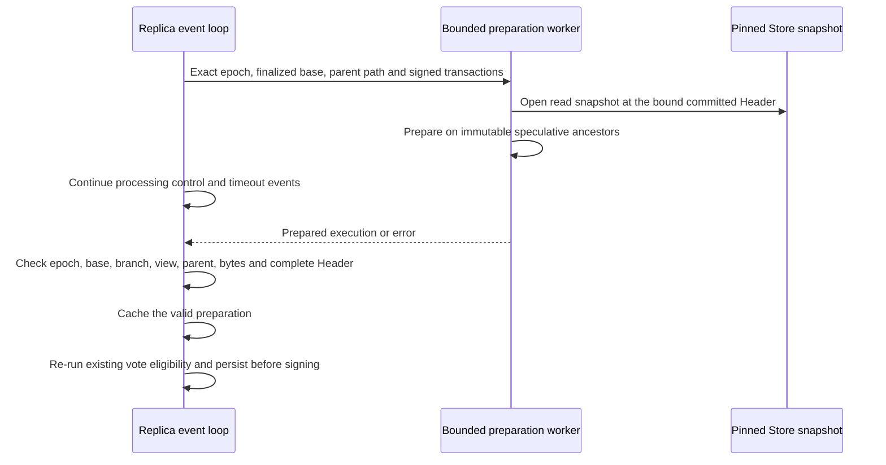

# Non-blocking Jolteon candidate preparation

The candidate feature moves follower preparation off the Replica event loop. A dedicated dispatch thread uses the replica's existing Rayon VM pool. The Replica continues handling peer messages, advancing the pacemaker and writing its journal. It schedules only the earliest unprepared candidate on the requested branch, with one slot for the whole job and its result. The existing branch horizon, frame size and native resource budgets also apply. Leader construction, certified RocksDB commit and admission ran synchronously in the original Follower comparison. [Implementation](../../src/jolteon/candidate_pipeline.rs) · [Admission experiment](../admission/pipeline/README.md)



The worker has no journal, signer or mutable consensus state. It reads an exact committed snapshot with already-prepared immutable ancestors. The Replica discards a result whose epoch or finalized base changed, whose exact candidate or path changed, or whose branch the replica no longer needs. After a view change a verified result can remain useful for an identical ancestor of the live high QC, recovery target or current preferred proposal. Completion never dispatches a vote. The normal tick checks current membership, view, lock, vote, local timeout and timestamp, persists the same journal record, and only then signs. The current Header encoding, Jolteon proof domains and CKB checkpoint witnesses carry through the experiment.

## Regression controls

| Control | Observed outcome |
| --- | --- |
| Exact branch binding | The unit test changes the epoch, finalized point, committed Header, exact parent branch and ordered wire bytes separately. Each mismatch rejects the completion. |
| Concurrent Store snapshot | Commit a new Header while holding the old snapshot. The snapshot still reads the old Header and a fresh snapshot for that stale base is refused. |
| Timeout recovery | Two four-node runs used a leader clock offset of +120 or −120 seconds. Both recovered from view 1 and certified a new payment at height 6. |
| Committee handoff | A funded CKB devnet completed two handoffs. The CKB verifier accepted checkpoints at heights 10, 20 and 25. |
| Mixed versions and restart | Two reference and two background replicas agreed on 96 signed payments after one scheduled leader was stopped and restarted. All four RocksDB stores reopened with the other implementation. The next payment spent an earlier output. WASM verified finality and the original, spent and successor Cell proofs to height 19. |

The locked release suite passed 512 tests with the default build and 515 with both pipeline features enabled. Both runs marked 25 tests ignored. The regression controls exercise independent failure boundaries. Interleavings of completion, timeout and process failure still need fault injection. The synchronous reference CLI also reproduced the two clock recovery proofs and all three execution or handoff proofs from the funded run. A checkpoint for the mixed run at height 17 also entered two CKB node pools over P2P and committed using a previously built checkpoint ELF. [Clock and committee evidence](faults.json.xz) · [Mixed-version restart proof](mixed.json.xz) · [Build and test output](https://github.com/a19q3/stem/blob/12338f2fea73c8df437694da473d08e950a0938b/research/execution-pipeline/checks.json.xz)

## Leader proposal construction

`jolteon-proposal-pipeline` runs one Leader construction job per replica, using the existing VM pool. It captures the ordered mempool entries, proposed timestamp, committed Header and prepared parent branch. The Replica rechecks the epoch, view, parent certificate, exact branch, vote lock, vote and timeout journal, and deadline before publishing. An epoch seal uses the existing publication path. The Replica persists the signed proposal and its voting decision before broadcast, then signs the vote. The worker does neither. [Implementation](../../src/jolteon/proposal_pipeline.rs)

| Control | Observed outcome |
| --- | --- |
| Pinned Store | A speculative child built from a pinned snapshot matched serial execution. A job submitted against an old committed Header returned no proposal. |
| Mixed versions and process restart | Two synchronous and two background replicas finalized 96 signed payments. One replica stopped and then caught up. All four agreed at height 11 and the synchronous verifier authenticated the finality proof. |
| Completion after timeout | A two-second delay on the first job of each Leader worker exceeded the 350 ms view timeout. Each worker recorded one discarded result and five published proposals. All four replicas finalized 96 payments and agreed at height 13. |
| Native workload and restart | Four replicas verified Polytype, sponsored OTX, atomic Lineage and Keeper batches. The same run exercised restart and verified scheduled execution proofs. |
| CKB-backed handoff | A funded CKB devnet accepted the existing Checkpoint witness at both handoffs, heights 10 and 20, and the follow-on execution checkpoint at height 25. |

The release workspace passed 517 tests with the Leader, Follower, Admission, certificate reuse and Work Stealing features enabled. The late-completion control uses the [worker-delay shim](delay-proposal.c), built with `cc -shared -fPIC delay-proposal.c -o delay-proposal.so -ldl -pthread`. Run the four-validator `tools/jolteon_localnet.py` fixture with `--cadence 50 --timeout 350 --offline-blocks 8 --transactions 96 --offered 250`. Set `--alternate-binary` to a wrapper that sets `LD_PRELOAD` to the compiled shim and executes the Leader build. The normal `--binary` is the synchronous reference. The report's `execution.proposal_jobs` counters distinguish started, published and stale work.

Leader construction remains selectable. The fault run demonstrates the deadline and journal boundary. Shared worker contention and throughput belong to the combined ablation after State Commitment, with stage timings, stale work and tail latency measured separately.

## Concurrent state commitments

`native-commitment-pipeline` prepares the Cell tree, System tree and execution/receipt record concurrently after ordered execution. It uses the existing pool for blocks with at least 256 execution items when the pool has at least two workers. It joins the results in the existing Cell, System, Header and execution-write order. The durable certified write remains a single batch.

A direct test compared the ordered batch key and value bytes and the Header bytes against serial finishing. A separate integration test prepared 768 signed payments in blocks of 255, 256 and 257 transactions. Serial replay, the Leader and the Follower produced identical Headers and receipts. After reopening RocksDB, the regression checked signed execution bytes, fee accounting and the encoded Cell and fee proofs.

An all-enabled four-replica smoke run offered 26,400 payments at 2,200/s for 12 seconds. All were jointly confirmed within the drain window. Of 87 measured blocks, 36 contained at least 256 payments. The largest contained 1,195. The independent finality verifier and history index check agreed at height 94. This run exercises the threshold on live validators. It supplies no isolated throughput estimate.

The Cell tree recursion is still serial inside its namespace. Stage timing in the planned ablation can show whether Patricia subtree parallelism helps once receipt and System work overlap.

## Certified Commit Pipeline

`jolteon-commit-pipeline` enables the Follower worker and delegates each certified synchronous RocksDB batch to one writer per replica. The batch contains execution, the finality proof, pruning and the next journal. The Replica installs the new tip and journal only after acknowledgement. It can serve status from the previous acknowledged state meanwhile. It queues requests that would read certified state or write the journal, with backpressure at eight events or two maximum frame lengths. Handoffs and recovery use the same ordered write acknowledgement.

For an ordinary single-block commit, the Replica can authenticate and prepare the current view's direct descendant against a pinned snapshot. If durability advances during preparation, the result can be reused only when the new finalized point and Header match the exact prefix of the pinned branch. The surviving parent path and signed transaction bytes must still match. Journal writes, votes and publications remain serialized through the Replica. [Writer and overlap guards](../../src/jolteon/commit_pipeline.rs)

| Fault control | Height visible during pause | Durable height on offline reopen | Result |
| --- | ---: | ---: | --- |
| Release a paused WAL sync | 3 | — | The Follower scheduled one overlapping preparation and reused it after acknowledgement. In-flight Header and finality reads returned after release. |
| Kill before writing the batch | 3 | 3 | The restart could replay the already certified candidate without peers. |
| Kill after WAL append and before its sync | 3 | 4 | The process restart recovered the whole batch from the OS page cache. This is a process-crash control. |
| Kill after WAL sync and before acknowledgement | 3 | 4 | The offline snapshot authenticated the new execution Header and proof. The restarted node accepted the matching journal. |

Each fault run ended with all 24 signed payments confirmed on four replicas. A separate mixed-version run confirmed 36 payments and converged at height 85 after restart. The archive retained a historical Header and proof that ordinary replicas pruned. The CKB devnet accepted both handoff checkpoints at heights 10 and 20 and the execution checkpoint at height 25. The combined release suite passed 520 tests.

Run the fault fixture on Linux with a feature build, a reference build and the native lock ELF. The fixture uses new databases. The reference build should keep the same pipeline features except for the Commit flag.

```sh
cc -O2 -shared -fPIC research/execution-pipeline/commit-fault.c \
  -o "$scratch/commit-fault.so" -ldl -pthread
PYTHONPATH=tools python3 research/execution-pipeline/probe_commit.py \
  --binary "$candidate" --reference "$reference" --lock "$native_lock" \
  --shim "$scratch/commit-fault.so" --output "$scratch/commit-overlap" \
  --port 24640 --mode overlap
```

Repeat with `before`, `before-sync` and `after-sync`, using fresh outputs. The fault probes establish publication and recovery boundaries. They supply no throughput estimate. The integrated comparison should compare the end-to-end commit histogram with the writer's service histogram and count how often a descendant preparation survives the commit.

### Commit-only ablation

The four same-host trials used one build of `7e06beb` with Admission, Follower, Leader, concurrent commitments and Work Stealing enabled, and a matched build additionally enabling Commit. The order was synchronous, writer, writer, synchronous. Four replicas used four VM workers each and a 100 ms cadence. The 4 billion cycle and 2,048 item limits held for every run. The driver wrote the same 45,000 signed payments at 3,000/s for 15 seconds and allowed 12 seconds to drain. Each trial confirmed every payment and passed the common finality and history-index checks.

| Run | Commit | Common TPS during offer | Write-to-common p99 | Mean control wait | Mean end-to-end commit | Validator CPU |
| --- | --- | ---: | ---: | ---: | ---: | ---: |
| A1 | Synchronous | 2,487.3 | 3.617 s | 7.676 ms | 12.042 ms | 54.83 s |
| B1 | Writer | 2,888.3 | 0.786 s | 3.903 ms | 12.454 ms | 53.21 s |
| B2 | Writer | 2,880.8 | 1.400 s | 4.932 ms | 11.411 ms | 51.93 s |
| A2 | Synchronous | 2,833.5 | 4.519 s | 30.527 ms | 12.239 ms | 54.61 s |

The writer's mean service times were 12.254 ms in B1 and 11.213 ms in B2. Those runs served 124 and 112 status requests during writes and reported no overlapping descendant jobs or rebases. Both pairs favored the writer on window TPS and p99, with a much larger throughput difference in the first pair. The gains occurred without descendant reuse in these runs. Keep Commit opt-in while testing longer windows and independent hosts. This comparison isolates Commit within one integrated feature set.

The workload file SHA-256 was `f0233229ebdf9d1c8a3ac1f54611a332eb9726898ff5498a27cd5b9d82a0ba6a`. The synchronous and writer binary SHA-256 values were `5abbc86b8e6fab184563c6767f112c2a71a93a19f91b16d569ae63fbbb17be5d` and `c58a4948046822b091f23f129d99571edd9b2da4c1bc0dbd41c89705160510d1`.

## Four-validator comparison

Four consecutive runs used the same 90,000 signed payments over 30 seconds at 3,000 scheduled writes per second, with 20 seconds of drain. The order was synchronous, background, background, synchronous. All runs wrote every payment inside the offer and commonly confirmed every payment by the drain deadline. The largest paired difference in cumulative writes at any one-second boundary was 31 and 66 payments. Four RocksDB validators shared twelve physical cores and their SMT siblings on one Ryzen 9 7950X3D. The load generator used two other cores. Both implementations used two VM workers per node and the same CPU affinity. [Raw results](results.json) · [Independent certificate replay](https://github.com/a19q3/stem/blob/12338f2fea73c8df437694da473d08e950a0938b/research/execution-pipeline/replays.json.xz)

| Run | Common TPS | Write-to-common p99 | Mean peer control wait | Peer control wait >10 ms | Mean candidate preparation | Validator CPU in offer (s) |
| --- | ---: | ---: | ---: | ---: | ---: | ---: |
| [Sync A1](https://github.com/a19q3/stem/blob/12338f2fea73c8df437694da473d08e950a0938b/research/execution-pipeline/a1/payments.json.xz) | 2,702.60 | 4.572 s | 11.98 ms | 18.1% | 56.63 ms | 101.67–102.71 |
| [Background B1](https://github.com/a19q3/stem/blob/12338f2fea73c8df437694da473d08e950a0938b/research/execution-pipeline/b1/payments.json.xz) | 2,943.27 | 1.099 s | 2.41 ms | 6.1% | 50.87 ms | 105.95–107.02 |
| [Background B2](https://github.com/a19q3/stem/blob/12338f2fea73c8df437694da473d08e950a0938b/research/execution-pipeline/b2/payments.json.xz) | 2,873.80 | 6.821 s | 9.30 ms | 4.2% | 56.39 ms | 108.69–109.90 |
| [Sync A2](https://github.com/a19q3/stem/blob/12338f2fea73c8df437694da473d08e950a0938b/research/execution-pipeline/a2/payments.json.xz) | 2,676.93 | 5.687 s | 15.11 ms | 16.5% | 59.15 ms | 101.36–102.49 |

The candidate gained 240.67 and 196.87 common TPS. The mean control wait fell in both pairs, and the share above 10 ms went from 18.1% to 6.1% and from 16.5% to 4.2%. Aggregate validator CPU increased. The write-to-common p99 improved by 3.473 seconds in the first pair and regressed by 1.134 seconds in the reverse pair. No validator persisted a local timeout in the four measured payment runs. The clock controls exercise timeouts separately. B1 applied 726 background results and B2 applied 648. Both sampled queues had at most one unfinished job per node, and these runs recorded no stale or invalid result. The exact binding test covers the mismatch paths. This evidence supports a longer integrated run while keeping the worker opt-in. These 30-second tests measure one host.

## Reproduction

For the published runs, retrieve the linked inputs and put them at their listed paths before running `analyze.py`. [Archive retrieval](../../benchmarks/README.md)

Build both variants from `e387ca8` with the same release toolchain. Enable only `jolteon-candidate-pipeline` for the candidate. The no-feature reference includes the same control queue and timeout instrumentation. Run the candidate with the same VM worker count and CPU affinity as the reference. [Existing external driver](../storage/external/README.md) · [Process accounting](../storage/submission-sessions/cpu.py)

```sh
cargo build --release --locked --bin stem
cargo build --release --locked --bin stem --features jolteon-candidate-pipeline
external=research/storage/external
python3 "$external/drive.py" --harness "$driver" --contracts "$contracts" prepare \
  --topology research/storage/proposal-cadence/100ms-peers.json --trial "$trial" \
  --rate 3000 --seconds 30 --drain 20 --senders 256 --ready-senders \
  --reuse-submissions --complete-volume --block-transactions 2048 --block-cycles 4000000000
python3 "$external/drive.py" --harness "$stock_verifier" --contracts "$contracts" verify \
  --trial "$trial" --report "$destination/payments.json.xz"
python3 research/execution-pipeline/analyze.py
```

The analysis uses the signed archive, initial and final per-node counters, timeout-view snapshots, and process accounting from each run. Capture `member`, `timeout_views`, `last_untimely_view`, `height` and `epoch` from the driver's initial and final status arrays for `views.json`. The mean control wait runs from a complete peer control frame at the transport to the Replica taking that frame. This includes inbound control-queue backpressure. Local timeout counts record persisted local timeout votes. Stale results remain in preparation service timing, which excludes waiting for the main loop to consume a finished result.
