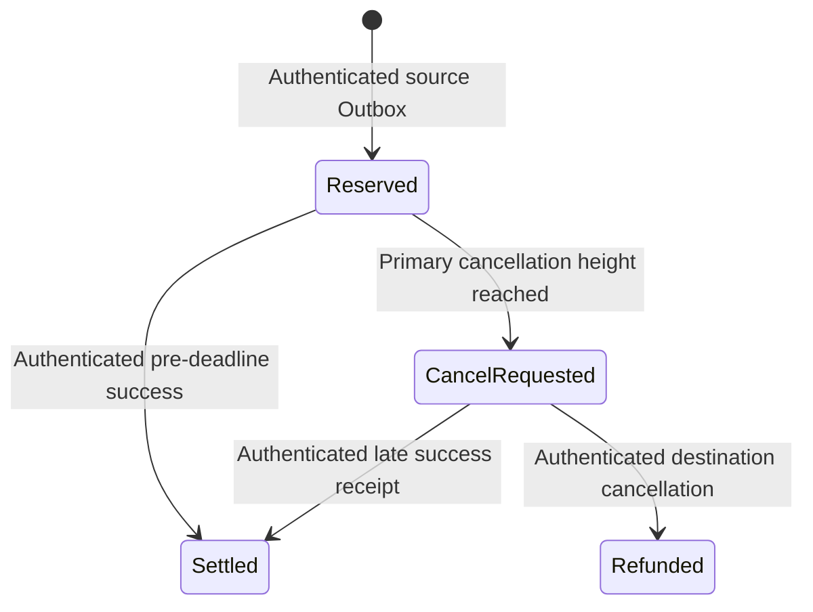

# Stem Primary coordination reference

The first Case A experiment coordinates a fixed route between separate Stem networks through Primary. Source, Primary and destination each have a pinned network, genesis Header and weighted committee. It uses the C0 profile, with no CKB dependency in the coordination path. Existing CKB-backed networks and custody rules remain deployment-specific. [Research question and source comparison](https://github.com/a19q3/stem/issues/31) · [Settlement work](https://github.com/a19q3/stem/issues/19)

## Records for a network prototype

| Record | Committed state | Who may advance it |
| --- | --- | --- |
| Chain | Network, genesis, deployment ID, admission status, registered manager, current verifier generation and proof/data policy | A genesis-pinned Primary registrar proposes a new identity. The manager accepts the exact registration and proves an eligible initial checkpoint. Activation consumes that proposal. Chain identities are single use, including after retirement. |
| Authority | Immutable verifier type and digest, committee commitment, predecessor, activation boundary and proof archive pointer | The configured source verifier authenticates committee handoffs. A change of verifier additionally requires the registered manager's authorization and a Primary registrar decision for the exact old and new generations. |
| Head | Authority generation, height, Header ID and committed roots | A permissionless relayer presents finality and ancestry under the active verifier. Check for conflicting or omitted boundaries before updating. Recover from a known trusted head using retained proofs and available linked data. |
| Channel | Directed pair of deployments, exact sender and receiver Locks, generation, admission state, pending limit and retained message IDs | Both managers authorize opening and policy changes. Relayers can use the lane subject to the active policy. Closing stops admissions and preserves authority for in-flight outcomes and acknowledgements. |
| Workflow | Source record ID and exact byte commitment, escrow reservation, decision, destination deadline and authenticated terminal outcome | The source Lock authorizes the request. Primary applies its funded local timer and verified outcomes. The destination application's enforced state transition supplies the terminal fact. |
| Capacity | Sponsor, escrow or quota owner, cycle and byte allowance, pending-work limit and renewal rule | The sponsor signs funding and renewal. Primary meters proof work and pending use before admission. Existing obligations retain a funded path or remain pending. |

Bind any signed manager command to the Primary network and genesis, its action, exact predecessor record and intended successor. Use a new generation for authorization changes and retain the original route and verifier for admitted work. Proposed chains become active after compatibility and trust evidence are accepted. A manager can request suspension or draining under its signed policy. Suspension closes admissions. Draining retains the channels, fees and evidence needed to finish outstanding work. Retirement waits for zero unresolved obligations and preserves the identity and replay record. A halted chain stays in its recorded state while proofs are unavailable. Resumption requires authenticated progress from the last accepted head and any intervening handoffs.

## Fixed-route state machine

`cargo test --release --locked --test primary_coordination` runs the offline reference. The fixture builds three separate Header histories, each with an independent four-member weighted committee. It generates the existing Jolteon two-chain proofs using real Ed25519 signatures and the native Patricia System paths. Proofs go through `FinalityVerifier`, `verify_intercell` or `verify_system_record`. A receiver accepts the exact next Header with the expected parent. The reference pins registrations directly and uses a fixed epoch. [Executable reference](../../tests/primary_coordination.rs) · [Native light verifier](../../ledger/src/light.rs)

1. The source authorizes a standard Intercell Outbox message. Primary checks both network identities and the pinned sender and receiver Locks. The fixture payload contains the amount, an inclusive Primary cancellation height and an exclusive destination execution deadline. The Intercell ID binds the endpoints and nonce. The decision and receipt records also bind the full message bytes because the ID omits the payload.
2. The Primary reservation initially allows `Deliver`. Its local height can change that decision to `Cancel`, with funds still reserved. Destination execution proves the exact decision under an authenticated Primary Header. At a destination height before expiry it can apply delivery. At or after expiry it can record cancellation. Destination records the terminal outcome together with any effect. Retries return the same outcome and cannot create another effect.
3. Primary proves the destination's outcome under a trusted destination Header. An execution recorded before expiry may settle after the cancellation request. Refund requires both a prior Primary cancellation request and the authenticated destination cancellation at or after the deadline. Duplicate receipts leave the same terminal state. Without destination evidence the reservation stays pending. A local timeout or an older absence proof cannot authorize a refund.

The test fixture constructs these application records in memory. Authorities and local heights are pinned by the fixture. Its amount represents an accounting effect, and the receipt and effect are updated together by the model. The executable slice exercises signed evidence and state transitions. It has no live network processes, Keeper integration, consensus ingestion, stored workflow restart or asset custody. Rebuilding a fresh destination verifier from the seven accepted certificate pairs checks proof catch-up only. The fixture uses one admitted workflow per scenario. Registration transactions, authority rotation, resource quotas and the recovery of pending workflows remain network-prototype work.

## Security and availability boundaries

In Case A each chain's own consensus authenticates its statements. Safety requires authentic trust roots, quorum safety on each participating chain, deterministic endpoint policy and atomic publication of application effects and terminal outcomes. Eventual completion additionally needs the destination's finality, retained proofs and a funded relayer. In a live prototype an expired request can remain reserved through a halt. A later authenticated destination result determines the disposition.

For Case B1 Primary must re-execute a candidate against the registered code, accepted parent and bounded inputs before voting for its executed Header. Domain-local ordering and quota accounting advance with the Primary transition. Required bodies and state must be available and retained for authenticated recovery. A withheld dependency keeps only the affected domain pending. B2 and B3 require separate proof or assignment, availability and recovery designs.

| CKB profile | Added dependency or guarantee |
| --- | --- |
| C0 coordination | Only the configured Stem finality and data paths are required for the reference route. |
| C1 anchoring | A periodic CKB checkpoint authenticates an already finalized Primary commitment. Work using that external checkpoint waits for the configured CKB confirmations. |
| C2 collateral | A CKB bond requires a separate objective penalty rule, liability window and authorized payout. |
| C3 custody | The existing settlement adapter supplies the current custody boundary. CKB-to-Stem proof freshness and guardian authority still apply. A CKB-confirmed asset settlement gate belongs to the relevant workflow. |
| C4 recovery or exit | A new exit policy needs availability of current owner proofs, a valid activation condition and replay and reconciliation rules across Primary resumption. |
| C5 publication | The data actually published adds a retrieval path. Commitments continue to authenticate the bytes provided by retrieval. |

Next, replace the pinned fixture identities with explicit signed registration and authenticated handoff records. Run one Primary and two sovereign devnets, then prove the same ordering at the actual Outbox, execution and restart boundaries. C1 and C3 are follow-up comparisons with the existing CKB devnet adapter. [Full acceptance matrix](https://github.com/a19q3/stem/issues/31) · [CKB freshness and reorganisation results](../../METATYPE.md#reorganize-a-burn-and-an-adopted-anchor)
