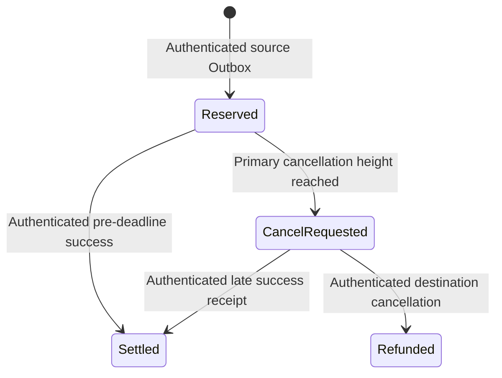

# Stem Primary coordination reference

The first Case A experiment coordinates a fixed route between separate Stem networks through Primary. Source, Primary and destination each have a pinned network, genesis Header and weighted committee. It uses the C0 profile, with no CKB dependency in the coordination path. Existing CKB-backed networks and custody rules remain deployment-specific. [Research question and source comparison](https://github.com/a19q3/stem/issues/31) · [Settlement work](https://github.com/a19q3/stem/issues/19)

## Records for a network prototype

| Record | Committed state | Who may advance it |
| --- | --- | --- |
| Chain | Network, genesis, deployment ID, admission status, registered manager, current verifier generation and proof/data policy | A genesis-pinned Primary registrar proposes a new identity. The manager accepts the exact registration and proves an eligible initial checkpoint. Activation consumes that proposal. Chain identities are single use, including after retirement. |
| Authority | Immutable verifier type and digest, committee commitment, predecessor, activation boundary and proof archive pointer | The configured source verifier authenticates committee handoffs. A change of verifier additionally requires the registered manager's authorization and a Primary registrar decision for the exact old and new generations. |
| Head | Authority generation, height, Header ID and committed roots | A permissionless relayer presents finality and ancestry under the active verifier. Check for conflicting or omitted boundaries before updating. Recover from a known trusted head using retained proofs and available linked data. |
| Channel | Directed pair of deployments, exact sender and receiver Locks, generation, admission state, pending limit and retained message IDs | Both managers authorize opening and policy changes. Relayers can use the lane subject to the active policy. Closing stops admissions and preserves authority for in-flight outcomes and acknowledgements. |
| Workflow | Source record ID and exact byte commitment, escrow reservation, decision, destination deadline and authenticated terminal outcome | The source Lock authorizes the request. Primary applies its funded local timer and verified outcomes. The destination application's enforced state transition supplies the terminal fact. |
| Capacity | Sponsor, escrow or quota owner, cycle and byte allowance, pending-work limit and renewal rule | The sponsor signs funding and renewal. Primary meters proof work and pending use before admission. Existing obligations retain a funded path or remain pending. |

Bind any signed manager command to the Primary network and genesis, its action, exact predecessor record and intended successor. Use a new generation for authorization changes and retain the original route and verifier for admitted work. Proposed chains become active after compatibility and trust evidence are accepted. A manager can request suspension or draining under its signed policy. Suspension closes admissions. Draining retains the channels, fees and evidence needed to finish outstanding work. Retirement waits for zero unresolved obligations and preserves the identity and replay record. A halted chain stays in its recorded state while proofs are unavailable. Resumption requires authenticated progress from the last accepted head and any intervening handoffs.

## Signed registration and committee handoff

The Case A fixture can now admit two independently signed chain registrations into one in-memory Primary registry. The registrar and each chain's manager sign a versioned digest that binds the Primary network and genesis, the source network and genesis, the deployment ID, manager key, weighted initial roster and exact initial checkpoint. The native Jolteon verifier authenticates the first checkpoint and its parent before activation. The registry retains the statement digest and permits one deployment per network in this fixture, matching the fixed Intercell route's network identifiers.

The source committee announces a successor through the native System Patricia tree and signs the terminal handoff proof. The registry first checks that the certified boundary directly extends the accepted Header. It then advances the verifier and accepts the next epoch's source Outbox proof. A correctly signed handoff on a different parent leaves the accepted Header and epoch intact. The regression also checks replay across Primary genesis identities, wrong signers, substituted deployments and initial rosters, wrong checkpoint IDs, duplicate registration, omitted handoff and stale finality. The destination retains its independently registered Header and epoch during the source rotation.

Run `cargo test --release --locked --test primary_coordination signed_registration_pins_the_initial_checkpoint_and_ancestor_of_the_handoff`. This offline fixture generates native signatures and Patricia proofs over synthetic Headers. The following live test covers registry transactions and restart. [Reference code](../../tests/primary_coordination.rs)

## Native registration on three live devnets

Three four-validator loopback networks on one physical host use distinct network IDs, genesis Headers and weighted committees. The Primary nodes execute an experimental RISC-V registry Type using the native Cell rules. The Type verifies two signatures over the configured Primary network and genesis, foreign network, deployment, foreign genesis, manager, initial checkpoint and weighted roster. The actual native network must match the Type's network argument. The test pins the Primary genesis and Type identity using the real deployment configuration. The contract verifies the foreign committee's native two-chain certificate and requires the initial checkpoint at height one with the exact registered genesis parent.

The registry Type permits one initialization from a seeded OutPoint and one appended record per transition. It preserves the existing records and the registry Lock across updates, rejects duplicate registrations, and limits registry data to 32 KiB and eight records across both entry kinds. The run submits a signed registration from each independent network. Every Primary validator rejects the negative controls for a changed Primary genesis or network, a foreign chain proof substituted for the requested chain, a forged manager signature, duplicate registration, state replacement and removal of the registry Type.

After both entries finalize, the fixture stops and restarts the Primary archive. The four validators agree on a later certified Header. The restarted archive returns the exact two-entry Cell and its authenticated Patricia proof. The test also verifies the original native transaction and receipt proof from each Cell's certified creation Header. This exercises active consensus validation and registry recovery. Concurrent source committee updates, Intercell routing, workflow and Keeper execution, and Primary's CKB adapter paths remain separate gates. [Registry Type](../../contracts/examples/primary-register.rs) · [Live fixture](../../tests/native_store/primary_registration.rs)

In the registration-only run both entries finalized at Primary heights 5 and 7, and the archive returned the same Cell at certified height 8 after restart. The foreign certificates were 910 and 782 bytes. The two-entry Cell data was 2,594 bytes and its Patricia path was 175 bytes. The two authenticated receipts charged 18,618,213 and 14,701,828 cycles within the ordinary fixture's 100-million-cycle transaction limit. The RISC-V executable SHA-256 was `be920259b4d4d111b287a4d465e28ac4192afaf149a695b8db726ed390fec6ed`. The registration regression also passed against the executable that supports handoff entries.

```sh
RUSTFLAGS='-C passes=lower-atomic -C target-feature=-c' cargo build \
  --manifest-path contracts/Cargo.toml --locked --release \
  --target riscv64imac-unknown-none-elf --target-dir target/stem-contracts \
  --example primary-register
STEM_PRIMARY_REGISTRATION_CONTRACT="$PWD/target/stem-contracts/riscv64imac-unknown-none-elf/release/examples/primary-register" \
  cargo test --release --locked --test native_store \
  primary_registration::native_primary_executes_signed_registrations_from_two_live_chains \
  -- --exact --ignored --nocapture
```

## Execute archived source handoffs on a live Primary

The registry log also supports a committee handoff entry. The Type loads the latest accepted checkpoint and roster for the named source. It authenticates the outgoing committee's terminal proof, checks that its boundary extends the previously accepted Header using the native MMR frontier and suffix, and verifies the successor committee's first finalized execution Header. The first successor Header must directly follow the certified boundary. The registry commits the new epoch, roster, anchor and checkpoint together while preserving the previous entries.

The fixture runs four live Primary validators and reads native certificates from a stopped CKB-funded source devnet archive. It registers the archived source's height-one checkpoint, then submits two native Jolteon handoffs and their first successor certificates. All four validators reject a missing first handoff, a corrupted history suffix, an execution proof from the old committee and a replayed handoff. The fixture restarts the Primary archive after each rotation and checks the exact registry Cell and matching receipt against a newer committed Primary Header. The Primary path reads native proofs and has no CKB RPC or settlement dependency. The source generated the recorded proofs with its own CKB stake policy. [Source discovery and stake runner](../../OPERATIONS.md#discovery-mode)

The source advanced to epochs 1 and 2 at heights 11 and 21. The Primary executed the two updates at heights 7 and 10, charging 14,738,172 and 14,747,075 cycles. After the second restart, the archive proved the 5,904-byte registry Cell at Primary height 12. The RISC-V executable SHA-256 was `8520d8c37d5368a05f73ecb6badba0da7d94cbdba9e67cb563097dc5b20796f1`.

Reuse the RISC-V build above and keep the archive from a completed `tools/jolteon_stake_localnet.py --open-admission --publish-checkpoint --retire` run. The output must retain `stem-genesis.json`, `genesis-committee.json`, `handoff-0.json`, `handoff-1.json` and a source replica database with exact finality certificates for height one and both first successor Heights. Use a replica that followed the chain from genesis and retained these certificates. The fixture creates a separate history index without changing the source archive.

```sh
STEM_PRIMARY_REGISTRATION_CONTRACT="$PWD/target/stem-contracts/riscv64imac-unknown-none-elf/release/examples/primary-register" \
STEM_PRIMARY_ARCHIVE_RUN="$source_run" STEM_PRIMARY_ARCHIVE_DB="$source_archive_db" \
  cargo test --release --locked --test native_store \
  primary_registration::native_primary_executes_two_certified_source_rotations \
  -- --exact --ignored --nocapture
```

## Fixed-route state machine

`cargo test --release --locked --test primary_coordination` runs the offline reference. The fixture builds three separate Header histories, each with an independent four-member weighted committee. It generates the existing Jolteon two-chain proofs using real Ed25519 signatures and the native Patricia System paths. Proofs go through `FinalityVerifier`, `verify_intercell` or `verify_system_record`. A receiver accepts the exact next Header with the expected parent. The reference pins registrations directly and uses a fixed epoch. [Executable reference](../../tests/primary_coordination.rs) · [Native light verifier](../../ledger/src/light.rs)



1. The source authorizes a standard Intercell Outbox message. Primary checks both network identities and the pinned sender and receiver Locks. The fixture payload contains the amount, an inclusive Primary cancellation height and an exclusive destination execution deadline. The Intercell ID binds the endpoints and nonce. The decision and receipt records also bind the full message bytes because the ID omits the payload.
2. The Primary reservation initially allows `Deliver`. Its local height can change that decision to `Cancel`, with funds still reserved. Destination execution proves the exact decision under an authenticated Primary Header. At a destination height before expiry it can apply delivery. At or after expiry it can record cancellation. Destination records the terminal outcome together with any effect. Retries return the same outcome and cannot create another effect.
3. Primary proves the destination's outcome under a trusted destination Header. An execution recorded before expiry may settle after the cancellation request. Refund requires both a prior Primary cancellation request and the authenticated destination cancellation at or after the deadline. Duplicate receipts leave the same terminal state. Without destination evidence the reservation stays pending. A local timeout or an older absence proof cannot authorize a refund.

The fixed-route workflow fixture constructs its application records in memory and pins authorities and local heights. Its amount represents an accounting effect, and the receipt and effect advance together in the model. Rebuilding a fresh destination verifier from the seven accepted certificate pairs checks proof catch-up. The fixture uses one admitted workflow per scenario. Live authority rotation, resource quotas, Keeper integration and recovery of pending workflows remain network-prototype work.

## Security and availability boundaries

In Case A each chain's own consensus authenticates its statements. Safety requires authentic trust roots, quorum safety on each participating chain, deterministic endpoint policy and atomic publication of application effects and terminal outcomes. Eventual completion additionally needs the destination's finality, retained proofs and a funded relayer. In a live prototype an expired request can remain reserved through a halt. A later authenticated destination result determines the disposition.

For Case B1 Primary must re-execute a candidate against the registered code, accepted parent and bounded inputs before voting for its executed Header. Domain-local ordering and quota accounting advance with the Primary transition. Required bodies and state must be available and retained for authenticated recovery. A withheld dependency keeps only the affected domain pending. B2 and B3 require separate proof or assignment, availability and recovery designs.

| CKB profile | Added dependency or guarantee |
| --- | --- |
| C0 coordination | Only the configured Stem finality and data paths are required for the reference route. |
| C1 anchoring | A periodic CKB checkpoint authenticates an already finalized Primary commitment. Work using that external checkpoint waits for the configured CKB confirmations. |
| C2 collateral | A CKB bond requires a separate objective penalty rule, liability window and authorized payout. |
| C3 custody | The existing settlement adapter supplies the current custody boundary. CKB-to-Stem proof freshness and guardian authority still apply. A CKB-confirmed asset settlement gate belongs to the relevant workflow. |
| C4 recovery or exit | A new exit policy needs availability of current owner proofs, a valid activation condition and replay and reconciliation rules across Primary resumption. |
| C5 publication | The data actually published adds a retrieval path. Commitments continue to authenticate the bytes provided by retrieval. |

Relay source updates during a concurrent live run and verify the workflow at the actual Outbox, execution and restart boundaries. C1 and C3 are follow-up comparisons with the existing CKB devnet adapter. [Full acceptance matrix](https://github.com/a19q3/stem/issues/31) · [CKB freshness and reorganisation results](../../METATYPE.md#reorganize-a-burn-and-an-adopted-anchor)
