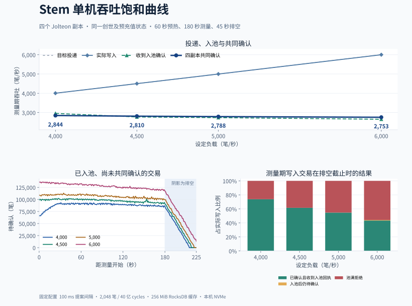

# Stem 单机吞吐饱和曲线

**实际写入从 4,003 到 6,001 TPS，共同确认始终在 2,753–2,844 TPS。** 本轮按顺序各测一档。在这套配置和 144 万预充值 Cell 的状态下，4,000 档已出现池满拒绝和积压，因此四个点覆盖饱和后的区间，精确拐点尚未定位。



## 180 秒测量期吞吐

| 目标 TPS | 实际写入 TPS | 入池 ACK/s | 共同确认 TPS | 池满拒绝 | 确认 p99 | p99 样本 |
| --- | --- | --- | --- | --- | --- | --- |
| 4,000 | 4,003.26 | 2,954.74 | 2,844.44 | 188,904 (26.2%) | 186.58 s | 531,683 |
| 4,500 | 4,500.00 | 2,768.94 | 2,810.31 | 311,504 (38.5%) | 185.16 s | 498,496 |
| 5,000 | 4,998.34 | 2,733.63 | 2,787.56 | 407,523 (45.3%) | 189.17 s | 492,179 |
| 6,000 | 6,000.99 | 2,650.54 | 2,753.42 | 603,126 (55.8%) | 191.09 s | 468,646 |

设定负载从 4,000 升到 6,000 后，实际写入增加 49.9%，共同确认下降 3.2%，池满拒绝率从 26.2% 升到 55.8%。入池回执和共同确认按各自事件发生的时刻计数。因此在积压下降的阶段，共同确认可以高于当期新增入池速度。

p99 从实际 socket 写入算到四副本首次共同观测，只包含测量期写入、收到成功回执并在截止前已共同确认的交易。6,000 档的同一入池队列仍有 8,406 笔未被观测确认，占该测量期写入且收到成功回执交易的 1.76%。该档 **191.09 秒**是已确认样本的 p99，整批已入池交易的最终 p99 在截止时仍未观测到。

## 积压和区块占用

以下计数含预热产生的已入池交易。6,000 档结束排空时仍观测到 13,261 笔待共同确认。其他三档的已入池积压在排空窗口内降到零。

| 目标 TPS | 测量期开头 | 测量期峰值 | 停止投递 | 排空截止 |
| --- | --- | --- | --- | --- |
| 4,000 | 65,834 | 93,079 | 85,687 | 0 |
| 4,500 | 98,369 | 102,024 | 90,922 | 0 |
| 5,000 | 108,758 | 112,997 | 99,052 | 0 |
| 6,000 | 136,017 | 136,023 | 117,498 | 13,261 |

| 目标 TPS | 第 1 分钟 | 第 2 分钟 | 第 3 分钟 | 触及 2,048 笔上限 | 节点 CPU | Follower 准备均值 |
| --- | --- | --- | --- | --- | --- | --- |
| 4,000 | 2,867.20 | 2,833.07 | 2,833.07 | 250/250 | 852.2 s | 365.7 ms |
| 4,500 | 2,730.67 | 2,833.07 | 2,867.20 | 247/247 | 828.3 s | 365.9 ms |
| 5,000 | 2,764.80 | 2,764.80 | 2,833.07 | 245/245 | 819.4 s | 367.1 ms |
| 6,000 | 2,662.40 | 2,798.93 | 2,798.93 | 242/242 | 804.8 s | 372.1 ms |

四档测量窗口内，共同观测到的 984 个非空区块全部达到 2,048 笔交易上限。Follower 准备均值在 366–372 ms 左右，三段分钟吞吐都维持在相近的范围。这组证据说明现有配置持续满块，同时给出了可用来进一步定位的执行耗时。改变哪一个参数或阶段能增加吞吐，需要独立对照才能确定。

## 独立回放

| 目标 TPS | 全程写入 | 全程 ACK | 共同确认至末次样本 | 离线回放区块 | 末次样本 |
| --- | --- | --- | --- | --- | --- |
| 4,000 | 960,000 | 771,096 | 771,096 | 467 | 284.993 s |
| 4,500 | 1,080,000 | 765,685 | 765,685 | 438 | 284.971 s |
| 5,000 | 1,200,000 | 766,766 | 766,766 | 407 | 284.999 s |
| 6,000 | 1,440,000 | 773,950 | 760,689 | 375 | 284.987 s |

四份归档均通过独立回放。共核对 1,687 个区块和 3,064,236 笔共同确认交易实例。最后一次四副本观测时仍待确认的交易保留在积压统计中。

## 实验条件与复现

- 节点基线为 `91dc7827959ebf70f129347c5b4bec2d1a73656e`，使用默认 Cargo feature 的 locked release 构建。四档共用一个可执行文件，期间保持配置固定。
- 单台 Ryzen 9 7950X3D 上运行四个 Jolteon 副本。节点使用 CPU `2-7,10-15,18-23,26-31`，负载端使用 `0-1,16-17`。三个副本保留 64 个区块，一个保留完整历史。RocksDB 在同一个 Btrfs NVMe 卷上，使用 256 MiB 块缓存。每个副本两个 VM worker 和 131,072 条成功验证缓存。
- 提案间隔 100 ms，视图超时 2,400 ms，区块上限 2,048 笔及 40 亿 cycles。每档新建节点数据库，使用相同创世文件和同一组测试验证者身份。每档都先完成相同的 1,440,000 个独立支付 Cell 的预充值，再用对应长度的确定性支付前缀投递。负载端固定使用 256 个发送者，复用连接并按可用发送者分配。
- 按 4,000、4,500、5,000、6,000 的顺序各跑一次。每档先投递 60 秒预热，再测 180 秒，并观察 45 秒排空。`complete-volume` 驱动可在负载窗口外继续写入落后的任务，因此曲线计算的是窗口中实际完成的 socket 写入、收到的成功入池回执和四副本共同观测的确认，分别按各自的事件时刻计数。
- 积压按唯一交易计算。它在收到成功回执时增加，在四副本共同观测该交易时减少。报告同时给出测量期开头、结束、每秒采样峰值和排空截止值。池满拒绝及传输未确认单独统计。表中的 p99 对应 `[60,240)` 实际写入、收到入池回执并在第 285 秒前已观测确认的交易，配有样本和截止仍待确认数量。
- 节点 CPU 使用 `/proc` 每秒快照计算，覆盖 180 秒测量期。RocksDB 写入和 WAL 同步的前后增量覆盖预热、测量与排空。离线回放在节点退出后单独执行，重建每个归档区块的签名交易根和 Header 链，核对抽样收据与最后的加权最终性证明。

准备和回放使用仓库的 [external driver](../storage/external/README.md)。使用 [测试身份生成函数](../../tools/jolteon_localnet.py) `evidence_keys`，生成四个仅用于本地的身份，并按公钥排序写入共同拓扑。用以下命令准备共同创世。

```sh
python3 research/storage/external/drive.py --harness "$harness" --contracts "$contracts" \
  prepare --topology "$topology" --trial "$common" \
  --rate 6000 --seconds 240 --drain 45 --senders 256 \
  --block-transactions 2048 --block-cycles 4000000000 \
  --reuse-submissions --ready-senders --complete-volume
```

为每档复制该准备目录。在复制的 `trial.json` 里把 `storage_settings.RATE` 改为该档速率，并写入 `storage_settings.FUNDED_CELLS = 1440000`。保留原拓扑及创世文件摘要。节点启用 `--storage-metrics --rocksdb-block-cache-mib 256`。带共同预充值选项的测试工具按下方补丁构建。运行 `drive.py measure` 生成归档，再用同一档计划执行 `drive.py verify`。`results.json` 保留逐档原始报告的摘要、终端证明和收据见证，`timeseries.csv` 保留绘图所用的逐秒计数。

<details>
<summary>固定预充值规模的测试工具补丁</summary>

在独立检出中使用 `git apply --unidiff-zero`，再执行 `cargo test --release --locked --test native_store --no-run`。

```diff
diff --git a/tests/native_store/storage_load.rs b/tests/native_store/storage_load.rs
index 24324b9..708846e 100644
--- a/tests/native_store/storage_load.rs
+++ b/tests/native_store/storage_load.rs
@@ -276 +276,7 @@ fn sustained_storage(mode: Option<lineage_load::Mode>) -> Result<()> {
-        funding_splits(&mut fixture, work)?
+        let funded_cells = match std::env::var("STEM_STORAGE_FUNDED_CELLS") {
+            Ok(value) => value.parse::<usize>().context("invalid fixed funding size")?,
+            Err(std::env::VarError::NotPresent) => work,
+            Err(error) => return Err(error.into()),
+        };
+        ensure!((work..=2_000_000).contains(&funded_cells), "invalid fixed funding size");
+        funding_splits(&mut fixture, funded_cells)?
```

</details>
