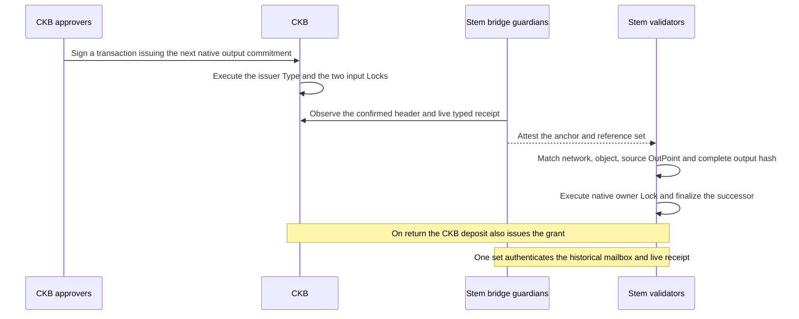

# CKB approval of a native Spore transfer

A Stem-native object can pin a CKB issuer at creation and require a live grant from that issuer on each native transfer. The witness answers a question that an offline history proof leaves open. Did the pinned policy approve this particular successor? The issuer can inspect CKB state, inputs, scripts and witnesses when it makes its decision. The tested Data2 issuer requires inputs from two distinct CKB Lock hashes. The holder also signs the native spend. [Native policy](../../contracts/src/bin/stem-object-permit.rs) · [CKB issuer](../../contracts/src/bin/ckb-object-permit.rs)

## What the five devnets established

Each run used four local Jolteon validators, disposable CKB funds, the published Spore V2 Type and a protected CKB holder Lock. The trials covered creation, two ordinary native transfers, export, an ordinary CKB wallet transfer, return and a second export. A wallet verified the four CKB Spore transitions. All four replicas agreed on the final application hash in each run. The archived transactions and proofs include the baseline using a native approver, a six-transaction standalone issuer, two compact combined-return runs, and a combined return with a 496 KiB body. [Devnet records](devnets.json.xz) · [Offline consistency checks](measure.py)

| Measurement at return | Two separate CKB transactions | Combined deposit and permit | Cycle reduction |
| --- | ---: | ---: | ---: |
| Compact object, first pair | 6,897,824 cycles | 5,320,061 cycles | 22.87% |
| Compact object, second pair | 6,917,985 cycles | 5,346,748 cycles | 22.71% |
| 496 KiB body | 24,689,394 cycles | 23,081,498 cycles | 6.51% |

Each pair used the same live inputs, output scripts and payloads. The CKB node evaluated both independently signed alternatives at the same tip before the fixture submitted the combined transaction. Combining the two consumed 190 fewer serialized bytes, paid one fewer 0.01 CKB fixture fee, and removed one serial CKB inclusion and confirmation wait. Across the six native transitions, five still needed a separate CKB issuance. The standalone devnet also committed the two separate return transactions. [Inputs, signatures, estimates and inclusions](devnets.json.xz)

The short native gift cost 1,971,933 cycles with native approval and 13,980,354 cycles with a CKB receipt. At return, where the original route already verified a reference certificate, the corresponding costs were 14,069,313 and 14,078,435 cycles. The combined 496 KiB restore used 16,491,395 cycles and 510,980 native transaction bytes. The fixture limits were 20 million cycles per transaction and 512 KiB. The gains in the table apply to the CKB return. [Receipt bytes and finality](devnets.json.xz)

The two compact combined runs each rejected 25 invalid operations and the large run rejected 27. Controls included a real receipt issued with the same CKB code and different signer arguments, a historical observation of the correct receipt, an old anchor, a missing CKB cosigner, a previous native source, a changed destination or capacity, and a return carrying only the mailbox observation. The CKB reference set in the successful combined return covered two different outputs of the same committed transaction. [Fixture](../../tools/spore_settlement_localnet.py)

## Acceptance boundary

The object pins the full issuer Type hash. The existing guardian threshold authenticates liveness at the committed CKB anchor. Updates become visible when Stem adopts a newer anchor. Multiple grants can be issued deliberately by the authority. A particular native source OutPoint can be consumed once. The tested issuer requires a successor object and provides no native melt operation.

An application can implement this receipt format in its own CKB Type. An existing Spore Mutant may inspect its original transaction, dependencies, witnesses or intermediate states. Such a program needs a path that executes its original transition and binds that outcome to the proposed native successor. The five devnets used the explicit issuer interface and immutable, plain Spore content. Independent acceptance of existing unmodified Mutants remains open. [Upstream extension dispatch](https://github.com/sporeprotocol/spore-contract/blob/3c796b6c02e5d3857bbaa42476adcb23e1c88722/contracts/spore/src/entry.rs#L242) · [Wallet history verification](../type-history/README.md)

## Reproduction

Build the two new guests alongside the normal native-origin Spore contracts. In the documented Spore settlement fixture set `--native-spore-approval` to the `stem-object-permit` ELF and `--ckb-spore-permit` to the `ckb-object-permit` ELF. Add `--spore-type-history` to verify ordinary CKB ownership transitions. Use `--separate-return-permit` for the standalone arrangement or `--spore-content-bytes 507904` for the large combined case. Run `python3 research/spore-permit/measure.py` to inspect the archived comparisons. [Wallet and fixture instructions](../../OPERATIONS.md#ckb-issued-native-transfer-permits)
