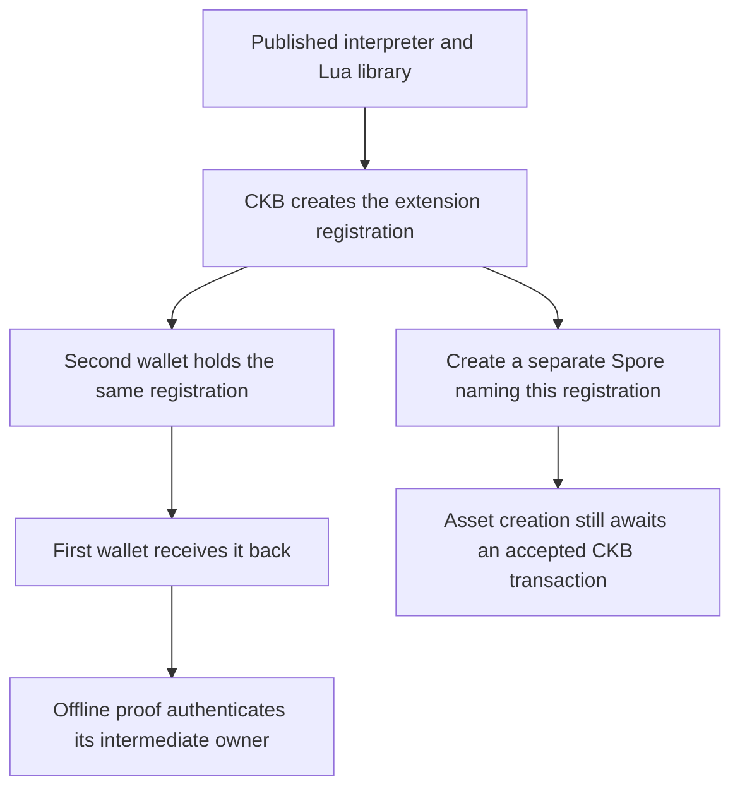

# Published Spore Mutant registration

The deployed Spore Lua interpreter accepted the upstream registration example on a fresh CKB devnet. The fixture retrieved the interpreter bytes from the testnet transaction listed in the upstream deployment manifest, checked their data hash, and used the Lua library from the corresponding source revision. All signed transactions ran against the local devnet. [Deployment manifest](https://github.com/sporeprotocol/spore-contract/blob/3c796b6c02e5d3857bbaa42476adcb23e1c88722/deployment/migration/testnet/spore_extension_lua/2024-01-19-0.2.1.json) · [Upstream registration test](https://github.com/sporeprotocol/spore-contract/blob/3c796b6c02e5d3857bbaa42476adcb23e1c88722/tests/src/tests/mutant.rs) · [Lua library](https://github.com/sporeprotocol/spore-contract/blob/3c796b6c02e5d3857bbaa42476adcb23e1c88722/contracts/spore_extension_lua/lua/libckblua.so)

| Registration operation | CKB height | CKB cycles |
| --- | ---: | ---: |
| Create under the first wallet | 8 | 2,761,001 |
| Transfer to the second wallet | 12 | 1,645,260 |
| Return to the first wallet | 16 | 1,659,946 |

The wallet authenticated all three transactions and the intermediate owner's Lock and data hash after the node stopped. A separate control minted and transferred a standard plain Spore. Attempting to mint a Spore that named the registered extension did not pass CKB validation in this fixture. The next cross-chain fixture needs a successful extension-bearing Spore transaction under the selected deployment, including its actual program and dependencies. Registration ownership and Spore ownership are separate CKB Type histories. [Transactions and inclusion proofs](registration.json.xz) · [Portable registration history](registration-history.json.xz) · [Upstream application semantics](https://github.com/sporeprotocol/spore-contract/blob/3c796b6c02e5d3857bbaa42476adcb23e1c88722/docs/MUTANT.md)



The fixture takes the node and wallet binaries, the two hash-checked upstream artifacts, a fresh output directory and a local RPC port. It writes a public report and an independently verifiable wallet history. [Reproduction script](registration.py)

```sh
python3 research/spore-permit/upstream/registration.py \
  --binary /path/to/stem --l1 /path/to/ckb \
  --extension /path/to/spore_extension_lua --lua /path/to/libckblua.so \
  --output /tmp/stem-mutant-registration --l1-port 29470

stem ckb-wallet verify-type-history \
  --request /tmp/stem-mutant-registration/request.json \
  --proof /tmp/stem-mutant-registration/history.json
```

## Public index lookup

The mainnet and testnet indexers returned zero historical transaction matches for the published Lua interpreter's data hash under Data, Data1 and Data2 addressing, and for its published testnet Type hash under Type addressing. Each lookup used a Type Script argument prefix and an exclusive upper bound of one block above the recorded indexer tip. The mainnet snapshot ended at height 21,117,954 and the testnet snapshot at 23,193,464. Both endpoints returned ordinary Spore transactions as positive controls. One matching output per network was checked against the returned transaction and its CKB transaction-and-witness inclusion proof.

These queries cover the listed identities and indexer responses. Other interpreter deployments, versions and privately supplied fixtures may provide a positive extension-bearing Spore. A successful original asset transfer and its dependencies are still needed for the next cross-chain comparison. [Exact search keys, indexer tips and control proofs](index-snapshot.json) · [Published interpreter deployment](https://github.com/sporeprotocol/spore-contract/blob/3c796b6c02e5d3857bbaa42476adcb23e1c88722/deployment/migration/testnet/spore_extension_lua/2024-01-19-0.2.1.json)

The later beta.2 testnet deployment has a distinct interpreter and Spore code hash. Both asset origins now have four-replica custody trials and offline verification under that deployment. [Release-matched settlement records](beta2/README.md)
