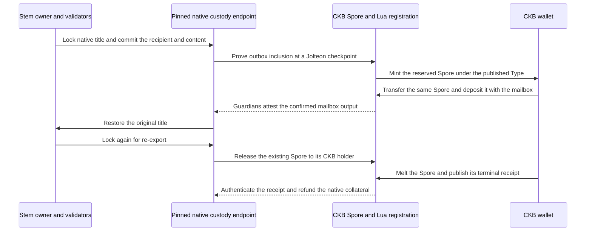

# A published Lua Mutant across Stem and CKB

A Spore issued on Stem reached a CKB wallet with the published beta.2 Type, its reserved 32-byte ID, the original content and a reference to a real Lua registration. After a CKB wallet transfer, the object returned to Stem and went back to CKB under the same Type. The final CKB melt authorized the retirement of the native title and refunded its full capacity. A second four-replica network began with a CKB-issued Spore and ended with the second owner's native custody claim. Both used the upstream registration example, `print('hello world')`. Every CKB operation used local development funds. [CKB histories and native receipts](histories.json.xz) · [Upstream positive fixture](https://github.com/sporeprotocol/spore-contract/blob/9e8663b3ef6e277a58acca9f4f347e5dbf8d5c06/tests/src/tests/mutant.rs)



| Trial | CKB Type transitions authenticated offline | Native executions | Final four-replica height |
| --- | ---: | ---: | ---: |
| CKB origin, import, redeem, wallet transfer, second deposit | 5 | 3 | 34 |
| Stem origin, standard export, wallet transfer, return, re-export, synchronized melt | 5 | 5 | 46 |

On the Stem-origin run, CKB estimated 5,548,974 cycles for the first standard export, 4,518,950 for the wallet transfer, 4,663,354 for the return deposit, 5,588,056 for release after the second export and 4,603,613 for the committed melt. The wallet authenticated the escrow as an intermediate owner and matched all five transition hashes. The recorded native receipts cover creation, locking, restoration, relocking and retirement. [Proof corpus](histories.json.xz) · [Trusted native committees](committee-trust.json)

In a separate CKB-only control, the same deployment minted, transferred and melted both a plain Spore and a Spore naming the upstream program. The respective cycle counts were 1,735,802 / 1,748,050 / 1,734,391 for plain and 2,868,359 / 2,848,560 / 2,840,385 for Mutant. These are individual devnet estimates for the signed, committed transactions. [CKB fixture](../beta2.py)

## Which rules the custody route enforces

The envelope accepts one lowercase, 64-digit `mutant[]` argument on an unclustered media type. A standalone native wallet-to-wallet transfer of this class is declined. CKB sees the actual Spore, registration, interpreter, library, owners, dependencies and witnesses when it decides a mint, transfer or melt. Transfer predicates which depend on transaction positions or other CKB inputs can decline a particular custody transaction. The ordinary portable content route keeps its own parser. [Content and wire encodings](../../../../bridge-wire/src/spore.rs) · [Imported representation](../../../../contracts/src/bin/stem-spore.rs)

The native-origin title pins its creation ID, counterpart Type hash and a hash of its settlement route. Escrowing the title also consumes the endpoint bond. Restoration and retirement execute the input endpoint Lock. Retirement requires a terminal CKB mailbox receipt and the exact untyped native refund. The CKB escrow checks its original Type, data, capacity, mailbox and checkpoint. The guardians still authenticate inbound CKB observations. The current evidence covers this testnet deployment and the archived program. Direct native transfers under arbitrary Lua, multiple Mutants, Cluster extensions and larger combinations require separate acceptance. An additional application-level condition did not meet its independent verification criterion. [Native title and endpoint](../../../../contracts/src/bin/stem-native-object.rs) · [CKB custody](../../../../contracts/src/bin/ckb-spore-escrow.rs)

## Reproduce

Read output zero from each testnet deployment transaction using CKB `get_transaction`. Save the bytes of `outputs_data[0]` as the program, removing the hex prefix and decoding the hex. The Spore program has CKB data hash `685a60219309029d01310311dba953d67029170ca4848a4ff638e57002130a0d`, the interpreter `5ff1a403458b436ea4b2ceb72f1fa70a6507968493315b646f5302661cb68e57` and the release Lua library `ed08faee8c29b7a7c29bd9d495b4b93cc207bd70ca93f7b356f39c677e7ab0fc`. The fixtures check these before deployment. [Spore manifest](https://github.com/sporeprotocol/spore-contract/blob/9e8663b3ef6e277a58acca9f4f347e5dbf8d5c06/deployment/migration/testnet/spore/2024-03-16-0.2.2-beta.2.json) · [Interpreter manifest](https://github.com/sporeprotocol/spore-contract/blob/9e8663b3ef6e277a58acca9f4f347e5dbf8d5c06/deployment/migration/testnet/spore_extension_lua/2024-03-16-0.2.2-beta.2.json) · [Lua library](https://github.com/sporeprotocol/spore-contract/blob/9e8663b3ef6e277a58acca9f4f347e5dbf8d5c06/contracts/spore_extension_lua/lua/libckblua.so)

Run the existing four-node fixture with the normal mailbox, escrow, native Lock, checkpoint and bridge binaries. Use the beta.2 ELF for `--spore-v2` and add `--spore-mutant-lua "$interpreter" --ckb-lua-library "$library" --spore-type-history`. For CKB origin use `--stem-spore "$contracts/stem-spore"`. For native origin use `--native-spore-origin "$contracts/stem-native-object" --native-spore-sync-melt`. A source file supplied with `--spore-mutant-program` replaces the upstream example for a new local experiment. [Four-node command](../../../../OPERATIONS.md#exercise-ckb-spore-settlement)

The CKB replay validates every requested data hash, and the full registration Type hash when specified, among each transition's resolved CellDeps, including DepGroup members. One proof also authenticates the registration's own history. Dependency presence alone does not establish the business semantics of a Lua program. The native replay checks heights, certificates, transaction IDs and receipt inclusion against the two pinned genesis committees.

```sh
python3 research/spore-permit/upstream/beta2/replay.py --stem target/release/stem
sdk/wasm/build.sh /tmp/stem-mutant-sdk
node research/spore-permit/upstream/beta2/native.mjs /tmp/stem-mutant-sdk
```
