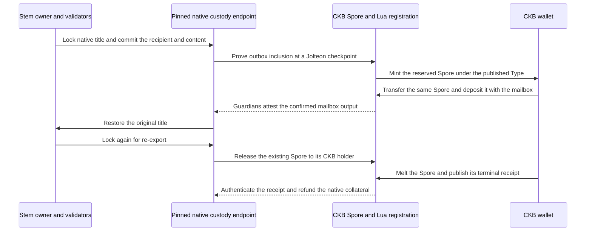
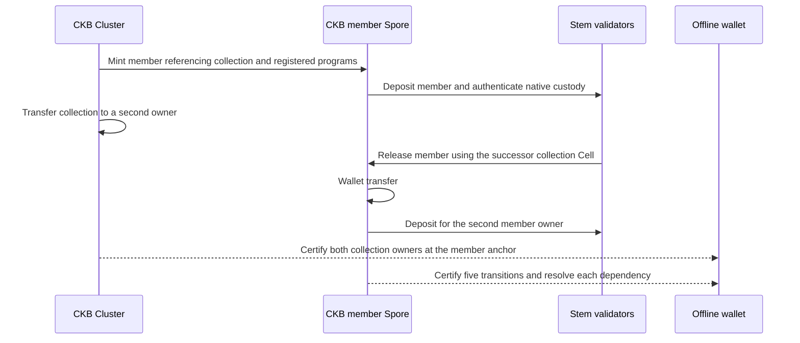

# A published Lua Mutant across Stem and CKB

A Spore issued on Stem reached a CKB wallet with the published beta.2 Type, its reserved 32-byte ID, the original content and a reference to a real Lua registration. After a CKB wallet transfer, the object returned to Stem and went back to CKB under the same Type. The final CKB melt authorized the retirement of the native title and refunded its full capacity. A second four-replica network began with a CKB-issued Spore and ended with the second owner's native custody claim. Both used the upstream registration example, `print('hello world')`. Every CKB operation used local development funds. [CKB histories and native receipts](histories.json.xz) · [Upstream positive fixture](https://github.com/sporeprotocol/spore-contract/blob/9e8663b3ef6e277a58acca9f4f347e5dbf8d5c06/tests/src/tests/mutant.rs)

A later study authenticated a public paid registration and an actual Spore mint. Four local validators on each asset-origin route verified the same program through wallet transfers and custody handoffs. [Public policy, 1,000-shannon registration and settlement](registered-policy/README.md)



| Trial | CKB Type transitions authenticated offline | Native executions | Final four-replica height |
| --- | ---: | ---: | ---: |
| CKB origin, import, redeem, wallet transfer, second deposit | 5 | 3 | 34 |
| Stem origin, standard export, wallet transfer, return, re-export, synchronized melt | 5 | 5 | 46 |

On the Stem-origin run, CKB estimated 5,548,974 cycles for the first standard export, 4,518,950 for the wallet transfer, 4,663,354 for the return deposit, 5,588,056 for release after the second export and 4,603,613 for the committed melt. The wallet authenticated the escrow as an intermediate owner and matched all five transition hashes. The recorded native receipts cover creation, locking, restoration, relocking and retirement. [Proof corpus](histories.json.xz) · [Trusted native committees](committee-trust.json)

In a separate CKB-only control, the same deployment minted, transferred and melted both a plain Spore and a Spore naming the upstream program. The respective cycle counts were 1,735,802 / 1,748,050 / 1,734,391 for plain and 2,868,359 / 2,848,560 / 2,840,385 for Mutant. These are individual devnet estimates for the signed, committed transactions. [CKB fixture](../beta2.py)

## Which rules the custody route enforces

The custody envelope accepts an ordered, comma-separated list of lowercase, 64-digit IDs under the media type’s `mutant[]` argument. An optional 32-byte Cluster ID travels in the same immutable Cell data. Titles issued on Stem and representations imported from CKB can transfer directly between native wallets using an exact grant from a committed CKB custody rotation. CKB sees the actual Spore, registration, interpreter, library, owners, dependencies and witnesses when it decides a mint, transfer or melt. Transfer predicates which depend on transaction positions or other CKB inputs can decline a particular custody transaction. [Handoff protocol and six devnets](handoff.md) · [Content and wire encodings](../../../../bridge-wire/src/spore.rs) · [Imported representation](../../../../contracts/src/bin/stem-spore.rs)

The native-origin title pins its creation ID, counterpart Type hash and a hash of its settlement route. Escrowing the title also consumes the endpoint bond. Restoration and retirement execute the input endpoint Lock. Retirement requires a terminal CKB mailbox receipt and the exact untyped native refund. The CKB escrow checks its original Type, data, capacity, mailbox and checkpoint. The guardians still authenticate inbound CKB observations. The current evidence covers this testnet deployment and the archived program. Acceptance of other Lua policies and collection-level extensions requires additional evidence. An additional application-level condition did not meet its independent verification criterion. [Native title and endpoint](../../../../contracts/src/bin/stem-native-object.rs) · [CKB custody](../../../../contracts/src/bin/ckb-spore-escrow.rs)

## Two registrations on one Spore

On a fresh CKB chain, three assets used the same published Spore binary. The plain asset and the asset naming one registration served as controls. The third asset named two separately issued registration IDs, in order, separated by a comma as specified by the upstream format. Its two programs contain distinct log messages and therefore have different content hashes. All three assets completed mint, wallet transfer and melt. Each of the three transactions for the two-ID asset had five authenticated dependencies: Spore, its interpreter, the shared Lua library and the two distinct registration Cells. [Upstream format](https://github.com/sporeprotocol/spore-contract/blob/9e8663b3ef6e277a58acca9f4f347e5dbf8d5c06/docs/MUTANT.md) · [Control and bridge proofs](two-registrations.json.xz)

| Test with two registrations | Certified CKB transitions | Native receipts | Common native height |
| --- | ---: | ---: | ---: |
| CKB-only mint, wallet transfer and melt | 3 | — | — |
| CKB origin, two deposits either side of a redemption and wallet transfer | 5 | 3 | 35 |
| Stem origin, mint on CKB, wallet transfer, return, re-export and terminal refund | 5 | 5 | 40 |

The wallet replay binds the two program hashes to the distinct registered Types, matches their ordered IDs to the original Spore MIME bytes and checks the complete data hash on every surviving output. In the native-origin run, CKB estimated 5,568,790 cycles to mint, 4,513,972 for the wallet transfer and 5,509,705 to release the original object on re-export. The shipping WASM verifier independently checked the native receipts against their four-member committees. These measurements establish interoperability and preservation of references for the two logging programs. They leave the semantics of other programs open. A separate single-registration import using the new guest binaries also reached a common height of 52. [Offline CKB verification](replay.py) · [Native verification](native.mjs)

## Cluster membership and collection-level registration

The published testnet Cluster ELF contains 46,528 bytes. Its CKB data hash is `0bbe768b519d8ea7b96d58f1182eb7e6ef96c541fbd9526975077ee09f049058`. The deployment output at index zero matched both the data hash and the release Type ID. A fresh devnet exercised the upstream plain collection profile, with an empty optional `ClusterDataV2.mutant_id`. A separate collection using a real Lua registration was declined by the published Cluster program during creation with `MutantNotInDeps`. That fixture produced no committed collection-level extension or member history. The accepted registration examples above place their references on the Spore itself. [Cluster deployment manifest](https://github.com/sporeprotocol/spore-contract/blob/9e8663b3ef6e277a58acca9f4f347e5dbf8d5c06/deployment/migration/testnet/cluster/2024-03-16-0.2.2-beta.2.json) · [Cluster field layout](https://github.com/sporeprotocol/spore-contract/blob/9e8663b3ef6e277a58acca9f4f347e5dbf8d5c06/lib/types/schemas/spore_v2.mol) · [Upstream Cluster fixtures](https://github.com/sporeprotocol/spore-contract/blob/9e8663b3ef6e277a58acca9f4f347e5dbf8d5c06/tests/src/tests/cluster.rs)

| Proven Type | Three committed transitions | Verified relationship |
| --- | --- | --- |
| Plain beta.2 Cluster | Mint, transfer to a second lock, return to its first lock | The intermediate owner and the unchanged collection bytes appeared in the certified history. |
| Spore member | Mint, transfer to a second lock, melt | Each transaction resolved the same collection Type and data as a dependency. The member's encoded Cluster ID matched the collection's Type arguments. |

The two histories can be verified after shutting down CKB. The member's mint, transfer and melt took 1,815,107, 1,759,776 and 1,717,516 estimated CKB cycles respectively. All three were confirmed locally. Run the CKB-only harness with `--cluster "$cluster_beta2_elf"` and the existing interpreter, Lua library and Spore inputs. The fixture also supports the independent `--second-mutant` control in the same invocation. [CKB histories](cluster-controls.json.xz) · [Offline verifier](replay.py)

To look for a known-good collection-level reference, the public testnet indexer was queried at tip 23,193,926. The two most recent pages of live Cells under the published Data1 identity contained 256 three-field collection records with an empty optional Mutant ID. The query using the deployment's Type identity returned no live matches. Both used a 64 KiB maximum data size and an upper block bound of the tip plus one. This sample leaves older, spent and larger collection records unexamined. A confirmed collection with a populated field and its matching registered program would let a subsequent test replay a known-good transaction. [Query parameters, outpoints and observed field shapes](cluster-index-sample.json.xz)

A second lookup covered historical outputs through testnet height 23,194,162. The indexer returned 4,611 output records for the published Data1 identity, representing 2,274 distinct collection IDs. The scanner read 2,274 compact live Cells and retrieved 2,337 additional committed transactions for the other outputs. All 4,611 decoded as three-field records with an empty optional Mutant ID. Data hashes stayed constant across every observed output for each ID. The deployment Type identity returned zero outputs. These counts cover the two queried script identities and the indexer's responses at the recorded block bound. Other deployments or a local positive fixture could still supply a collection-level test case. [Public index record](cluster-index-history.json.xz) · [Historical query and field decoder](cluster_index.py)

The offline wallet also authenticated two of those public outputs, the collection's creation at height 22,434,867 and its transfer to a different Lock at 22,434,870. Each transaction resolved the published Cluster program. The 50-byte collection record had the same hash and empty extension field under both owners. To repeat the enumeration use `python3 cluster_index.py --height 23194162 --output cluster-index.json.xz`. [Public wallet request, inclusion proofs and certified owners](public-collection.json.xz) · [Offline check against the indexed rows](replay.py)

## Cross-chain settlement of registered Cluster members

Four fresh devnets combined an ordinary beta.2 Cluster with a Spore whose own MIME field names one or two registered Lua programs. Each run had four Jolteon validators and a separate disposable CKB chain. The member's wallet history and the collection's history terminate at the same authenticated CKB header. Each member transaction resolved the Spore binary, interpreter, shared library, each named registration, Cluster binary and a collection Cell with the committed Type and data hash. [CKB and native proof archive](cluster-settlement.json.xz) · [Pinned native committees](committee-trust.json)

| Asset origin | Registrations on member | Certified member transitions | Certified collection transitions | Native execution receipts | Common native height |
| --- | ---: | ---: | ---: | ---: | ---: |
| CKB | 1 | 5 | 2 | 3 | 40 |
| CKB | 2 | 5 | 2 | 3 | 39 |
| Stem | 1 | 5 | 1 | 5 | 43 |
| Stem | 2 | 5 | 1 | 5 | 44 |

On both imports, the collection changed owners on CKB after the member entered escrow and before its release. The next member transaction named the new collection outpoint. Both collection owners had the same Type and data hash. The wallet matched the 32-byte ID inside the actual member to the certified collection's script arguments. The member returned to a CKB wallet, changed hands and entered Stem custody under its second owner. [Offline history verifier](replay.py)

On both native-origin paths the title initially committed to the requested collection and registered programs. CKB accepted membership on first export. An ordinary wallet transferred the resulting standard Spore, returned it to Stem and received the same Spore on re-export. CKB then committed the melt and the native validators released the collateral. The two-registration mint, wallet transfer, re-export and melt were estimated at 5,578,370, 4,479,214, 5,558,981 and 4,595,605 CKB cycles. The registered programs in these runs log fixed messages. The collection's own optional Mutant field was empty. [Certified execution replay](native.mjs) · [Published release identities](https://github.com/sporeprotocol/spore-contract/blob/9e8663b3ef6e277a58acca9f4f347e5dbf8d5c06/docs/VERSIONS.md)



To reproduce, add `--spore-cluster-v2` with the published beta.2 Cluster ELF to either beta.2 bridge command below. The runner publishes the Cluster program separately to fit CKB's transaction size limit. For the two-registration case supply both program files. Replay the CKB histories and native receipts using the commands below.

## Reproduce

Read output zero from each testnet deployment transaction using CKB `get_transaction`. Save the bytes of `outputs_data[0]` as the program, removing the hex prefix and decoding the hex. The Spore program has CKB data hash `685a60219309029d01310311dba953d67029170ca4848a4ff638e57002130a0d`, the interpreter `5ff1a403458b436ea4b2ceb72f1fa70a6507968493315b646f5302661cb68e57` and the release Lua library `ed08faee8c29b7a7c29bd9d495b4b93cc207bd70ca93f7b356f39c677e7ab0fc`. The fixtures check these before deployment. [Spore manifest](https://github.com/sporeprotocol/spore-contract/blob/9e8663b3ef6e277a58acca9f4f347e5dbf8d5c06/deployment/migration/testnet/spore/2024-03-16-0.2.2-beta.2.json) · [Interpreter manifest](https://github.com/sporeprotocol/spore-contract/blob/9e8663b3ef6e277a58acca9f4f347e5dbf8d5c06/deployment/migration/testnet/spore_extension_lua/2024-03-16-0.2.2-beta.2.json) · [Lua library](https://github.com/sporeprotocol/spore-contract/blob/9e8663b3ef6e277a58acca9f4f347e5dbf8d5c06/contracts/spore_extension_lua/lua/libckblua.so)

Run the existing four-node fixture with the normal mailbox, escrow, native Lock, checkpoint and bridge binaries. Use the beta.2 ELF for `--spore-v2` and add `--spore-mutant-lua "$interpreter" --ckb-lua-library "$library" --spore-type-history`. For CKB origin use `--stem-spore "$contracts/stem-spore"`. For native origin use `--native-spore-origin "$contracts/stem-native-object" --native-spore-sync-melt`. For the two-registration runs, pass `--spore-mutant-program` twice. The two files contain exactly `print('hello world')` and `print('second registration')` respectively, without a trailing newline. For the CKB-only control, add `--second-mutant` to `beta2.py`. [Four-node command](../../../../OPERATIONS.md#exercise-ckb-spore-settlement)

The CKB replay validates every requested data hash, and the full registration Type hash when specified, among each transition's resolved CellDeps, including DepGroup members. One proof also authenticates the registration's own history. Dependency presence alone does not establish the business semantics of a Lua program. The native replay checks heights, certificates, transaction IDs and receipt inclusion against the two pinned genesis committees.

```sh
python3 research/spore-permit/upstream/beta2/replay.py --stem target/release/stem
sdk/wasm/build.sh /tmp/stem-mutant-sdk
node research/spore-permit/upstream/beta2/native.mjs /tmp/stem-mutant-sdk
```
