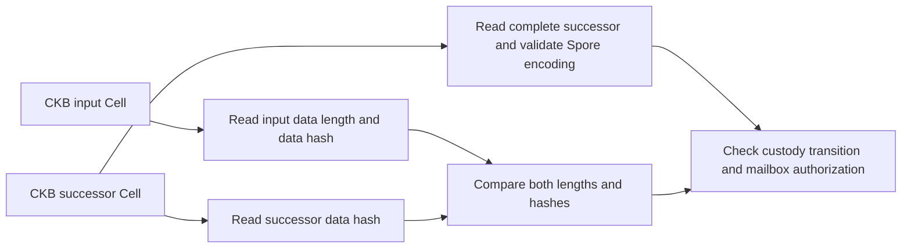

# CKB cost of preserving a registered Spore during custody

Comparing the original and successor Cell data lengths and CKB data hashes reduced the mean cost of a 496 KiB CKB-issued handoff from 22,549,053 to 14,419,409 cycles. An independent repeat averaged 14,407,248 cycles. The same change reduced a Stem-issued handoff from 22,552,808 to 14,399,922 cycles. These estimates cover the complete signed CKB transactions that went on chain. The selected contract still reads and validates the full successor Spore. [Ten devnet records, public genesis files and CKB proofs](https://github.com/a19q3/stem/blob/12338f2fea73c8df437694da473d08e950a0938b/research/spore-permit/upstream/beta2/cost/cases.json.xz) · [Custody contract](../../../../../contracts/src/bin/ckb-spore-escrow.rs)

| Asset and content | Original byte comparison | Aligned word comparison | CKB length and data hashes | Change from original |
| --- | ---: | ---: | ---: | ---: |
| CKB-issued, 29-byte content | 4,754,507 | 4,772,582 | 4,771,557 | +0.36% |
| CKB-issued, 496 KiB | 22,549,053 | 15,780,124 | 14,419,409 | −36.05% |
| Stem-issued, 496 KiB | 22,552,808 | — | 14,399,922 | −36.15% |

Each number is the mean of A→B and B→A, rounded to the nearest cycle. The large CKB-issued transactions were 510,808 signed bytes under all three implementations. The Stem-issued transactions were 510,841 bytes. All cases used the published beta.2 Spore and Cluster programs and two member registrations. Each fresh four-validator network executed the native handoffs, the CKB redemption and the remaining lifecycle. The compact digest repeat averaged 4,768,624 cycles. Compact results overlap at the individual transaction level. Different deployments and signatures produce distinct signed transactions, so the compact differences give no basis for claiming a saving. [Per-transaction measurements and validation](verify.py)

## Why the large transaction costs changed

The original gate loaded the complete predecessor and successor data into guest memory and compared the two byte vectors. The word candidate used the existing aligned equality routine on those same two vectors. The selected gate asks CKB for the predecessor data length and for the BLAKE2b-256 data hashes of both indexed Cells. Hash equality uses the same commitment that CKB exposes to its scripts. The gate still validates the successor encoding, the registered Spore Type, both capacities and the mailbox action. The CKB Spore script also executes on the actual transaction. The three gates have different code hashes. Existing Data2 deployments retain the program named in their Lock scripts. [Aligned comparison](../../../../../contracts/src/spore.rs) · [Wallet and native handoff checks](../handoff.md)



The baseline and selected CKB-issued cases each included a deposit advertising changed content in its own mailbox record. One variant changed a byte while preserving the encoded length. Another shortened the content and rebuilt its canonical Spore encoding. The deployed custody gate declined both with code 112, for compact and large objects. The compact digest repeat also exercised recovery after a stale native source. Native finality verification and CKB proof verification run offline. The cycle counts are recorded node estimates. [Functional controls](../../../../../tools/spore_settlement_localnet.py) · [Offline replay](verify.py)

## Reproduce the comparison

Use the two-registration Cluster handoff command with `--spore-content-bytes 507904`. Omit this flag for compact cases. Choose either the CKB-issued or Stem-issued route and a fresh devnet per run. Capture `estimate_cycles` for the signed rotation before submitting it and retain the confirmed transaction's hash and size. Use commit `0504e47` for the original escrow. To reproduce the word candidate, replace the equality of the two loaded byte vectors at the capacity check with `stem_contracts::spore::same_content(&input, &output)`. The candidate retains the bounded full input load. The selected escrow uses CKB's `load_cell_data_hash` on input and output. Build with the guest release settings used by the settlement fixture. [Four-replica commands](../../../../../OPERATIONS.md#exercise-ckb-spore-settlement)

```sh
cargo build --release --locked --bin stem
python3 research/spore-permit/upstream/beta2/cost/verify.py --stem target/release/stem
```

The replay verifies each complete CKB Type history, matches the signed bytes and transaction IDs of the four measured operations, and resolves the actual custody executable from each rotation's direct dependencies. It checks the second handoff's native finality certificate against its own genesis. The driver compared four node headers at the recorded common height. Replica status was sampled immediately afterwards and had advanced one block in one run. [Original estimates, transactions, dependency bytes and certificates](https://github.com/a19q3/stem/blob/12338f2fea73c8df437694da473d08e950a0938b/research/spore-permit/upstream/beta2/cost/cases.json.xz)
