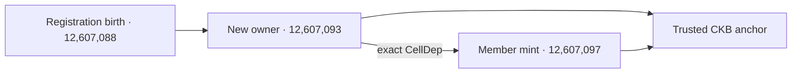

# Which Cell did a Spore transaction reference?

A collection can keep the same Type and bytes when its owner changes. The Rust wallet now accepts an expected OutPoint on a particular transaction of its authenticated Type history. Each claim checks the data hash. A caller can also pin the full Lock and Type hashes. The proof already contains the raw output and its references, including the contents of dependency groups. [Wallet interface and concrete request](../../../../../OPERATIONS.md#offline-history-of-a-ckb-type) · [Offline replay](check.py)

## A registration that changed owners on public testnet

A public Spore mint at height 12,607,097 referenced output zero of the registration transfer at 12,607,093. The program had first been issued at 12,607,088. Both versions have identical code bytes and Type, and different owner Locks. The registration and mint histories verify against the same archived CKB anchor. The wallet accepted the transferred Cell as a dependency of the mint. It rejected both the superseded OutPoint and the transferred OutPoint paired with the previous owner's Lock. [Packed public mint and registration histories](../registered-policy/public.json.xz)



## Two fresh four-validator settlements

Each funded devnet issued an ordinary Cluster member under the SDK's immortal and transfer programs. Each registration charged its own recipient 1,000 shannons. The end-to-end workflow authenticated the collection at the member's anchor, requested its exact historical version at each member transaction, collected the witnessed history through RPC and verified it offline. The CKB-origin collection transferred to a new owner at height 70. All four earlier and all three later member transactions referenced the expected owner and OutPoint. The Stem-origin route referenced one collection version through all six CKB transitions. [Settlement receipts, requests and proofs](settlement.json.xz) · [Independent committee anchors](../committee-trust.json)

| Origin | CKB collection heights | Member transition heights | Agreed Stem height |
| --- | --- | --- | ---: |
| CKB | 41, 70 | 44, 52, 58, 64, 78, 82, 86 | 51 |
| Stem | 42 | 58, 62, 66, 72, 78, 87 | 49 |

On each mint two additional authenticated Cells appeared only through a DepGroup. The same wallet accepted both expanded OutPoints in addition to the Cluster. The offline check also covers an empty request, a DepGroup container, duplicate claims, a transaction outside the path, and mismatched Lock, Type and data hashes. A historical reference proves which Cell was supplied to that transaction. It does not establish later liveness or prove which instructions an executable ran.

## Replay

Use the release wallet and a built WASM SDK. The first command checks each version and the two group members. The second replays the wider beta.2 corpus. The third verifies the certified Stem executions and native custody changes.

```sh
study=research/spore-permit/upstream/beta2
python3 "$study/dependency-uses/check.py" --stem target/release/stem
python3 "$study/replay.py" --stem target/release/stem
node "$study/native.mjs" /path/to/built/wasm
```

To produce fresh runs, use the two separate-beneficiary routes in the [SDK policy study](../sdk-policies/README.md) with `--spore-type-history`. The [localnet fixture](../../../../../tools/spore_settlement_localnet.py) now constructs both wallet requests during settlement.
