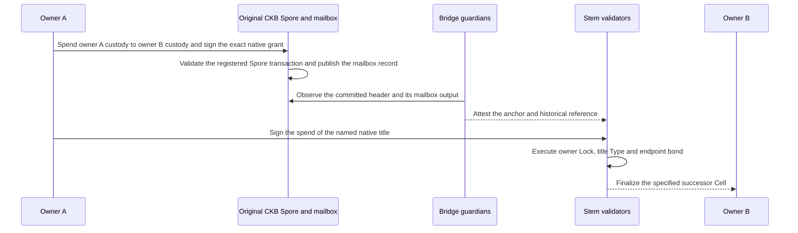

# CKB authorization of a direct native Spore transfer

A native wallet spent its existing Stem-issued title directly to a second wallet after the original beta.2 Spore changed custody locks in a committed CKB transaction. The second wallet transferred the same title back under a fresh CKB authorization. The native Type, capacity, content bytes and Cluster ID persisted through both transfers. Each devnet then re-exported the Spore, melted it on CKB and redeemed the native collateral. [Compact trial](handoff-compact.json.xz) · [Cluster trial](handoff-cluster.json.xz) · [496 KiB trial](handoff-large.json.xz)

| Stem-issued Spore | Member history on CKB | Successful native handoffs | CKB cycles, first / second | Stem cycles per handoff | CKB bytes per handoff |
| --- | ---: | ---: | ---: | ---: | ---: |
| Single registration | 7 transitions | 2 | 4,734,442 / 4,768,265 | 14,105,863 | 2,739 |
| Cluster member with two registrations | 8 transitions | 2 | 4,756,055 / 4,774,339 | 14,110,109 | 2,951 |
| Cluster member, two registrations and 496 KiB content | 7 transitions | 2 | 22,544,392 / 22,548,951 | 16,523,608 | 510,841 |

The measured CKB cost covers the signed transaction estimated by the devnet node and subsequently committed. Stem cycles come from the certified execution receipt. All four validators agreed in each local devnet. The two clustered cases also produced an independent collection history at the final member anchor. These runs used the published testnet Spore, interpreter and ordinary Cluster binaries and the logging programs documented in the original custody experiments. [Release identities and registration programs](README.md)



## What both chains verify

The CKB holder Lock carries the custody gate, original Spore Type hash, native wallet code hash and the holder's 20-byte key argument. A handoff spends and recreates the same Spore under different holder Locks. The CKB gate preserves capacity and data, requires a signed input from the first holder's standard CKB account, validates the new custody owner and emits the grant through the pinned mailbox. A normal redemption still requires the certified Stem outbox. [CKB custody Lock](../../../../contracts/src/bin/ckb-spore-escrow.rs)

The 204-byte payload contains the native object ID, successor and previous Lock hashes, a format tag, the spent native OutPoint, the complete successor Cell hash, and the size and hash of the original Spore data. The authenticated message header provides both network IDs, the mailbox, the endpoint and its one-use nonce. On Stem the title owner's input Lock executes independently of the endpoint bond. The endpoint verifies the receipt, exact input, exact output, immutable data, capacity and owner change. The existing bridge guardians attest inbound CKB observations. [Wire format](../../../../bridge-wire/src/spore.rs) · [Native title and endpoint](../../../../contracts/src/bin/stem-native-object.rs)

The CKB and Stem transactions finalize separately. In the compact Cluster run, the original holder deliberately signed a third CKB rotation naming the already spent native input from the first transfer. The third rotation committed on CKB. Stem refused to move the current title under that receipt. Its holder then re-exported using the live native input, and the CKB gate redeemed the original Spore from its latest custody Lock. Missing CKB holder signatures and grants naming a different recipient also failed CKB validation in the fixtures. [Certified Cluster history and recovery](handoff-cluster.json.xz)

These transfers require one original CKB transaction, bridge confirmation and a signed Stem transaction per change of owner. A Mutant can restrict the admissible CKB transaction shape, destination or dependencies. The trials establish the transitions in the table. General compatibility with third-party Lua policies and collection-level registrations remains open.

## Reproduction

Run the native-origin beta.2 CKB settlement fixture with `--spore-type-history --native-spore-sync-melt --spore-handoff`. Add `--spore-cluster-v2` and both registered Lua sources for the Cluster cases. Use `--spore-handoff-stale-source` for the spent-source control and `--spore-content-bytes 507904` for the large case. The wallet command `stem intercell spore-handoff --request request.json` takes the native object Type hash, previous owner's Lock hash, source OutPoint and complete encoded successor Cell under the keys `object`, `previous_owner`, `source` and `output`. It returns the binary mailbox payload as hex. [Fixture instructions](../../../../OPERATIONS.md#exercise-ckb-spore-settlement)

The CKB replay extracts each grant directly from the transaction included in the wallet proof and reconstructs both owner identities from the certified custody Locks. The WASM replay checks the committee finality and execution proofs, then decodes the actual signed native transaction and matches its spent OutPoint and successor bytes. [CKB verifier](replay.py) · [WASM verifier](native.mjs)

```sh
python3 research/spore-permit/upstream/beta2/replay.py --stem target/release/stem
sdk/wasm/build.sh /tmp/stem-handoff-sdk
node research/spore-permit/upstream/beta2/native.mjs /tmp/stem-handoff-sdk
```
