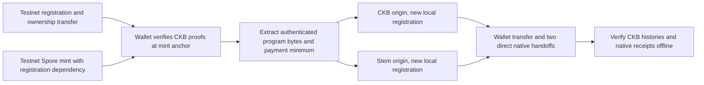

# A testnet Spore registration with a mint payment

A public CKB testnet mint at height 12,607,097 referenced a 79-byte Lua program registered with the published beta.2 interpreter. Two local CKB devnets used the exact program bytes and the same 1,000-shannon minimum payment. Assets issued on CKB and Stem both completed a wallet transfer, direct native handoffs and cross-chain settlement. The public registration describes a restriction on melting. The measured local routes preserve the CKB Spore and retain a live asset at their last observed state. [Public mint](https://pudge.explorer.nervos.org/transaction/0xf4859369950ec9c0ddc6cea1a6819042dd360892cf7616f9a6c8575b202e2797) · [Two local settlement histories](settlement.json.xz)

| Observed mint | Net shannons credited to registration owner's Lock | CKB states verified | Native handoffs | Native cycles per handoff | Common native height |
| --- | ---: | ---: | ---: | ---: | ---: |
| Public testnet origin | 6,100,000,000 | 1 mint and 2 separate registration states | — | — | — |
| New CKB-issued asset | 48,000,000,000 | 7 | 2 | 14,072,420 | 48 |
| New Stem-issued asset | 48,000,000,000 | 6 | 2 | 14,105,942 | 44 |

The registration Type has a 32-byte ID followed by the eight-byte little-endian minimum. The Spore MIME field references the 32-byte ID. The wallet checks the full registration Type hash and the program data hash. The reported capacity delta sums outputs at the registration owner's Lock and subtracts consumed capacity at the same Lock. On both local mints the owner received the 480 CKB asset Cell, whose capacity counts toward the minimum. The delta measures all capacity credited to that Lock. [Release implementation of the mint charge](https://github.com/sporeprotocol/spore-contract/blob/9e8663b3ef6e277a58acca9f4f347e5dbf8d5c06/contracts/spore/src/entry.rs#L283-L309) · [Offline payment reconciliation](verify.py)



## Public evidence

At testnet index height 23,194,606 the Data1 interpreter identity had 33 historical outputs across 17 registration IDs. All had the same program hash and payment suffix. The Data, Data2 and deployment Type queries returned zero outputs. A bounded query then looked for ordinary Spore outputs in the 120-block intervals starting at the registration outputs. The twelve merged intervals yielded eleven distinct Spore IDs. Each matched both a parsed MIME reference and the exact referenced registration outpoint among the transaction's direct dependencies. Assets minted outside those intervals are outside the count. [Index rows and intervals](index.json.xz) · [Reproducible historical query](public_index.py) · [Interpreter deployment](https://github.com/sporeprotocol/spore-contract/blob/9e8663b3ef6e277a58acca9f4f347e5dbf8d5c06/deployment/migration/testnet/spore_extension_lua/2024-03-16-0.2.2-beta.2.json)

The wallet authenticated one of those eleven mints against the recorded creation-block anchor. A separate proof to that same anchor established the registration's creation at height 12,607,088 and a change of owner at 12,607,093. Its data hash stayed constant. The mint referenced that successor registration output. The indexer supplies the broader inventory. The two portable proofs supply independent offline verification for the selected example. [Public wallet requests and proofs](public.json.xz)

## Local settlement

The CKB-origin route minted a new asset, deposited it to Stem, transferred its native title A→B→A under two CKB custody handoffs, redeemed the original, transferred it on CKB, and deposited it again under the successor owner. On the Stem-origin route the first export reached a CKB wallet, changed owners, returned to Stem, passed through the two native handoffs, and was exported to CKB again. The local registration IDs reflect their own creating inputs. The public program data hash was identical on both routes. The WASM verifier replayed eleven native executions across the two committees. A separate regression using the original 32-byte registration arguments completed the CKB-origin route at common native height 30. [Trusted development committees](../committee-trust.json) · [Native receipt verifier](../native.mjs)

The whole-transaction CKB cycle estimates for the two custody handoffs were 4,724,740 and 4,771,452 for CKB origin, and 4,781,632 and 4,780,707 for Stem origin. These measurements cover one real-world program and the exercised transitions. A separate attempt put the referenced ID in the collection’s own optional Mutant field and included the paid registration as a direct CellDep. The published Cluster program returned code 54 during the node’s cycle estimate. That candidate produced no collection. Other Lua policies and collection-level compatibility remain open. [Collection attempt](collection-attempt.json) · [Earlier collection evidence](../README.md#cluster-membership-and-collection-level-registration)

## Paying a separate beneficiary

Four further devnets used a registration owner with an independent secp256k1 Lock. Each mint spent the beneficiary’s existing 100 CKB Cell and returned one ordinary Cell at the same Lock. The Spore went to a different Lock. One registration added exactly 1,000 shannons to the beneficiary’s balance. Two distinct registrations of the same authenticated program, owned by the same beneficiary, added exactly 2,000. The beneficiary signed the spend of its existing Cell. A wallet using this settlement arrangement therefore needs the beneficiary’s signature at mint. [Four signed settlement histories](separate-payees.json.xz)

| Asset origin | Registrations | Net shannons paid | CKB mint bytes | CKB mint cycles | Ordinary CKB transfer cycles | Common Stem height |
| --- | ---: | ---: | ---: | ---: | ---: | ---: |
| CKB | 1 | 1,000 | 1,491 | 4,609,224 | 4,523,043 | 46 |
| Stem | 1 | 1,000 | 3,128 | 7,365,933 | 4,519,969 | 45 |
| CKB | 2 | 2,000 | 1,593 | 4,626,136 | 4,544,312 | 47 |
| Stem | 2 | 2,000 | 3,397 | 7,451,726 | 4,557,554 | 47 |

The CKB wallet replayed 26 asset states, including two native-title handoff authorizations per asset. The WASM verifier checked 22 certified native executions against the four recorded committees. The payment verifier reads the registration IDs and prices from the referenced outputs, checks the IDs against the Spore MIME field, and reconciles every input and output at the beneficiary’s Lock. These four cases measure the amounts actually paid. They cover one program, an individual Spore, and one beneficiary per mint. [Payment verifier](verify.py) · [Committee trust roots](../committee-trust.json)

## Reproduce

Run the commands below from the repository root. The first command verifies both public proofs and the six local histories. It also extracts the authenticated program to a new file. The two subsequent offline checks verify the CKB authorizations of the native spends and the native receipts. The final command refreshes the historical index against the pinned block bound. [WASM build instructions](../README.md#reproduce)

```sh
d=research/spore-permit/upstream/beta2/registered-policy
python3 "$d/verify.py" --stem target/release/stem --extract-program public-policy.lua
python3 "$d/../replay.py" --stem target/release/stem
node "$d/../native.mjs" "$wasm_sdk"
python3 "$d/public_index.py" --height 23194606 --output index-repeat.json.xz
```

For live devnets, use the four-validator beta.2 fixture on fresh stores with the published Spore ELF, interpreter and Lua library. Add `--spore-mutant-program public-policy.lua --spore-mutant-payment 1000 --spore-type-history --spore-handoff`. Choose `--stem-spore` for the import and `--native-spore-origin` for the export. Use the standard native CKB wallet transfer and re-export endpoints for this profile. [Base fixture and binary arguments](../../../../../OPERATIONS.md#exercise-ckb-spore-settlement)

Add `--spore-mutant-separate-payee` to pay the independent beneficiary. To issue with two distinct registrations, pass `--spore-mutant-program public-policy.lua` twice on the same command line.
