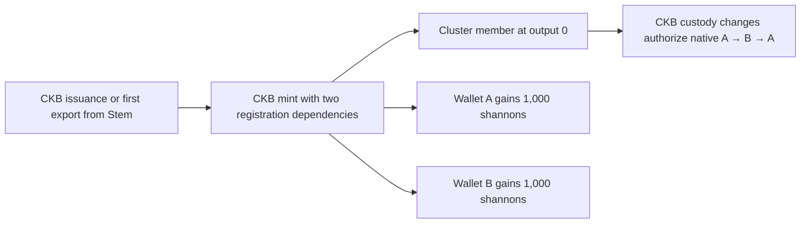

# SDK policy combinations on two Spore settlement routes

Four CKB devnets issued ordinary Cluster members carrying the SDK's `immortalMutant.lua` and `mustTransferMutant.lua` together. Two assets originated on CKB and two on Stem. The wallet authenticated all 26 CKB member states and the corresponding collection history at each member's anchor. Every transfer in these histories changed the CKB Lock hash. The WASM verifier replayed all 22 native executions against the four recorded development committees, including eight direct native title transfers. These are observations of successful movements. The runtime mode invoked for each SDK conditional remains unverified. [Signed settlement histories](settlement.json.xz) · [SDK resources at the tested revision](https://github.com/sporeprotocol/spore-sdk/tree/5e5d886e49bfbd78253e9c14fd8baebccb488a81/packages/core/src/__tests__/resources)

| Asset origin | Registration owners | Net mint payments (shannons) | Mint inputs / outputs | CKB mint body / signed bytes | Mint cycles | Common Stem height |
| --- | --- | --- | --- | --- | ---: | ---: |
| CKB | One | 2,000 | 2 / 3 | 1,160 / 1,651 | 4,643,270 | 51 |
| CKB | Two | 1,000 each | 3 / 4 | 1,313 / 1,897 | 6,319,752 | 51 |
| Stem | One | 2,000 | 4 / 4 | 1,805 / 3,280 | 7,351,750 | 49 |
| Stem | Two | 1,000 each | 5 / 5 | 1,958 / 3,628 | 9,117,891 | 49 |

In each mint the issuer funded the prices through an existing input. Each beneficiary co-signed the spend of one ordinary 100 CKB balance Cell and received its successor with the exact net credit. Its Lock differed from the asset recipient's Lock. Every mint paid a miner fee of 1,000,000 shannons. Splitting the two prices across separate owners added one input and one output, or 153 bytes to the body on each route. Signed sizes also include the witnesses and, on export, checkpoint material from the corresponding independent run. The cycle estimates cover the complete transaction on that devnet. [Mint payment verifier](check.py) · [Beneficiary funding and signing](../../../../../tools/spore_settlement_localnet.py)



## An output-position restriction

Two further devnets each issued a Cluster member at output zero under `firstOutputMutant.lua` and `mustTransferMutant.lua`. The ordinary deposit placed the successor Spore at output one. A second signed deposit on a fresh devnet placed it at output zero. The local CKB node returned script code 89 for both cycle estimates. Both assets remained at issuance. The runs also used different beneficiaries, so they establish the outcomes of the two complete transactions. The runtime cause remains unresolved. The wallet authenticates each mint and reconstructs the signed deposit's input, output position, Type and data. The refusal is a recorded node observation. Both routes retain all registration dependencies. [Output-one deposit and mint proof](first-output.json.xz) · [Output-zero deposit and mint proof](first-output-zero.json.xz) · [SDK output-position program](https://github.com/sporeprotocol/spore-sdk/blob/5e5d886e49bfbd78253e9c14fd8baebccb488a81/packages/core/src/__tests__/resources/firstOutputMutant.lua)

The SDK's example creates an ordinary Cluster, then attaches a Mutant reference to a member's content type. The four completed routes exercise that placement. A collection with its own Mutant field still needs an authenticated positive example. [Pinned SDK test](https://github.com/sporeprotocol/spore-sdk/blob/5e5d886e49bfbd78253e9c14fd8baebccb488a81/packages/core/src/__tests__/Mutant.test.ts#L159-L227) · [Collection-level evidence](../README.md#cluster-membership-and-collection-level-registration)

The public Pudge indexer also returned zero new Cluster outputs for either published beta.2 identity from heights 23,194,163 through 23,195,186 inclusive. The earlier scan counted 4,611 historical outputs under the Data1 identity, all with an empty Mutant field. The later query rechecked the earlier endpoint against its canonical header and recorded the hash at the new endpoint. These results apply to those identities and heights. [Indexer queries and both anchors](collection-window.json) · [Earlier historical scan](../cluster-index-history.json.xz)

## Replay

Use a release Stem binary and a built WASM SDK. The first command reconciles the price encoded in each full registration Type with the actual inputs and outputs at its owner's Lock. The next two authenticate the complete CKB member and collection histories, then the certified native transactions and receipts.

```sh
python3 research/spore-permit/upstream/beta2/sdk-policies/check.py --stem target/release/stem
python3 research/spore-permit/upstream/beta2/replay.py --stem target/release/stem
node research/spore-permit/upstream/beta2/native.mjs /path/to/built/wasm
```
