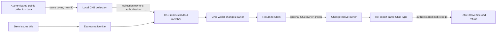

# Ordinary Cluster members issued on Stem

A Stem-issued Spore can name an ordinary Cluster and use the published mainnet Spore V2 program on CKB. The first CKB mint supplies the collection and a transaction authorized by its owner. The native title commits to the complete Spore bytes, the reserved CKB Type and the settlement endpoint. A wallet can then use the CKB original to authorize a direct change of native owner. The bound checks include the prior native input, successor Cell and original content digest. Inbound observations use the configured Stem guardians. [Operator instructions](../../../../OPERATIONS.md#exercise-ckb-spore-settlement)

## Public deployment and collection data

The two historical deployments use the same Cluster binary, with data hash `7366a61534fa7c7e6225ecc0d828ea3b5366adec2b58206f2ee84995fe030075`. The queries include spent outputs through the indicated heights. Compact live outputs supplied raw data directly. For remaining outputs the scan fetched their committed creating transactions. The end header was checked again after enumeration. Counts depend on the queried indexer's completeness. [Upstream releases](https://github.com/sporeprotocol/spore-contract/blob/9e577ea6b5f2fb9cbf555e9e86effcc037c78039/docs/VERSIONS.md) · [Mainnet rows and anchor](mainnet.json.xz) · [Testnet rows and anchor](testnet.json.xz)

| Chain and addressing | Height | Historical outputs | Distinct collection IDs | Three fields, empty third | Four fields, empty third |
| --- | ---: | ---: | ---: | ---: | ---: |
| Mainnet Data1 | 21,119,521 | 1,853 | 492 | 1,853 | 0 |
| Testnet Data1 | 23,195,425 | 776 | 487 | 773 | 3 |
| Testnet deployment Type | 23,195,425 | 0 | 0 | 0 | 0 |

For all three four-field records, the offline wallet verified the creating transaction and its Cluster executable against the archived creation-block header. The fourth field contains a length-prefixed IPFS URI. Two distinct IDs shared the same 124-byte record. The third record was 91 bytes and had a different digest. Its exact bytes served as collection data in three funded devnets. Those runs issued fresh IDs. The public records establish the observed layout and bytes. The separate case of a nonempty collection-level Mutant still needs a successful original-program issuance. [Three public history proofs](four-field-histories.json.xz) · [Upstream Mutant specification](https://github.com/sporeprotocol/spore-contract/blob/9e577ea6b5f2fb9cbf555e9e86effcc037c78039/docs/MUTANT.md) · [Earlier beta.2 deployment scan](../beta2/README.md#cluster-membership-and-collection-level-registration)

The same deployed executable hashes were also queried under Data and Data2 addressing through mainnet height 21,119,680 and testnet height 23,195,655. All six bounded indexer queries returned an empty first page. This covers the two additional addressing modes for the January mainnet and testnet binaries and the March testnet binary. [Query bodies, responses and rechecked anchors](alternate-addresses.json)



Four public testnet member mints also consumed and renewed a Cluster Agent. The wallet resolves the previous Agent as a spent input and checks the referenced version of the collection at that same mint. [Proxy, Agent and member histories](agent/README.md)

## Settlement and compatibility

Six independent CKB devnets used four local Jolteon replicas apiece. Native-origin ordinary members used tag 6 on both the native identity and the custody endpoints. At first export the original CKB contract accepted the collection owner's authorization. Registered beta.2 members retained their identity tag 4 and gate tag 3. On the import run the ordinary collection transferred to a second CKB owner between deposit and release. The referenced collection version at issuance and its later owner were verified at the same anchor as the member history. [Settlements and witnessed CKB transactions](settlements.json.xz) · [Public native trust roots](committee-trust.json)

| Run | Member transitions on CKB | Exact collection references checked | Certified Stem executions | Common Stem height | Outcome |
| --- | ---: | ---: | ---: | ---: | --- |
| Ordinary native member | 5 | 5 | 4 | 33 | Re-export and wallet melt |
| Native member with two grants | 7 | 7 | 7 | 52 | CKB melt, native retirement and refund |
| Immortal native member | 6 | 6 | 6 | 42 | Two grants and live re-export |
| Registered beta.2 native member | 6 | 6 | 6 | 48 | Two grants and live re-export |
| Unclustered native Spore | 5 | 0 | 5 | 36 | CKB melt, native retirement and refund |
| Ordinary member issued on CKB | 4 | 1 | 4 | 35 | Collection changed owner, member redeemed and reimported |

The standard wallet melt in the first run left the native original in custody. The synchronized path also delivered the terminal receipt and produced the full tagged refund on Stem. The WASM verifier rechecked membership of the refund and absence of the spent original at retirement, and verified native execution against its initial committee. [Native proof replay](../beta2/native.mjs)

## Collection dependencies after issuance

The ordinary import supplied the collection at mint and moved the member after the collection itself changed owners. That result suggested a smaller native-origin transaction. Three additional funded devnets repeated ordinary issuance, two-owner custody and immortal custody using the release's standard transfer path. At mint the wallet resolves the collection Cell while the collection owner's Lock authorizes issuance. After mint the owner's ordinary wallet and the bridge operate on the issued Spore. The wallet independently authenticates the collection history and its exact use at mint. [Upstream mint and transfer rules](https://github.com/sporeprotocol/spore-contract/blob/9e577ea6b5f2fb9cbf555e9e86effcc037c78039/docs/RFC.md) · [Measured transactions and proofs](issuance-deps/settlements.json.xz) · [Native trust roots](issuance-deps/committee-trust.json)

| Native-origin run | CKB member transitions | Fewer bytes in raw transaction bodies, summed | Common Stem height |
| --- | ---: | ---: | ---: |
| Ordinary | 5 | 333 | 34 |
| Two grants and synchronized retirement | 7 | 481 | 52 |
| Immortal with two grants | 6 | 407 | 44 |

All 18 mint or subsequent transaction bodies were smaller than their corresponding baseline bodies. Each mint shed the separate Cluster executable reference (37 bytes). On each later transaction the two redundant direct dependencies occupied 74 bytes. The ordinary wallet transfer fell from 1,211 to 1,137 witnessed bytes in both meltable cases. Checkpoint and inclusion witnesses vary across independent chains. For example the synchronized route's re-export grew by 130 witnessed bytes despite its smaller body. These savings apply to the ordinary released profile. Registered beta.2 executions continue to pin and resolve their program and collection dependencies. [Offline comparison of packed transaction fields](dependencies.py)

## Replay

From the repository root, use the release wallet and the built WASM SDK directory. The four commands below can also run as the [ordinary settlement regression baseline](../../compatibility.md).

```sh
study=research/spore-permit/upstream/collections
python3 "$study/check.py" --stem target/release/stem
node "$study/../beta2/native.mjs" "$sdk_directory" "$study"
python3 "$study/dependencies.py" --stem target/release/stem
node "$study/../beta2/native.mjs" "$sdk_directory" "$study/issuance-deps"
```

To regenerate the public evidence, select a new output directory. The collection index uses the public JSON-RPC endpoints for each chain. The three short histories can also be verified fully offline from the archive.

```sh
python3 "$study/migrations.py" mainnet --height 21119521 --output "$out/mainnet.json.xz"
python3 "$study/migrations.py" testnet --height 23195425 --output "$out/testnet.json.xz"
python3 "$study/public.py" --stem target/release/stem --index "$out/testnet.json.xz" --output "$out/four-field-histories.json.xz"
```

The local fixture accepts packed collection bytes with `--spore-cluster-data`. With the six report directories named as in [the archive collector](pack.py), collect their public histories, settlement results and independently exported genesis committees with `python3 "$study/pack.py" --runs "$runs" --stem target/release/stem --output "$out"`.
