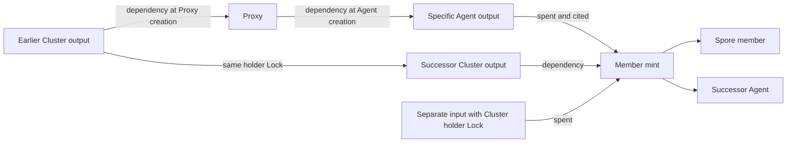

# Which Cell authorized a Cluster member mint?

Four confirmed CKB testnet transactions minted a Spore member and spent a Cluster Agent. The wallet can now prove which previous output a named transaction spent. A caller can also require the exact collection version listed among its CellDeps. Both predicates use the existing witnessed Type history bundle. [Public histories, requests and results](https://github.com/a19q3/stem/blob/12338f2fea73c8df437694da473d08e950a0938b/research/spore-permit/upstream/collections/agent/public.json.xz) · [Upstream Proxy and Agent RFC](https://github.com/sporeprotocol/spore-contract/blob/9e577ea6b5f2fb9cbf555e9e86effcc037c78039/docs/RFC_PROXY_AGENT.md)

| Member mint height | Cluster creation | Proxy creation | Agent creation | Member transaction |
| ---: | ---: | ---: | ---: | --- |
| 12,888,196 | 12,888,170 | 12,888,174 | 12,888,181 | [383ae0aa](https://pudge.explorer.nervos.org/transaction/0x383ae0aa442440b3a53a0e220f9f0dbccdc15ce4bf58996f1f77d19eef90e42f) |
| 14,012,544 | 14,012,524 | 14,012,528 | 14,012,536 | [243ca823](https://pudge.explorer.nervos.org/transaction/0x243ca8230b0b1a928e33936d5bd4ac95e10fd9d9ec28188a7741f9ec81d7ba44) |
| 16,403,603 | 16,403,582 | 16,403,585 | 16,403,594 | [90623aff](https://pudge.explorer.nervos.org/transaction/0x90623aff43799446b98c6a7ea110d4e41462df449a256147f852c337b0d6edba) |
| 22,018,117 | 22,018,099 | 22,018,102 | 22,018,111 | [1f8b47ad](https://pudge.explorer.nervos.org/transaction/0x1f8b47ad0ee32b3c7287317e08303387e99e9bab40ac52cc0d43adece60c90a1) |

Each case has four proofs anchored at the member's creation block. Together they authenticate six path entries per case. The Agent history and the member history both include the mint. Each proof pins the executable data hash at every transition and starts at the selected birth OutPoint. The exact OutPoint matters because several Agents can represent the same delegation.



In each mint, the Agent data contained the Proxy Type hash, the Proxy data contained the collection ID, and the member's encoded Cluster ID matched. The original Agent Cell appeared both as a spent input and as a direct dependency. The referenced Cluster had a different holder Lock from the Agent. A separate spent input shared the Cluster holder's Lock. These records establish actual Agent use and leave open whether Agent authority alone suffices for that transaction. Proxy creation used an earlier Cluster OutPoint with the same holder Lock. Only the exact dependency identifies the version that transaction used. The collection-level Mutant case still requires a successful original-program mint with a populated collection registration.

At the four Agent creations the Proxy appeared as a CellDep. The creation transactions carried its Type in neither their inputs nor their outputs. In each authenticated Proxy, the eight-byte little-endian price suffix encoded 10 shannons. Reconciliation of every input and output at its holder Lock gave zero input capacity and 6,100,000,000 output shannons (61 CKB). The measured net credit includes the capacity occupied by the recipient Cell. The release contract compares the net capacity increase with the encoded minimum. This charge applies to Agent creation, which preceded the member mints in the table. [Release implementation](https://github.com/sporeprotocol/spore-contract/blob/9e8663b3ef6e277a58acca9f4f347e5dbf8d5c06/contracts/cluster_agent/src/entry.rs#L57-L83)

For two funded local settlements, the same verifier replayed the owner-authorized ordinary mint from each origin. The Stem-origin mint spent wallet output 6, and the CKB-origin mint spent wallet output 4. Each owner input shared its referenced Cluster's Lock. [Stem-origin mint](../issuance-deps/settlements.json.xz) · [CKB-origin mint](../settlements.json.xz)

## Replay

From the repository root, supply the release wallet. Offline replay checks all 16 public histories, the two local mints, and the rejection of a dependency-only Cell supplied as an input, duplicate input claims, the wrong path transaction and mismatched Lock, Type or data hashes. It also removes the optional input claim and compares the resulting wallet response with the previous format. Network collection requires an archival testnet RPC and a new output file. For independent chain authentication, compare each archived request's anchor with a trusted CKB header at the listed mint height. [Offline verifier](check.py) · [Read-only collector](public.py)

```sh
study=research/spore-permit/upstream/collections/agent
python3 "$study/check.py" --stem target/release/stem
python3 "$study/public.py" --stem target/release/stem --output /tmp/stem-agent-fresh.json.xz
```
