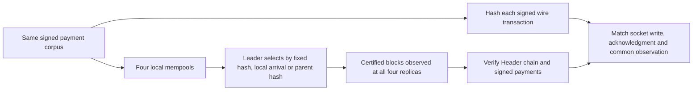

# Proposal order under sustained payment load

The ordinary Jolteon proposer starts at the lowest key in its local mempool. The key is the CKB BLAKE2b digest of the complete signed transaction. In two earlier overload runs, the lowest hash band's median write-to-common latency was 3.44 and 3.88 seconds. The highest band's median was 91.99 and 91.30 seconds. Each band covers roughly one tenth of the first digest byte's range. This pattern motivated two changes to *local proposal selection*. Validators executed the proposed sequence under the same protocol in all runs. [Earlier payments regrouped by digest](previous.json) · [Earlier signed archives](../patricia-finishing/network/)

- **Local arrival** uses a linked hash map in each validator's admission order. A duplicate or relay retry retains its original position. Network delivery can give each proposer a different local order. [Candidate and regression test](arrival.patch)
- **Parent hash** keeps the ordered map. It starts at the first key at least as large as the certified parent's Header hash, then wraps once to the beginning. Every proposer can compute the same starting key for that parent. Its set of locally available requests can differ. [Candidate and regression test](parent.patch)



## Seven runs at 3,000 scheduled writes per second

Each run used the same 360,000 signed payments, a 120-second offer and a 45-second drain. The table follows physical run order. The middle fixed run serves as the closing control for local arrival and the opening control for parent hash. The pending column counts successful acknowledgments whose payments had yet to appear at all four replicas by exactly 165 seconds. Latency starts at the socket write and covers acknowledged payments visible by that deadline. [Arrival counts and per-payment comparisons](network/results.json) · [Parent-hash counts and per-payment comparisons](rotate/results.json) · [Arrival order and latency populations](network/ordering.json) · [Parent order and latency populations](rotate/ordering.json)

| Proposal order | Writes by 120 s | Acknowledged in total | Common by 120 s | Common TPS | Pending at 165 s | Median (s) | p99 (s) |
| --- | ---: | ---: | ---: | ---: | ---: | ---: | ---: |
| Fixed | 360,000 | 351,332 | 267,742 | 2,231.18 | 0 | 4.15 | 134.94 |
| Arrival | 360,000 | 351,912 | 229,410 | 1,911.75 | 26,246 | 32.31 | 56.08 |
| Arrival | 359,877 | 353,545 | 231,870 | 1,932.25 | 31,563 | 30.98 | 57.01 |
| Fixed | 360,000 | 345,516 | 261,651 | 2,180.43 | 0 | 4.62 | 135.80 |
| Parent | 360,000 | 345,148 | 234,016 | 1,950.13 | 23,068 | 19.45 | 105.58 |
| Parent | 359,980 | 341,744 | 229,940 | 1,916.17 | 29,884 | 18.28 | 110.63 |
| Fixed | 360,000 | 339,401 | 248,263 | 2,068.86 | 5,122 | 5.16 | 139.75 |

Local arrival removed most of the hash-band skew. Its lowest and highest band medians differed by under 0.04 seconds in both runs. Those bands also contained thousands of acknowledged payments still pending at the deadline. The shorter conditional p99 comes with lower confirmation coverage. Even among the signed payments acknowledged and ultimately observed in both histories, local arrival raised the paired median latency by 18.69 and 16.67 seconds. Parent rotation raised it by 7.15 and 4.23 seconds. In the second rotation run a final 2,048-payment block entered the archive after the 165-second cutoff. The table excludes it. Each variant used the full signed corpus, with up to 123 writes landing after the offer window.

The parent-hash verifier rebuilt the parent ID from the previous certified Header and checked the exact circular ordering of the signed payments. All 161 and 160 multi-payment blocks followed that order. The three fixed controls had 178, 175 and 169 multi-payment blocks, all in ascending hash order. None of the 165 and 163 multi-payment blocks under local arrival was in fixed or parent-relative hash order. The proof archive authenticates the executed order. The fixture's local insertion unit test covers FIFO, duplicate admission, relay, expiry and removal. [Order analyzer](order.py) · [Test outputs](https://github.com/a19q3/stem/blob/12338f2fea73c8df437694da473d08e950a0938b/research/storage/admission-order/checks.json.xz)

## Six runs at 1,800 scheduled writes per second

Every run wrote all 108,000 signed payments within 60 seconds and all four replicas confirmed them within the 15-second drain. The two controls bracketed the four candidate runs. In this profile every acknowledgment contributes to the deadline-bounded latency population. [Local-arrival comparison](paced/results.json) · [Parent-hash comparison](paced-rotate/results.json) · [Arrival hash bands](paced/ordering.json) · [Parent hash bands](paced-rotate/ordering.json)

| Run order | Fixed | Arrival | Parent | Parent | Arrival | Fixed |
| --- | ---: | ---: | ---: | ---: | ---: | ---: |
| Common by 60 s | 106,921 | 107,062 | 107,073 | 106,771 | 107,165 | 106,914 |
| Common TPS | 1,782.02 | 1,784.37 | 1,784.55 | 1,779.52 | 1,786.08 | 1,781.90 |
| Write-to-common p99 (s) | 1.935 | 1.189 | 1.455 | 1.722 | 1.878 | 2.798 |

Local arrival gained 2.35 and 4.18 TPS against its two controls. Parent rotation gained 2.53 in the first comparison and lost 2.38 in the second. Both candidates shortened the p99 at this lower load. The node retains the fixed selection policy because the overload throughput losses ranged from 153 to 319 TPS and both alternatives left more accepted payments waiting at the cutoff. The fixed policy's long waits for high hash keys remain visible in the archived overload measurements.

## Proposer cost on the same block

The four-node counters reported aggregate proposal elapsed time of 184.6–196.8 µs per certified payment for the fixed controls, 233.6–234.6 µs for local arrival and 227.3–235.4 µs for parent rotation. These ratios include work on other proposals and empty blocks and normalize by the archived certified payment count.

A separate stock proposer built a 2,048-payment child on the same uncommitted 2,048-payment parent. Three traversal orders used exactly the same valid payments. A second pass in each order inserted one of the parent's already-spent payments before each valid payment. Every result matched the full selected byte sequence, execution Header and receipts of serial execution for its order. Each fresh process ran two warmups and twelve timed repetitions per condition in balanced positions. The timer covers selection, execution and block finishing. Building input lists, sorting keys, opening the database and checking the result are outside the timer. [Fixture](build-order.rs) · [All 168 samples and Header IDs](build-costs.json)

| Traversal order | All live, process 1 / 2 (ms) | One spent input per live payment, process 1 / 2 (ms) |
| --- | ---: | ---: |
| Ascending signed hash | 32.15 / 31.74 | 36.00 / 36.86 |
| Input index | 33.34 / 33.44 | 36.74 / 36.93 |
| Rotated signed hash | 32.71 / 31.85 | 36.57 / 35.97 |

Interleaving the 2,048 spent requests added 3.39–5.12 ms to the median build. Clean-block ordering alone moved the process median by at most 1.70 ms. This controlled fixture uses warm caches and independent inputs. The network evidence does not count how many already-spent requests each proposer inspected. Measuring that count would connect the isolated cost to actual consensus traffic.

## Local mempool costs

Two processes per implementation each filled and drained a pool twice, using the first 131,072 records of the high-load signed corpus. A fill inserted 65,536 signed payments (15,859,712 wire bytes). A scan measured 128 reads of the first 2,048 candidates. Removal alternated odd and even indices across the pool. All four processes used one pinned logical CPU, in fixed, arrival, arrival, fixed order. The linked map's peak process RSS was 44,360–44,412 KiB against 48,760–48,848 KiB for the tree. Its removal pass took 4.98–5.03 ms against 14.24–14.85 ms. Prefix scans took 0.53–0.77 ms and 0.51–0.55 ms respectively. These local savings coexisted with lower overloaded network throughput. [Per-round results and executable digests](costs.json) · [Linux test fixture](queue.rs)

## Mixed versions and replay

Each candidate ran beside the reference on a four-validator weighted network. Validator 0 was taken offline. The other validators kept finalizing, and all four agreed on the 96 payments after it resumed. Then every database was reopened by the other implementation, and a new signed payment spent one original output. Independent WASM replay verified the finality proof, the original Cell's inclusion and later absence, and the successor's inclusion and execution. The before/after heights were 16/18 for local arrival and 17/19 for rotation. [Arrival mixed run](https://github.com/a19q3/stem/blob/12338f2fea73c8df437694da473d08e950a0938b/research/storage/admission-order/mixed.json.xz) · [Rotation mixed run](https://github.com/a19q3/stem/blob/12338f2fea73c8df437694da473d08e950a0938b/research/storage/admission-order/mixed-rotate.json.xz) · [Restart and proof procedure](../patricia-finishing/README.md#reopening-stores-across-versions)

## Bounded priority for aged payments

`jolteon-aged-proposal-selection` lets the proposer visit at most 256 locally admitted transactions that have waited at least five seconds before resuming signed-hash order. Duplicate submissions preserve the first accepted time. A rejected candidate visit leaves the transaction eligible on subsequent branches. The Leader worker snapshots the same iterator used by synchronous proposal construction. The unit test checks the threshold, cap, order, duplicate admission, expiry and removal. The proposed transaction sequence continues to undergo ordinary execution and finality verification.

Both binaries use `bb24d2a`. The reference has no Cargo features and the candidate enables only the age-priority feature. Four validators used one physical Ryzen 9 7950X3D host with affinity `2-7,10-15,18-23,26-31`, while the driver used `0-1,16-17`. There were two VM workers per replica, 100 ms proposal cadence, 2,400 ms view timeout, 2,048 transactions and 4B cycles per block. Three nodes retained 64 heights and the fourth archived. One genesis and 198,000 signed payments were reused across the four runs. The offer was 3,300/s for 60 seconds, then 45 seconds to drain. Use the external driver with `prepare --rate 3300 --seconds 60 --drain 45 --senders 256 --ready-senders --block-transactions 2048 --block-cycles 4000000000 --complete-volume --reuse-submissions`. Restart with fresh stores for each run. [External driver procedure](../external/README.md)

| Run order | Writes by 60 s | Common TPS by 60 s | Peak acknowledged backlog | Pending at 105 s | p99 (s) | Common within 5 s |
| --- | ---: | ---: | ---: | ---: | ---: | ---: |
| Fixed A1 | 198,000 | 2,358.75 | 57,085 | 0 | 68.475 | 129,831 |
| Aged B1 | 198,000 | 2,398.87 | 55,796 | 0 | 52.822 | 121,333 |
| Aged B2 | 198,000 | 2,390.93 | 56,258 | 0 | 51.343 | 121,525 |
| Fixed A2 | 197,855 | 2,310.22 | 60,702 | 0 | 72.786 | 120,160 |

All four runs acknowledged and commonly confirmed all 198,000 payments by 105 seconds. A2 wrote its last 145 requests during drain. There were zero local timeout votes and zero full-mempool responses. Latency starts at the socket write and covers all 198,000 acknowledged payments in each run. The median delay in the highest signed-hash band fell from 44.57 to 34.07 seconds and from 49.12 to 32.39 seconds. The lowest band stayed at 3.11–3.20 seconds. Overall p99 fell by 22.9% and 29.5%, while the five-second confirmation count moved in opposite directions across pairs. Both candidate runs confirmed about 2,400/s during the offer and peaked above 55,000 pending. This load is a fairness comparison. Sustainable capacity and behavior with a persistent pool of stale aged transactions remain open. Keep the feature opt-in.

Independent offline replay checked the signed workload and each certified chain through its finality proof, across 1,052 archived blocks. The signed-hash order check covered all 104 multi-payment blocks in each fixed run. In the candidate runs 84 and 80 multi-payment blocks deviated from full hash order, and every suffix after position 256 retained that order. The replay authenticates the committed sequence. The local arrival times and precise promoted positions were checked by the mempool regression rather than observed on the network.

The signed workload BLAKE2b digest was `2648f0dfe05df043f10076522515bf8f43f3af940f5898d9c33a9bf883bba9c2`. SHA-256 fingerprints were `10a5e17c581d99dd0b24531973e955ee5fa362845eb936ec3a93cd6e053a3515` for genesis, `51db5b584f3dc310ef3b7af7fb8f6dfa488b181fa00b6ee5ecc08881884baa13` for the fixed binary, `43b3b8f59f8b7acd028ff84898e31a4aa33c650b2b651a191ed5262c57bfcd86` for the aged binary and `19b9d5aef2f17d5391a2a3e1e2eec3ab429d26b93bf11bffdea0eee3ef806479` for the independent replay harness.

### Age priority with Cell subtrees and the larger cache

Build both nodes from `4c50f7a` with `native-cell-subtree-parallel`. Enable `jolteon-aged-proposal-selection` only in the aged build. Both runs used 65,536 verification entries per validator and the [same single-host payment profile](../../patricia/README.md#cell-subtree-and-verification-cache-matrix). The aged build ran first. Each run started with fresh stores, the same genesis and the same 720,000 signed payments. The software offered 3,000/s with 60 seconds of warmup, 180 seconds of measurement and 45 seconds of drain.

Regenerate the workload with `drive.py prepare-v1 --profile sustainable`. Keep the topology pinned and set `verification_cache_entries` in each local node configuration. Replay both archives with `drive.py verify` and score the post-warmup observations with the unchanged sustained-profile bounds. For each signed-hash band, include only measurement writes that were acknowledged. Compute latencies on the subset that commonly confirmed by drain and retain the pending count separately. [Driver and replay](../external/README.md#measure-and-replay)

| Post-warmup metric | Fixed hash order | Bounded age priority |
| --- | ---: | ---: |
| Common TPS | 2,742.77 | 2,935.47 |
| Common confirmations by minute | 168,067 / 155,648 / 169,984 | 178,176 / 176,128 / 174,080 |
| Measurement writes without ACK | 0 | 0 |
| Peak acknowledged backlog | 58,723 | 28,465 |
| Backlog growth | 46,534 | 11,873 |
| Pending at drain | 0 | 0 |
| Write-to-common p99 | 152.772 s | 38.729 s |
| Lowest signed-hash band p99 | 7.142 s | 5.865 s |
| Highest signed-hash band p99 | 186.043 s | 43.847 s |
| Total validator CPU | 1,363.06 s | 1,354.96 s |

Each run wrote, acknowledged and commonly confirmed all 720,000 payments. Independent replay authenticated 1,226 observed blocks and both terminal proofs. All 377 fixed-order blocks with multiple payments strictly followed signed-hash order. In the aged build, 290 of 375 multi-payment blocks deviated from full hash order. Every suffix after position 256 retained strict hash order. The archive authenticates the committed sequence. Local arrival times determine eligibility and are outside this replay.

The aged build confirmed 7.0% more payments in the measurement window. In the exact cohort of 540,074 measurement writes acknowledged and confirmed in both, p99 fell by 74.6% from 152.772 to 38.729 seconds. The highest hash band contributed 40,753 acknowledged measurement payments confirmed by the end of the offer, compared with 7,471 under fixed order. Both runs missed the 3,000 TPS floor, 5 s p99, and the backlog peak and growth bounds. The pair ran in only one order, so repeat with fixed order first before selecting a default.

In the new Cell-phase histograms Patricia traversal, reads, node hashing and journal assembly accounted for 93.7–94.1% of the measured mean Cell commitment across the two roles and two builds. The fixed and aged Leader tree phases averaged 70.70 and 58.29 ms. The respective Follower means were 79.79 and 65.45 ms. These distributions include different block counts and sizes across runs. [Cell-phase counter definitions](../../execution-pipeline/README.md#cost-of-selecting-and-committing-ordinary-payments)

SHA-256 values were `f3070213b430826a1dbf89daa0d4c1eade7e2bf553682842595537a1c79331d4` for fixed, `bbb8f3cbd95e0672457894dcfd0bf076579a01f103e156070eb4d44c36bdccc0` for aged, `5da8acad0f553e78143b3d30f86c81749bbcf57d78fa92a1db59d19f04a9903c` for the driver and independent replay harness, and `2fb0207c35b3416b36fde01361966c2bc09dbbdfb3806061fd1e7004558d4cbe` for genesis. The signed workload BLAKE2b digest was `5ecfc85a430edd167c04f6b568235785ddf6fb61d5dad6b89fec3328f1985939`.

#### Reverse-order sustained comparison

Run fixed order first and age priority second using the same binaries, genesis and signed corpus. The repeat changed the four loopback ports and reused the same CPU placement and retention. Both runs wrote 720,000 payments. The fixed-order run acknowledged and confirmed 712,174. The aged run acknowledged and confirmed all 720,000. Independent replay authenticated another 1,239 observed blocks and both terminal proofs, bringing the total across the two pairs to 2,465 blocks.

| Post-warmup metric | Fixed hash order | Bounded age priority |
| --- | ---: | ---: |
| Common TPS | 2,510.89 | 2,998.74 |
| Common confirmations by minute | 152,952 / 155,648 / 143,360 | 174,051 / 189,644 / 176,079 |
| Measurement writes without ACK | 7,826 | 0 |
| Peak acknowledged backlog | 87,145 | 25,653 |
| Backlog growth | 80,171 | 4,322 |
| Pending at drain | 0 | 0 |
| Write-to-common p99 | 166.778 s | 20.033 s |
| Lowest signed-hash band p99 | 7.175 s | 6.367 s |
| Highest signed-hash band p99 | 186.145 s | 22.722 s |
| Total validator CPU | 1,442.71 s | 1,257.37 s |

Aging raised common throughput by 19.4% in the reverse pair, following a 7.0% increase in the first pair. For the same 532,174 measurement writes acknowledged and confirmed in both reverse runs, p99 fell from 166.778 to 20.058 seconds. The aged run commonly observed 539,774 payments in 180 seconds, 226 below the target. It passed the write, acknowledgment and drain checks. The throughput, peak backlog, backlog growth and latency gates remained open. Keep the lane opt-in while testing additional capacity and tails.

The fixed build's 385 multi-payment blocks all followed complete signed-hash order. In the aged build 158 of 442 multi-payment blocks deviated from that order, and all suffixes after position 256 preserved it. The Patricia tree phase remained the largest Cell commitment cost. Mean Leader and Follower tree time was 96.68 and 106.53 ms in fixed order and 45.48 and 52.88 ms with the age lane. Block counts and sizes varied between runs.

#### 131,072-entry cache probe

One further run retained the aged binary, identical genesis, 720,000-payment corpus and two VM workers per node. Only the verification cache capacity increased to 131,072 entries and fresh loopback ports were allocated. All writes received successful acknowledgments and commonly confirmed by drain. Independent replay authenticated 804 observed blocks and the terminal proof.

| Post-warmup metric | 131,072 entries with age priority |
| --- | ---: |
| Common TPS | 2,973.43 |
| Common confirmations by minute | 176,125 / 184,524 / 174,568 |
| Measurement writes without ACK | 0 |
| Peak acknowledged backlog | 17,985 |
| Backlog growth | 5,392 |
| Pending at drain | 0 |
| Write-to-common p99 | 6.554 s |
| Lowest signed-hash band p99 | 4.852 s |
| Highest signed-hash band p99 | 9.075 s |
| Total validator CPU | 1,258.81 s |

The p99 population included 539,894 measurement payments. All four caches reached capacity. The observed cache hit fraction was 39.44%, with zero wrong-parent misses in this payment corpus. Compared with the prior two aged runs at 65,536 entries, this run had the lowest tail and peak backlog, and throughput fell between them. It missed the sustained throughput, backlog peak, backlog growth and 5 s p99 gates. One run warrants a matched repeat while preserving the existing cache default.

#### Matched capacity comparison

One pair ran the 131,072-entry cache first and the 65,536-entry cache second. Both used the same node and harness builds, parallel Cell commitments, age-priority selection, two VM workers per node and the same 720,000 signed payments. Four loopback validators ran on one physical host. The driver offered 3,000 payments/s with 60 seconds of warmup, 180 seconds of measurement and 45 seconds of drain. Both runs acknowledged and commonly confirmed all payments by drain. Independent replay authenticated 768 and 531 observed blocks and both terminal proofs.

| Post-warmup metric | 131,072 entries | 65,536 entries |
| --- | ---: | ---: |
| Common TPS | 2,979.33 | 2,756.89 |
| Common confirmations by minute | 172,551 / 187,252 / 176,476 | 156,272 / 167,936 / 172,032 |
| Write-to-common p99 | 7.274 s | 99.213 s |
| Peak acknowledged backlog | 13,845 | 57,575 |
| Backlog growth | 7,616 | 44,000 |
| Pending at drain | 0 | 0 |
| Cache hit rate | 39.72% | 33.49% |
| Wrong-parent cache misses | 0 | 0 |
| Total validator CPU | 1,278.65 s | 1,357.51 s |

The larger cache raised common throughput by 8.1% in this pair. Among the 539,990 measurement payments acknowledged and confirmed in both runs, p99 fell from 99.215 to 7.274 seconds. The larger cache passed the 15,000 peak limit and missed the 3,000 TPS, 5 s p99 and 3,000 backlog growth gates. The earlier larger-cache probe reached 2,973.43 TPS with 6.554 s p99. Earlier 65,536-entry runs performed better than this control. The single matched run order and variation across controls limit attribution, so the cache default stays in place.

#### Five-second and two-second age thresholds

One pair changed only `PROPOSAL_PRIORITY_AGE` from five to two seconds at `4c50f7a`. Both used a 131,072-entry verification cache, parallel Cell commitments, two VM workers per node and at most 256 priority visits per proposal. The five-second control ran first on the same four loopback validators with the same prepared genesis and signed workload as the capacity comparison. The 3,000/s offer had 60 seconds of warmup, 180 seconds of measurement and 45 seconds of drain. Both runs wrote, acknowledged and commonly confirmed all 720,000 payments by drain. Independent replay authenticated 693 and 618 observed blocks and the two terminal proofs.

| Post-warmup metric | 5 s threshold | 2 s threshold |
| --- | ---: | ---: |
| Common TPS | 3,003.36 | 2,844.92 |
| Common confirmations by minute | 178,108 / 174,080 / 188,416 | 157,781 / 172,032 / 182,272 |
| Write-to-common p99 | 41.427 s | 75.540 s |
| Peak acknowledged backlog | 27,553 | 40,255 |
| Backlog growth | 7,727 | 30,049 |
| Pending at drain | 0 | 0 |
| Total validator CPU | 1,300.68 s | 1,323.31 s |
| Per-validator peak RSS | 327.7–329.9 MiB | 338.4–341.8 MiB |

The five-second run exceeded 540,000 common confirmations over 180 seconds. Its second minute missed the 177,000 minimum, so it also failed the sustained throughput gate. Both runs exceeded the tail and backlog limits. For the same 539,904 measured payments acknowledged and confirmed in both runs, p99 rose from 41.428 to 75.540 seconds with the shorter threshold. In the two runs, 303 of 378 and 316 of 381 multi-payment blocks departed from full hash order, and the suffix after position 256 remained hash-ordered. Block contents and sizes varied, and this block observation does not measure how many priority visits were used.

The earlier five-second run with the same cache had 7.274 s p99. The variation across five-second runs and the single run order limit attribution. Retain the five-second threshold in the opt-in feature. Measure headroom at a lower offer and record priority visits and accepted transactions before tuning the visit budget. The signed workload identifier was `5ecfc85a430edd167c04f6b568235785ddf6fb61d5dad6b89fec3328f1985939`.

#### Lower-offer headroom

The 2,700/s and 2,850/s runs kept the five-second priority threshold, 256-visit cap, 131,072-entry cache, parallel Cell commitments and two VM workers per validator. The same four loopback validator roles and CPU placement used fresh ports and a deterministically prefunded workload sized for each offer. The driver kept the 60/180/45-second warmup, measurement and drain settings. Each run was scored at its configured offer with the same latency and backlog limits.

| Post-warmup metric | 2,700/s offer | 2,850/s offer |
| --- | ---: | ---: |
| Common TPS | 2,711.78 | 2,841.61 |
| Common confirmations by minute | 165,612 / 159,794 / 162,714 | 168,422 / 170,988 / 172,080 |
| Write-to-common p99 | 4.337 s | 5.550 s |
| Peak acknowledged backlog | 12,393 | 13,711 |
| Backlog growth | 2,146 | 2,608 |
| Pending at drain | 0 | 0 |
| Measurement writes without ACK | 0 | 0 |
| Total validator CPU | 1,164.68 s | 1,232.85 s |
| Per-validator peak RSS | 287.7–301.9 MiB | 303.7–319.2 MiB |

The 2,700/s run passed every check. The 2,850/s run passed both backlog checks and each minute's floor. It was 1,510 confirmations short of the 513,000 total and missed the 5 s p99 gate. The p99 populations included all 486,000 and 513,000 measurement writes. Independent replay verified all 648,000 and 684,000 payments, 935 and 866 observed blocks, and the terminal proofs at heights 1,248 and 1,216. The workload identifiers were `79150db215f1c5fa4d982a6b80cbf7d6371c1153de46596e687f401be4caf266` and `ded41954e6a5798d3c6a105af2a164c063f21bd11f7f36153e579233bf83c6c6`.

## Reproduction

These four RocksDB validators shared twelve physical cores and their SMT siblings on a Ryzen 9 7950X3D. Two separate cores ran the driver. Three validators retained 64 heights and the fourth archived the full chain. All stores shared the same two-device Btrfs volume. The CPU observer, archive repacking and other work on remaining cores shared the same memory and storage. The performance comparisons cover one machine. [Machine and storage layout](../proposal-cadence/nvme/README.md) · [Validator and driver commands](../external/README.md)

Build the stock node at `7e480b4`. In two other checkouts of that revision, apply the corresponding candidate patch. Build all three with `CXXFLAGS='-include cstdint' cargo build --release --locked --bin stem`. Use the published 100 ms topology, two VM workers, 2,048 transactions and four billion cycles per block. The prepared 256 senders use persistent connections. Each report includes the driver and node fingerprints. Verify each archived payment stream against the prepared genesis, regenerated signed transactions, certified Headers and sampled receipt proofs with the separate stock verifier. All thirteen archives passed independent replay. [Verifier output by run](https://github.com/a19q3/stem/blob/12338f2fea73c8df437694da473d08e950a0938b/research/storage/admission-order/replays.json.xz) · [Topology](../proposal-cadence/100ms-peers.json) · [Receipt crossover replay example](../receipt-crossover/README.md#reproduction)

```sh
study=research/storage/admission-order
driver=research/storage/external/drive.py
python3 "$driver" --harness "$harness" --contracts "$contracts" prepare \
  --trial "$trial" --topology research/storage/proposal-cadence/100ms-peers.json \
  --rate 3000 --seconds 120 --drain 45 --block-transactions 2048 \
  --block-cycles 4000000000 --senders 256 --ready-senders --reuse-submissions --complete-volume
python3 "$driver" --harness "$stock_verifier" --contracts "$contracts" verify \
  --trial "$trial" --report "$study/network/a1/payments.json.xz"
python3 research/storage/receipt-crossover/analyze.py "$study/network" --labels fixed arrival
python3 "$study/order.py" --workload "$workload_bin" "$study/network"/{a1,b1,b2,a2}
node research/storage/patricia-finishing/reopen.mjs "$sdk" "$study/mixed.json.xz"
node research/storage/patricia-finishing/reopen.mjs "$sdk" "$study/mixed-rotate.json.xz"
```

Repeat with `--rate 1800 --seconds 60 --drain 15` for the smaller workload. The timed driver leaves the length-prefixed signed `workload.bin` in its measurement directory. The same deterministic corpus can be regenerated with the same genesis and preparation parameters. The analyzer checks its digest before matching payments. For `rotate` and `paced-rotate`, use the labels `fixed parent`. Shared controls link to their original run directories.

For the fixed-block cost, copy this study into the reference checkout, apply [the test harness patch](build-order.patch), and build the release `native_store` integration-test executable. Pass that binary to `taskset -c 0,1 python3 "$study/build-cost.py" --binary "$test" --contracts "$contracts" --output /tmp/stem-proposal-order.json`. [Measurement runner](build-cost.py)

For the local mempool measurements, copy `queue.rs` to `tests/mempool_observer.rs` in the stock and arrival checkouts. Build each with `cargo test --release --locked --test mempool_observer --no-run` and retain both test executables. Run `taskset -c 0 python3 "$study/cost.py" --reference "$stock_probe" --candidate "$arrival_probe" --workload "$workload_bin" --output /tmp/stem-mempool-cost.json`. Peak RSS uses Linux child resource accounting. The per-round RSS snapshots come from procfs. [Measurement runner](cost.py)
