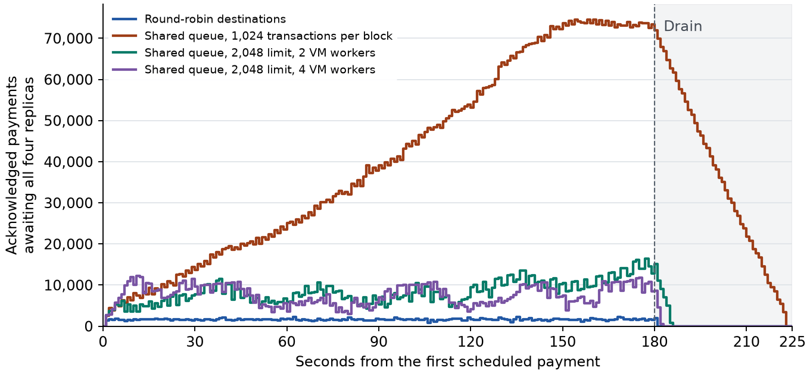
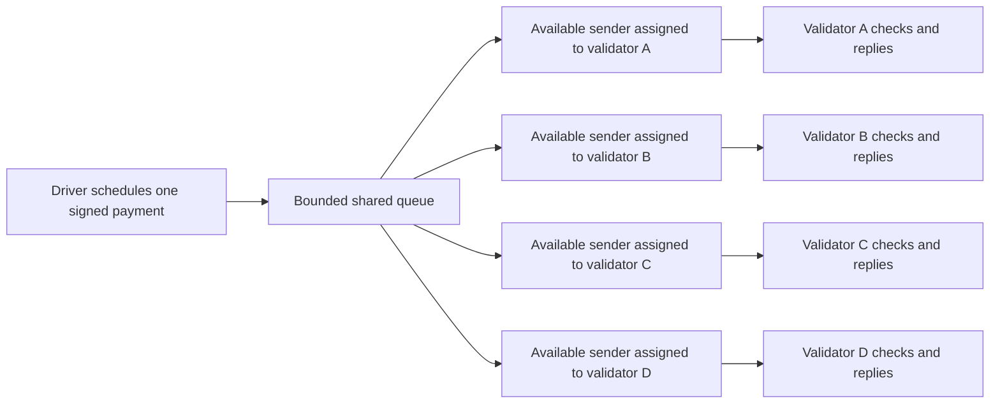

# Payment dispatch, block capacity and VM concurrency

Four disk-backed Jolteon replicas processed the same corpus of 540,000 funded, independently signed payments. The experiment changed how a ready client chooses a validator, then varied the capacity available to commit those payments. Each measurement used 180 seconds of scheduled load followed by 45 seconds of drain. Stock blocks allow 1,024 transactions and two billion cycles. Wide blocks allow 2,048 transactions and four billion cycles.

| Mode | Socket writes | Rejected by full mempool | Acknowledged and confirmed by end | Common in 180 s | Window TPS | Write-to-common p99 |
| --- | ---: | ---: | ---: | ---: | ---: | ---: |
| [Round-robin, stock, 2 workers](round-a.json.xz) | 333,950 | 0 | 333,950 | 331,926 | 1,844.03 | 2.24 s |
| [Fixed senders, stock, 2 workers](ready-a.json.xz) | 447,819 | 24,054 | 423,765 | 351,814 | 1,954.52 | 192.75 s |
| [Fixed senders, wide, 2 workers](ready-wide.json.xz) | 415,001 | 0 | 415,001 | 399,806 | 2,221.14 | 21.98 s |
| [Fixed senders, wide, 4 workers](ready-wide-4w.json.xz) | 406,292 | 0 | 406,292 | 397,606 | 2,208.92 | 14.89 s |

## Where the extra deliveries went

With stock block limits, assigning 16 senders to each endpoint delivered 19,888 more common confirmations by the deadline than the round-robin control. At 180 seconds, 71,945 acknowledged payments were still awaiting all four replicas. During the offer 342 of 345 nonempty blocks reached the 1,024-payment maximum. The nodes declined 24,054 distinct writes with a full-mempool response. Each signed transaction occupied 242 bytes. Two replicas sampled 69,327 pending transactions occupying 16,777,134 bytes, leaving 82 bytes of their 16 MiB budget. All accepted payments finalized during the offer or drain. [Stock fixed-sender counters](ready-a-counters.json) · [Round-robin counters](round-a-counters.json)

With 2,048 transactions and four billion cycles per block, the same delivery policy had 15,178 acknowledged payments outstanding at 180 seconds. All 415,001 writes received successful replies and finalized. The three minute counts were 134,667, 134,419 and 130,720. The profile changes count and cycle limits together, and has its own genesis ID. It produced greater common throughput and higher write-to-common p99 than round-robin delivery with stock limits. [Wider-profile counters](ready-wide-counters.json) · [Per-minute counts and timing stages](timings.json)



For each second the curve counts payments already acknowledged whose blocks have yet to appear on all four replicas. A payment first observed in a block before its client reply contributes zero backlog once acknowledged. The certified block archive supplies ordered payment positions. All latency observations use the driver's monotonic clock. [One-second samples](backlog.csv) · [Recompute the series](backlog.py) · [Render the figure](plot.py)

The two wide-profile trials have the same genesis, sender allocation, CPU affinity, inputs and limits. Increasing VM workers from two to four per replica changed mean cumulative candidate-verification time per validator from 60.05 to 56.96 seconds. Dividing those stage totals by the common confirmations over offer plus drain gives 144.7 and 140.2 microseconds per finalized payment. The window count changed from 399,806 to 397,606. These are aggregate stage times between the before and after snapshots, including drain. The comparisons share one workstation and have one trial per configuration. [Four-worker counters](ready-wide-4w-counters.json) · [Execution stage and I/O records](runs.json)

At four workers the 180-second backlog fell to 8,678 payments and p99 to 14.89 seconds. Across all one-second-aligned 60-second intervals fully inside the offer, the two-worker wide profile reached 2,101.85–2,378.68 common TPS and the four-worker wide profile reached 2,127.32–2,373.12. The shorter tail in the four-worker trial and the similar throughput justify carrying both worker counts into a multi-host comparison. The full three-minute and rolling 60-second measurements remain below 3,000 TPS. To measure a sustained 3,000 common confirmations per second, allow headroom above 3,000 actual socket writes per second and publish admission, finality and backlog over the same clock interval. [Per-second counts](backlog.csv)

## Writes during offer and drain

The cgroup v2 counter covers both block devices and all four validators plus their driver. The per-payment figure divides the bounded 225-second device total by the payments finalized on all four replicas. RocksDB WAL counters come from each validator and are summed separately. Values use decimal GB and kB. [Raw device samples](io-samples.json.xz) · [Integer byte bounds](device-bounds.json)

| Mode | Device writes, GB | Device kB per finalized payment | RocksDB WAL, GB | WAL syncs |
| --- | ---: | ---: | ---: | ---: |
| Round-robin, stock, 2 workers | 12.790–12.800 | 38.30–38.33 | 4.424 | 10,093 |
| Fixed senders, stock, 2 workers | 14.908–14.925 | 35.18–35.22 | 5.303 | 5,161 |
| Fixed senders, wide, 2 workers | 13.459–13.460 | 32.43–32.43 | 4.797 | 5,999 |
| Fixed senders, wide, 4 workers | 13.326–13.341 | 32.80–32.84 | 4.730 | 6,918 |

## Which delay the driver observed

The earlier 100 ms disk trial scheduled 540,000 independently signed payments and wrote 332,045. The four validators recorded a total of 9,068.283 seconds from receipt of a submission frame to the start of application handling and 66.062 seconds servicing those client requests. The load generator recorded 9,143.883 cumulative worker-seconds from socket write to reply. Server queue time accounted for 99.17% of the aggregate client wait. The four server queue sample counts matched all four client acknowledgement totals. The unit is wall time summed across concurrent requests. [Earlier payment archive](../proposal-cadence/nvme/nvme100.json.xz) · [Replica counters](nvme100-counters.json)

For each scheduled payment that did not reach a socket write, the analysis counted unfinished requests at its scheduled instant. A request contributes to an endpoint's count from its write time until its successful acknowledgement. In the historical trial, all 332,045 written requests had an acknowledgement. All 207,955 unwritten positions coincided with at least 60 of 64 senders awaiting replies. At 190,751 of those positions the quietest endpoint had at most three requests still awaiting acknowledgement. Each endpoint reached 64 concurrent submissions at some point. New trials record the instant the nonblocking enqueue reports a full queue and the reply time for explicit admission refusals. [Reconstruction](pressure.py) · [Timing results](pressure.json)



The existing shared-queue mode chooses the destination by signed-workload index modulo the validator count. The earlier sharded mode uses this same destination but gives each validator its own fixed queue. The experimental mode keeps the shared bounded queue and assigns equal numbers of senders to each validator. An available sender takes the next scheduled transaction and submits it once to its assigned endpoint. Every acknowledged payment still uses the ordinary network protocol, signature, state checks, block execution and four-replica finality.

A follow-up scheduled 4,000 payments per second with the wide block limits. It compared TCP reuse, twice as many sending threads, and pausing individual senders after a full-mempool reply. [CPU, queue and finality measurements](../submission-sessions/README.md)

## Reproduce

All four runs used a fresh database on the same two-NVMe Btrfs volume, the same 540,000 separately signed 242-byte payments and the same four public validator keys. The driver scheduled 3,000 payments per second for 180 seconds, using 64 senders and 64 pending queue slots. Three validators retained 64 heights and one served full history. All used a 100 ms proposal interval. The first three used two VM workers per replica, and the fourth used four. Validators shared twelve physical Ryzen 9 7950X3D cores, and the driver used two other physical cores. Proof processing used the remaining cores. The order was fixed senders with stock limits, round-robin with stock limits, then fixed senders with the larger block limits at two workers and again at four. All test traffic used the loopback interface. Each row represents one trial on this host. [Host and filesystem](../proposal-cadence/nvme/README.md) · [Public peer configuration](../proposal-cadence/100ms-peers.json) · [Binary and archive hashes](runs.json)

Build the release node and native-store test harness. Follow the external-driver instructions with `--rate 3000 --seconds 180 --drain 45 --senders 64` and the linked public peer configuration. For the fixed-sender runs add `--ready-senders`. For the larger profile also add `--block-transactions 2048 --block-cycles 4000000000` at preparation. Genesis changes with those block limits. For the final run set `vm_workers` to 4 in the public peer configuration before preparation. The signed workload commitment stays identical across profiles. Run the cgroup sampler around the local validator-and-driver launcher to collect device counters on the common clock. [Prepare, run and verify independently](../external/README.md) · [Device sampler](../proposal-cadence/nvme/device.py)

For each archive, `drive.py verify` with its matching prepared trial regenerates the payments, checks their ordered roots in successive Headers, verifies the final certificate and authenticates sampled executions against their Header. The receiving endpoint and observation timestamps come from the driver. In these controlled runs the per-endpoint write totals also match independently sampled server request counters. Replay rejected copies of the fixed-sender archive with either a missing endpoint or an out-of-range endpoint for a written payment. A previously published round-robin archive also replayed successfully with the updated harness.

```sh
d=research/storage/dispatch
python3 "$d/pressure.py" research/storage/proposal-cadence/nvme/nvme100.json.xz \
  "$d/round-a.json.xz" "$d/ready-a.json.xz" "$d/ready-wide.json.xz" "$d/ready-wide-4w.json.xz"
python3 "$d/backlog.py" "$d/round-a.json.xz" "$d/ready-a.json.xz" "$d/ready-wide.json.xz" "$d/ready-wide-4w.json.xz"
python3 research/storage/proposal-cadence/analyze.py \
  "$d/round-a.json.xz" "$d/ready-a.json.xz" "$d/ready-wide.json.xz" "$d/ready-wide-4w.json.xz"
python3 research/storage/proposal-cadence/nvme/device.py summarize --samples "$d/io-samples.json.xz" \
  "$d/round-a.json.xz" "$d/ready-a.json.xz" "$d/ready-wide.json.xz" "$d/ready-wide-4w.json.xz"
```
