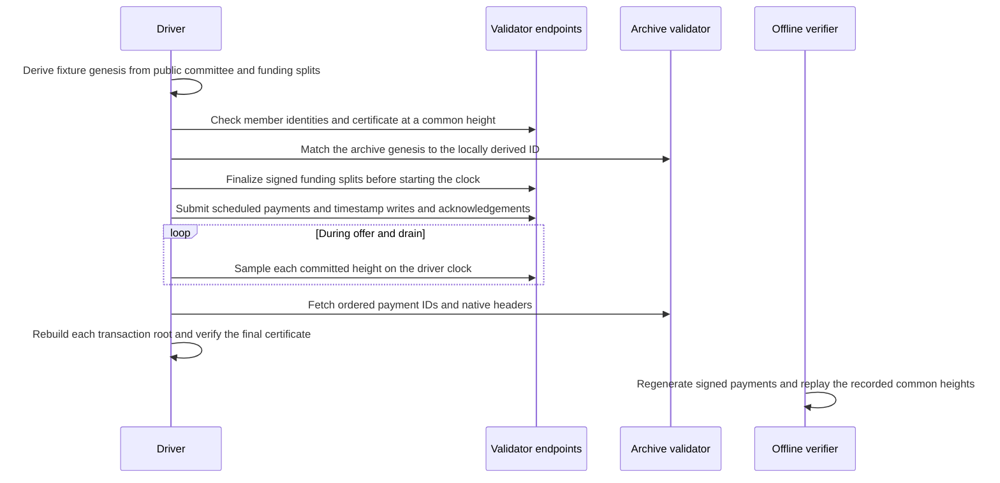

# Measure a Jolteon payment trial from a separate host

The existing funded-payment driver can prepare a transferable genesis and measure four or more independently started validators over their configured socket addresses. The same signed workload, paced dispatch, common-height observer and bounded drain are used in the local and external modes. Only the load-generator host runs the driver. Validators use their own operator-held Ed25519 keys. Development funding uses the benchmark's deterministic payment key. [Driver](drive.py) · [Experiment harness](../../../tests/native_store/storage_load.rs)



For the measured 3,000 TPS milestone, use the [physical-host qualification profile and acceptance command](qualification.md).

## Prepare the trial

Build the release node and integration harness. Build `stem-lock` with the contract flags used by the repository. Record the release revisions and binary hashes, per-host core and disk allocation, and which host runs the load generator. Each node operator supplies the public key and reachable Jolteon socket address for its own validator. The standard Jolteon `replicas.json` places peers in ascending key order and contains `vm_workers`, `proposal_interval_ms` and `view_timeout_ms`. The last endpoint serves archive history. [Node operations](../../../OPERATIONS.md) · [Existing single-host protocol](../sustained/README.md)

```sh
cargo build --release --locked --bin stem
cargo test --release --locked --test native_store --no-run
RUSTFLAGS='-C passes=lower-atomic -C target-feature=-c' cargo build \
  --release --locked --manifest-path contracts/Cargo.toml \
  --target riscv64imac-unknown-none-elf --bin stem-lock
```

The test build prints the path of the `native_store` executable. Substitute that path for `$harness` and the RISC-V release directory for `$contracts` below. Prepare writes `genesis.json`, its locally derived ID, the public peer directory and the measurement settings into a new directory. The offer below schedules 540,000 payments from 2,110 signed splits. Choose the offer size before initializing the validator databases because funding inputs are part of genesis.

```sh
python3 research/storage/external/drive.py --harness "$harness" --contracts "$contracts" \
  prepare --topology replicas.json --trial trial --rate 3000 --seconds 180 --senders 64 --drain 45
```

Distribute the two public files `trial/genesis.json` and `trial/replicas.json` to the participant hosts. On each host start the node using its own key and a fresh database. For the last endpoint substitute `--archive` for `--history-window 64`. The storage metrics endpoint provides the before and after RocksDB counters. Record host resource statistics on the validator hosts when the experiment needs CPU, compaction or physical-device attribution.

```sh
stem run --initialize --home "$node_home" --configuration trial/replicas.json \
  --genesis trial/genesis.json --key-file "$validator_key" --history-window 64 --storage-metrics
```

The optional `--block-transactions` and `--block-cycles` settings are part of genesis. A different profile requires fresh validator databases. `--senders` and `--shard-senders` apply to the client. Per-endpoint pools divide the same sender count and bounded queue capacity equally among the replicas. The sender count must divide evenly across the configured peers in this mode. With `--ready-senders`, each endpoint still gets the same number of senders, but every sender takes its next payment from one shared queue after finishing the preceding request. The driver records the actual destination for every socket write. An unsuccessful reply is recorded separately from admission, and the driver never retries a written payment on another endpoint. The two sender options are mutually exclusive. [Disk-backed dispatch and capacity trials](../dispatch/README.md) [Measured cadence, capacity and client configurations](../proposal-cadence/README.md)

With `--reuse-submissions`, a sender can reuse its TCP connection across consecutive requests. With `--pause-on-full`, an explicit full-mempool reply pauses the affected sender for one proposal interval, capped at the remaining dispatch time. The driver continues to schedule new payments and records each paused interval. Both options are opt-in. [TCP session and overload measurements](../submission-sessions/README.md)

## Measure and replay

Once every validator has finalized at least three blocks, start the driver. It checks the genesis and committee before submitting funding transactions. The raw output includes socket stages, acknowledgements, per-replica height samples, storage metrics and the finality proof. The archive validator serves the block history over the network. The driver does not need a local replica database or the operators' private keys. An interrupted measurement that already spent fixture inputs requires a fresh trial database to repeat that workload.

```sh
python3 research/storage/external/drive.py --harness "$harness" --contracts "$contracts" \
  measure --trial trial --output measurement
python3 research/storage/external/pack.py measurement/stem-storage-*/report.json report.json.xz
python3 research/storage/external/drive.py --harness "$harness" --contracts "$contracts" \
  verify --trial trial --report report.json.xz
```

Replay runs with the validators stopped. It regenerates the exact signed bytes and workload digest, checks each payment list against its native transaction root, follows every Header to the pinned committee's certificate, and recomputes writes, acknowledgements, common confirmations and offer-window TPS. On new runs the archive also supplies paired transaction and execution-receipt proofs for up to three payments from one nonempty block after the midpoint. Both measurement and replay match them to the Header and the signed payment position. The timestamps and per-replica heights come from the driver. A certificate authenticates a block, while timing accuracy depends on the observer's polling cadence and RPC latency. When present, the compact socket trace identifies fresh connections, reused connections and payments without a connection. Replay checks that every written payment has a connection and that the reuse count matches the prepared mode. It also checks the recorded rate, windows, sender count and dispatch options against the prepared trial. Previously published archives can omit the socket trace. External mode leaves the per-snapshot PID resource array empty. Distinct socket addresses establish connectivity. Identifying physical hosts and their storage devices requires the deployment inventory.

## Workstation rehearsal

All four validators and the driver ran on one workstation with shared memory and storage. The three-minute run assigned twelve physical cores and their SMT siblings to validators, and two other cores to the driver. Small integration checks and builds used the remaining cores during part of the run. All four endpoints had different loopback addresses, three validators retained 64 heights and the fourth served the complete archive. Host PID samples were empty on the driver, and the four remote storage queries supplied per-node RocksDB counters. [Recorded genesis IDs, process settings and storage deltas](runs.json)

| Offer | Scheduled | Written and acknowledged | Common in offer | Common after drain | Common TPS in offer |
| --- | ---: | ---: | ---: | ---: | ---: |
| 100/s for 6 s, drain 5 s | 600 | 600 | 563 | 600 | 93.83 |
| 3,000/s for 180 s, drain 45 s | 540,000 | 361,707 | 309,720 | 361,707 | 1,720.67 |

The three minute windows contained 100,824, 105,472 and 103,424 common confirmations. The driver dropped 178,293 scheduled payments before writing. All successful acknowledgements reached common visibility, including 51,987 payments first observed during drain. The write-to-common p99 was 187.152 seconds across the completed transactions. The signed workload and 377 successive block headers replayed offline to certified height 521. A second run with 600 payments exercised the same verifier. [Three-minute evidence](https://github.com/a19q3/stem/blob/12338f2fea73c8df437694da473d08e950a0938b/research/storage/external/540k.json.xz) · [Small regression evidence](600.json.xz)

The live preflight rejected a different funded genesis and a swapped member address before funding. The offline controls independently changed the payment order, common observation clock, reported confirmation count, reported TPS, acknowledgement time and final certificate. Every altered report was rejected. The original local launcher also ran its 100-payment regression and generated its separate archive index proof. [Control results](controls.json)

To replay an archived trial, prepare the public configuration and workload size from the matching row. The large archive uses the three-minute command above with `--topology research/storage/external/540k-peers.json`. The smaller archive uses `600-peers.json`, `--rate 100 --seconds 6 --senders 64 --drain 5`. Pass the corresponding compressed report to `verify`. Both the preparation and verification steps work offline with built artifacts. Compare the derived genesis ID against the published value. The physical-host throughput experiment still requires separate load-generator and validator machines. [Large committee](540k-peers.json) · [Small committee](600-peers.json) · [Genesis commitments](runs.json)

## Single-host V1 profile rehearsal

The default release build of `c6acc29` ran four loopback validators on one Ryzen 9 7950X3D. The validators shared logical CPUs `2-7,10-15,18-23,26-31`, and the driver used `0-1,16-17`. Three validators kept 64 heights and one served archive history. The 100 ms proposal interval, 2,400 ms view timeout, two VM workers, 4B cycles and 2,048-entry block limits held throughout. Each fresh `prepare-v1` profile used 256 persistent senders, 60 seconds of warmup, 180 seconds of measurement, and 45 seconds of drain. The binary SHA-256 was `13a9c85315d8441f04dd9587f4ebbe39b109bd7b74c29379596fcfc0aee9e379`.

| Scheduled/s | Actual writes/s | Common TPS | Unacknowledged writes in measurement | Write-to-common p99 | Peak acknowledged backlog | Minute-boundary growth | Acknowledged pending at drain |
| ---: | ---: | ---: | ---: | ---: | ---: | ---: | ---: |
| 1,800 | 1,800.00 | 1,789.02 | 0 | 4.196 s | 9,068 | 4,261 | 0 |
| 3,000 | 3,000.00 | 1,956.98 | 164,584 | 197.811 s | 96,132 | 27,461 | 11,323 |
| 3,300 | 3,300.00 | 1,911.47 | 247,811 | 194.575 s | 100,722 | 8,164 | 9,208 |

All three runs wrote their entire signed corpus and passed offline replay. The 1,800/s run confirmed all 432,000 payments by drain. It fell short on the common confirmation rate, the 9,000 peak backlog limit and the 1,800 growth limit. The 3,000/s trial wrote 720,000, acknowledged 555,416 and confirmed 544,093. The 3,300/s trial wrote 792,000, acknowledged 543,593 and confirmed 534,385. The above p99 values use 324,000, 367,353 and 340,118 acknowledged measurement writes that became common by drain.

All unacknowledged writes in the high-rate runs received `mempool capacity exceeded`. The counts in the table cover only writes during measurement. The full 3,300/s run reported 248,407 such replies, including 596 during warmup. The 3,000/s and 3,300/s runs contained 255 and 257 blocks at the count cap. Across all three comparisons the exhaustive proposer recorded zero classified block-cycle VM rejections. This distinguishes the payment behavior from the earlier mixed-Type proposal stall. Local timeout-vote counts across the full trial were 8, 6 and 0, respectively. [Mixed-Type comparison](../../execution-pipeline/README.md#mixed-script-stall-reproduction-and-bounded-cycle-scan)

Use the [V1 presets](qualification.md) with four local endpoints and omit the physical inventory during preparation. Measure and replay using the external driver in the commands above. For this rehearsal, apply `qualify.score` to the verified packed report and the prepared `storage_settings`. Use the sustainable limits for 1,800/s and 3,000/s and the overload limits for 3,300/s. The physical-host qualification is deferred. The genesis JSON SHA-256 values were `0c5fb55fdba3f419ee17cee28c698ce1caa0d4b71715aba4de5c49d9ce498a02`, `2fb0207c35b3416b36fde01361966c2bc09dbbdfb3806061fd1e7004558d4cbe` and `33aa3e5c09e6354925729f61e154afb8b144bdc2ef538b0d92e8943bd0cb72c2` in run order.
