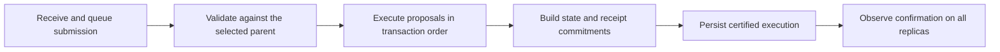

# Qualifying 3,000 common confirmations per second across physical hosts

Start with four separately operated physical validators and a fifth physical machine for the load generator. Pin the same Stem revision and contract digest on each host. Record the validator key and endpoint of each replica, CPU assignment, storage device and filesystem, retention mode, network RTT and bandwidth, and the driver host. Keep independent host inventory and the observer output with the packed archive. Four endpoints can share hardware, so the operators must verify the physical placement. [Existing driver and node setup](README.md#prepare-the-trial)

## Sustainable load and overload

Use independent ordinary prefunded payments, the released selection policy, a 100 ms proposal interval, 2,048 transactions and four billion cycles per block, and two VM workers. Three validators keep 64 heights and the fourth serves full history. Each first-profile run has 60 seconds of warmup, 180 seconds of measurement and 45 seconds of drain. The observer and the senders share the driver's elapsed clock. [Prior same-host profiles](../admission-order/README.md)

| Criterion | Sustainable 3,000 TPS | Overload at 3,300 TPS |
| --- | --- | --- |
| Scheduled writes | Exactly 3,000/s | 3,300/s for the first overload run |
| Four-replica common confirmation | At least 3,000/s averaged over measurement | At least 3,000/s averaged over measurement |
| Writes without a successful acknowledgment | At most 0.1% of measurement writes by default | Declare a bound before the run. Start with 10%. |
| Acknowledged backlog | Peak at most 15,000 and growth across minute boundaries at most 3,000 by default | Declare a peak bound before the run. Start with 15,000. |
| Write-to-common p99 | At most 5 seconds as the initial engineering target | Report it along with the population size. |
| Drain | All successful acknowledgments have common visibility by the deadline | Same requirement |

The default sustainable bounds of one second of backlog growth, five seconds of outstanding work and 5-second p99 are experimental service targets. Record any adjustment for network RTT or product requirements before measuring. The qualifier requires at least 99.9% of the scheduled writes over the full measured interval in both modes. At each minute boundary it allows up to one second of batching or observation skew for the write and common-confirmation targets. The whole-window common-confirmation threshold remains exact. A minute excludes its left boundary and includes its right boundary.

Growth is the largest increase between any earlier and later measurement minute boundaries, including the post-warmup starting boundary. Peak backlog uses every acknowledged and common-observation event during measurement so a transient buildup inside a minute still counts. A trial that admits 3,300/s and confirms 3,000/s adds 54,000 pending payments in three minutes. That exceeds the initial overload cap even if the trial drains completely in 18 seconds. The same run also fails the sustainable profile, which requires a 3,000/s schedule.

Prepare fresh funded state separately for each profile. `prepare-v1` fixes the workload and block settings for the 1,800, 3,000 and 3,300 TPS stages and checks the validator count, cadence and VM workers against the topology. Supply `--inventory` to validate and pin the operator's placement declaration at preparation. The general-purpose `prepare` command still accepts custom profiles.

```sh
external=research/storage/external
for profile in baseline sustainable overload; do
  python3 "$external/drive.py" --harness "$harness" --contracts "$contracts" prepare-v1 \
    --topology replicas.json --inventory inventory.json --profile "$profile" --trial "trial-$profile"
done
```

Launch one validator per host with its own key and a fresh database. Start the driver after all four report the expected genesis and make progress. Pack the measured report and run qualification with a separately built verifier and the same signed workload inputs. Keep the qualifier output for passing and failing runs. [Measure, pack and verify](README.md#measure-and-replay)

```sh
python3 "$external/qualify.py" --harness "$stock_verifier" --contracts "$contracts" \
  --mode sustainable --trial trial-sustainable --report report-3000.json.xz --inventory inventory.json \
  --target-tps 3000 --warmup-seconds 60 > qualification-3000.json
python3 "$external/qualify.py" --harness "$stock_verifier" --contracts "$contracts" \
  --mode overload --trial trial-overload --report report-3300.json.xz --inventory inventory.json \
  --target-tps 3000 --warmup-seconds 60 --max-pending 15000 --max-unacknowledged-bps 1000 \
  > qualification-3300.json
```

In `inventory.json`, provide `driver.physical_host` and a `validators` array in measured endpoint order. Each element contains `endpoint` and `physical_host`. Include hardware, binary digests and local monitoring data with the deployment record. The qualifier matches measured endpoints to the prepared peer list and inventory, checks that the declared hosts are distinct, and rejects loopback addresses. When preparation pins the inventory, supply the same file for qualification. Operator records establish physical placement.

Independent replay regenerates the signed workload and validates the chain and observation record. The qualifier then scores actual writes, recorded acknowledgments and the first common observation. The unacknowledged rate uses the cohort written during measurement and includes responses that never recorded success. That cohort supplies the latency population when a payment was acknowledged and commonly visible by the drain deadline. Report per-minute confirmations, acknowledgment counts, outstanding acknowledgments, losses before socket write and payments that finalized without a successful acknowledgment.

## Run order

1. Establish the cross-host baseline at 1,800 TPS with the sustainable profile. Prepare at 1,800/s and pass `--target-tps 1800`.
2. Qualify the sustainable 3,000 TPS profile with tails, backlog growth and drain verified.
3. Measure overload from 3,300 through 5,000 scheduled TPS. Declare the rejection and peak-backlog bounds for each offer. Keep the 3,000 TPS confirmation floor while finding saturation. A separate sustained 5,000 TPS claim requires its own matched-load qualification.
4. Use the observed bottlenecks to select an execution-pipeline change and compare it against the pinned baseline.
5. Challenge 10,000 sustainable TPS after extending the funding fixture and resource profile to support the workload.

## Which measurements justify a pipeline change



Before testing a pipeline candidate, retain per-node admission waits, proposal and follower verification elapsed time, commit time, WAL and compaction counters, and device and network samples. Where timing stages overlap, measure the overlap per replica. Existing counters provide a baseline without per-transaction logging. A later diagnostic can record actual attempts rejected because an input is already spent in the current uncommitted branch. Distinguish those from earlier transactions in the same block, unresolved dependencies and committed-state misses. The previous fixed-block experiment establishes the cost of a controlled number of spent inputs. The cross-host trial must establish their frequency. [Queue attribution](../queue-attribution/README.md) · [Fixed-block spent-input experiment](../admission-order/README.md#proposer-cost-on-the-same-block)

Carry forward one candidate at a time if the measurement supports it. Branch-aware selection needs exact parent binding, with skipped transactions eligible again when branches change. Deferred execution or Patricia work needs bounded queues and the same ordered inputs, execution result, state root, receipts and durable commitment as the reference. Test it on the same signed corpus, in reverse run order, and verify finality, mixed versions and restart before using the measured change to advance the throughput target. The independent consensus branch supplies separately evaluated candidates for verification scheduling, certificate reuse and dissemination. [Consensus experiment index](https://github.com/a19q3/stem/blob/7ea3d8d7367f80e5bd099ff093003175bad09890/research/README.md)

The cross-host results remain open pending experiments on the five physical machines.
