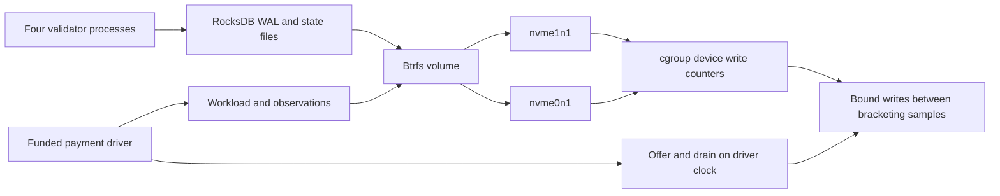

# Proposal cadence with four RocksDB replicas on NVMe

Does shortening the proposal interval still reduce payment backlog when each replica persists to disk? Four validators ran on one workstation. With the same 540,000 signed payments, 100 ms proposals delivered 26,972 more common confirmations before the three-minute deadline. The shorter interval also increased block-device writes and WAL syncs. Each interval ran once on disk. [250 ms payment archive](https://github.com/a19q3/stem/blob/12338f2fea73c8df437694da473d08e950a0938b/research/storage/proposal-cadence/nvme/nvme250.json.xz) · [100 ms payment archive](https://github.com/a19q3/stem/blob/12338f2fea73c8df437694da473d08e950a0938b/research/storage/proposal-cadence/nvme/nvme100.json.xz)

| Proposal interval | Socket writes, all acknowledged and finalized | Common in 180 s | Window TPS | First common during drain | Write-to-common p99 | Full / nonempty blocks in window |
| --- | ---: | ---: | ---: | ---: | ---: | ---: |
| 250 ms | 340,389 | 303,734 | 1,687.41 | 36,655 | 175.32 s | 296 / 297 |
| 100 ms | 332,045 | 330,706 | 1,837.26 | 1,339 | 2.24 s | 0 / 505 |

At 250 ms the driver dropped 199,611 scheduled sends before writing. At 100 ms it dropped 207,955. Both trials confirmed every socket write within the offer plus 45-second drain. The shorter interval accepted 2.45% fewer payments overall but delivered 8.88% more before the deadline. Its three successive one-minute counts were 109,335, 114,121 and 107,250. Median nonempty block size went from 1,024 to 663 payments. The two earlier tmpfs trials at 100 ms reached 2,079.95 and 2,099.64 TPS. Moving the databases and measurement files back to disk preserved the direction of the cadence result. The experiments ran sequentially and do not isolate the filesystem contribution to the difference between individual runs. [Timing stages and endpoint counts](timings.json) · [Matched tmpfs profiles](../README.md)

## What reached the devices

A Linux cgroup v2 scope contained all four validators, their driver and its child processes. A separate process sampled its cumulative block-device counters about every 250 ms. The two Linux devices below back the same Btrfs volume. Data used the single profile and metadata used DUP. Btrfs mounted the home subvolume with zstd level 1. Each table cell is the lower to upper bound in decimal GB, rounded to three decimal places. The JSON supplies the integer byte bounds and the distance of each sample from the boundary. [Raw cgroup samples](https://github.com/a19q3/stem/blob/12338f2fea73c8df437694da473d08e950a0938b/research/storage/proposal-cadence/nvme/io-samples.json.xz) · [Byte bounds](device-bounds.json)

| Interval | Device | Offer, 180 s | Drain, 45 s | Full 225 s |
| --- | --- | ---: | ---: | ---: |
| 250 ms | nvme1n1 (259:0) | 4.774–4.775 | 0.353–0.354 | 5.127–5.129 |
| 250 ms | nvme0n1 (259:1) | 5.893–5.900 | 0.466–0.466 | 6.359–6.367 |
| 100 ms | nvme1n1 (259:0) | 5.965–5.980 | 0.022–0.022 | 5.987–6.002 |
| 100 ms | nvme0n1 (259:1) | 6.430–6.443 | 0.225–0.227 | 6.655–6.670 |

Across both devices, the 225-second totals were 11.487–11.495 GB at 250 ms and 12.642–12.671 GB at 100 ms. RocksDB reported 4.259 and 4.400 GB of WAL writes across the four replicas, and 4,836 and 9,503 WAL syncs, respectively. The sampled flush-byte and compaction-byte ticker deltas were zero in both runs. These observations cover different layers. Device writes may include filesystem metadata, journals, other files from the measurement processes and delayed writeback. Device firmware writes and the distribution between individual validators are outside the scope of the samples. Longer experiments with captured SST files provide separate compaction evidence. [Per-replica RocksDB deltas, errors and artifact hashes](runs.json) · [Long-running SST evidence](../../sustained/README.md)



## Reproduce and verify

Use the funded-driver protocol with `--rate 3000 --seconds 180 --drain 45 --senders 64`. Use the matching public topology and a fresh on-disk data directory for each trial. Keep the stock 1,024 transaction and 2-billion cycle limits, two VM workers and the same allocation of twelve physical cores to the validators and two to the load driver. Three validators retained 64 heights and one retained archive history. Both runs used the release node with SHA-256 `e5d4c42bac89dbc3e7472f3428b8e5458d7377b892ff568577adb3911b6b92d6` on Linux 7.3.5-2-cachyos. Auxiliary work used the other two physical cores and shared the workstation's memory and cache. The 250 ms run preceded the 100 ms run. [External preparation and node commands](../../external/README.md) · [250 ms topology](../../external/540k-peers.json) · [100 ms topology](../100ms-peers.json)

Wrap the local launcher which starts the validators and driver with `device.py capture --output raw.json -- <launcher> <arguments>`. Both the launcher's databases and measurement output must reside on the filesystem being measured to match this experiment. On the measurement machine inspect the mount, the Btrfs member devices and the major/minor mapping. The first trial used a prototype of the same scope reader, and the second used the archived capture command. Both sampled the same kernel counter and data format. The following commands replay the published timing and I/O tables from the repository root.

```sh
d=research/storage/proposal-cadence/nvme
python3 "$d/device.py" summarize --samples "$d/io-samples.json.xz" \
  "$d/nvme250.json.xz" "$d/nvme100.json.xz"
python3 research/storage/proposal-cadence/analyze.py \
  "$d/nvme250.json.xz" "$d/nvme100.json.xz"
```

Run `drive.py verify` for each compressed payment archive against its prepared public trial. It regenerated the signed workload, checked the ordered blocks against the final committee certificate at heights 551 and 1,068 respectively, and verified three sampled native execution receipts per run. These two storage devices and all four replicas share one physical machine. Validation of sustained 3,000, 5,000 and 10,000 TPS still requires independently hosted replicas and a separate load-generator host.
