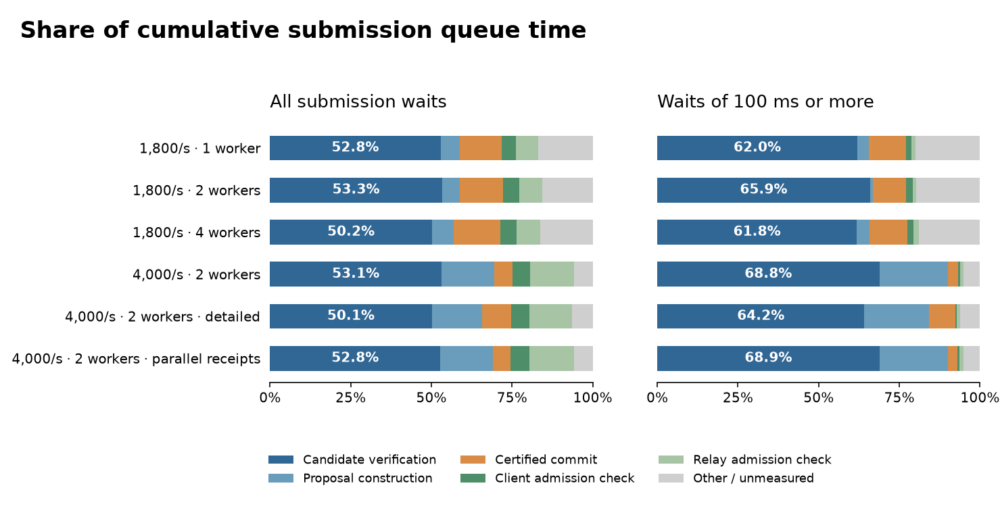
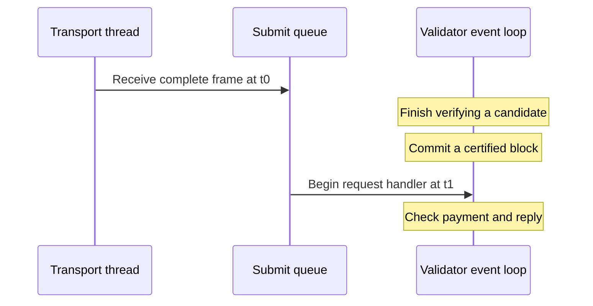

# Which replica work overlaps payment submission queues?

Four disk-backed Jolteon validators handled independently funded payments on one workstation. Earlier measurements located most of the socket reply delay before the replica dispatched a submit request. This study measures which event-loop operations were in progress during each request’s wait. [Previous submission-session experiment](../submission-sessions/README.md)

## Measured results

| Configuration | Writes by 180 s | Acks by 180 s | Common by 180 s | Common TPS | Common by 225 s | Write-to-common p99 |
| --- | ---: | ---: | ---: | ---: | ---: | ---: |
| [Stock, 2 workers](https://github.com/a19q3/stem/blob/12338f2fea73c8df437694da473d08e950a0938b/research/storage/queue-attribution/stock2/payments.json.xz) | 324,000 | 323,997 | 323,129 | 1,795.16 | 324,000 | 2.69 s |
| [Probe, 1 worker](https://github.com/a19q3/stem/blob/12338f2fea73c8df437694da473d08e950a0938b/research/storage/queue-attribution/trace1/payments.json.xz) | 324,000 | 323,983 | 323,003 | 1,794.46 | 324,000 | 3.34 s |
| [Probe, 2 workers](https://github.com/a19q3/stem/blob/12338f2fea73c8df437694da473d08e950a0938b/research/storage/queue-attribution/trace2/payments.json.xz) | 324,000 | 324,000 | 322,632 | 1,792.40 | 324,000 | 2.13 s |
| [Probe, 4 workers](https://github.com/a19q3/stem/blob/12338f2fea73c8df437694da473d08e950a0938b/research/storage/queue-attribution/trace4/payments.json.xz) | 324,000 | 324,000 | 323,184 | 1,795.47 | 324,000 | 2.46 s |
| [Overload, 2 workers](https://github.com/a19q3/stem/blob/12338f2fea73c8df437694da473d08e950a0938b/research/storage/queue-attribution/pressure2/payments.json.xz) | 645,857 | 439,442 | 343,009 | 1,905.61 | 420,833 | 196.29 s |
| [Overload, detailed probe, 2 workers](https://github.com/a19q3/stem/blob/12338f2fea73c8df437694da473d08e950a0938b/research/storage/queue-attribution/parts2/payments.json.xz) | 627,657 | 430,186 | 333,205 | 1,851.14 | 406,933 | 197.95 s |
| [Overload, parallel receipt experiment, 2 workers](https://github.com/a19q3/stem/blob/12338f2fea73c8df437694da473d08e950a0938b/research/storage/queue-attribution/paired2/payments.json.xz) | 642,486 | 440,338 | 343,230 | 1,906.83 | 423,102 | 196.48 s |

The four 1,800/s trials used identical signed inputs and the same genesis. The number of socket writes in each one-second bin and the scheduling delay through the socket write show how closely the driver reproduced the offered load. These times are measured at the driver. The transport-receive timestamps come from each validator.

| Configuration at 1,800/s | Seconds with exactly 1,800 writes | Minimum–maximum writes in a second | Schedule-to-write p99 |
| --- | ---: | ---: | ---: |
| Stock, 2 workers | 174 of 180 | 1,562–2,038 | 9,643 µs |
| Probe, 1 worker | 172 of 180 | 575–3,025 | 12,143 µs |
| Probe, 2 workers | 178 of 180 | 1,738–1,862 | 117 µs |
| Probe, 4 workers | 178 of 180 | 1,771–1,829 | 160 µs |

| Instrumented configuration | Mean submit queue wait | Node queue p99 range | Requests waiting ≥100 ms | Candidate share of all wait time | Candidate share of long wait time |
| --- | ---: | ---: | ---: | ---: | ---: |
| Probe, 1 worker | 24.78 ms | 194.6–243.4 ms | 24,346 | 52.84% | 62.00% |
| Probe, 2 workers | 21.69 ms | 137.3–141.8 ms | 17,876 | 53.30% | 65.93% |
| Probe, 4 workers | 23.13 ms | 159.5–177.7 ms | 21,974 | 50.19% | 61.82% |
| Overload, 2 workers | 21.48 ms | 522.8–536.9 ms | 22,014 | 53.15% | 68.80% |
| Overload, detailed probe, 2 workers | 22.79 ms | 522.9–549.6 ms | 22,581 | 50.13% | 64.17% |
| Overload, parallel receipt experiment, 2 workers | 21.89 ms | 526.2–535.0 ms | 22,156 | 52.77% | 68.86% |



At 1,800/s, two workers spent a mean 43.90 seconds per replica in candidate verification across the offer and drain. Four workers spent 42.99 seconds, while the number of requests waiting at least 100 ms grew from 17,876 to 21,974. The four-worker run confirmed 552 more payments by the offer deadline. Its end-to-end p99 was 2.46 seconds versus 2.13 seconds with two workers. One worker produced 24,346 waits of at least 100 ms and a 3.34-second end-to-end p99. The two-worker configuration had the shortest observed p99 among the three instrumented runs. Each configuration ran once. The uninstrumented two-worker control reached 1,795.16 TPS with a 2.69-second p99. Throughput and tail differences of this size need independent repeats before changing a node default.

Under overload, the driver scheduled 720,000 payments, wrote 645,857 and received 206,368 full-mempool replies. There were 74,143 scheduled payments without a socket write. The nodes acknowledged 439,489 including the last 47 responses after the offer. At the 225-second deadline, 18,656 acknowledged payments still lacked common visibility. The final certified archive includes one additional 2,048-payment block observed after that deadline. The latency percentile covers confirmed payments with an observed write. [Driver errors and node counters](pressure2/counters.json)

Only 2.52% of written requests began waiting during candidate verification in the overload run, yet 53.15% of cumulative wait time overlapped that phase. For requests waiting at least 100 ms, 68.80% of wait time overlapped verification and 21.27% overlapped proposal construction. The earlier uninstrumented run on the same signed 4,000/s workload reached 1,882.19 TPS against 1,905.61 here. These two runs also differed in actual write volume. [Earlier pressure control](../submission-sessions/README.md) · [Per-node spans, minute counts and driver timing](results.json)

## Inside follower candidate verification

A second overload trial used the same stock driver, funded corpus, block limits and two VM workers. It subdivided each follower verification into five contiguous intervals. The original verification histogram still measures the entire interval. The offline reader matches both endpoints and requires the measured subphases to sum exactly to the parent for total elapsed time, overlap with all waits and overlap with waits of at least 100 ms. [Additional research probe](candidate-parts.patch) · [Detailed counters](parts2/counters.json)

| Verification step | Elapsed across four replicas | Share of candidate elapsed time | Share of candidate overlap with all waits | Share of candidate overlap with long waits |
| --- | ---: | ---: | ---: | ---: |
| Decode candidate transactions | 1.168 s | 0.41% | 0.03% | 0.03% |
| Enter worker pool and open speculative branch | 0.010 s | 0.00% | 0.00% | 0.00% |
| Build transaction root, stage and verify transactions | 148.512 s | 52.17% | 50.98% | 50.99% |
| Finish state roots, receipts, history and write batch | 134.958 s | 47.41% | 48.99% | 48.98% |
| Return from worker pool | 0.008 s | 0.00% | 0.00% | 0.00% |

Block finishing constructs the speculative state and receipt commitments and assembles a future write batch. The later certified commit performs the durable database write. Transaction staging includes input resolution, resource accounting, overlay changes and VM verification. Its counter includes all of those activities. [Store preparation and finalization](../../../src/native_store.rs)

## Synchronous storage writes

The database counters below cover the interval between the driver’s before and after snapshots, including the drain. Write durations measure the RocksDB synchronous write call. Journal and finality writes have separate purposes. Finality sync is already part of the commit span. The WAL byte counter measures logical WAL writes across the four processes. The device-level and SST figures for this host are in the earlier disk study. [Storage counters](../../../src/native_store/storage_metrics.rs) · [Device write attribution](../device/README.md)

| Configuration | WAL (GB) | Journal sync calls | Journal sync mean time per replica | Finality sync calls | Finality sync mean time per replica |
| --- | ---: | ---: | ---: | ---: | ---: |
| Stock, 2 workers | 4.128 | 7,653 | 13.17 s | 3,916 | 11.86 s |
| Probe, 1 worker | 4.087 | 7,211 | 17.67 s | 3,608 | 12.15 s |
| Probe, 2 workers | 4.171 | 8,043 | 12.47 s | 4,072 | 11.05 s |
| Probe, 4 workers | 4.122 | 7,879 | 11.69 s | 3,968 | 11.68 s |
| Overload, 2 workers | 5.043 | 1,700 | 4.30 s | 848 | 5.98 s |
| Overload, detailed probe, 2 workers | 4.878 | 1,639 | 5.50 s | 816 | 11.85 s |
| Overload, parallel receipt experiment, 2 workers | 5.059 | 1,693 | 4.09 s | 846 | 6.02 s |

## Parallel receipt encoding experiment

The detailed control placed roughly half of candidate verification time in block finishing. A candidate used the existing VM worker pool to compute the receipt tree and serialized execution record concurrently with hashing and sorting the changed Cell records. The subsequent Patricia batch application and durable commit use the existing paths. The trial cutoff of 256 transactions restricts the extra work scheduling to larger blocks inside a pool with at least two workers. This affects both leaders building a block and followers verifying it. [Research patch](parallel-receipts.patch) · [Serial equivalence test](receipt-equivalence.rs)

| Measurement | Detailed control | Parallel receipt encoding |
| --- | ---: | ---: |
| Socket writes during offer | 627,657 | 642,486 |
| Common payments in each minute | 114,069 / 114,688 / 104,448 | 115,902 / 112,640 / 114,688 |
| Write-to-common p99 | 197.95 s | 196.48 s |
| Common window TPS | 1,851.14 | 1,906.83 |
| Acknowledged backlog at 225 s | 23,320 | 17,300 |
| Full blocks / blocks containing a payment in the certified archive | 196 / 202 | 204 / 209 |
| Blocks meeting the 256-transaction cutoff | 202 | 208 |
| Candidate preparation before block finishing, mean elapsed per validator | 37.13 s | 38.43 s |
| Candidate block finishing, mean elapsed per validator | 33.74 s | 35.00 s |
| Candidate block finishing, mean elapsed per validator per certified payment | 82.50 µs | 82.71 µs |

The verifier regenerated the signed payment corpus and checked each archive against its committee certificate. The two live runs had independent consensus schedules and different accepted and finalized sets. The final row divides all measured follower block-finishing time by four validators and the number of payments in the certified archive. It is an aggregate cost ratio. [Detailed control](https://github.com/a19q3/stem/blob/12338f2fea73c8df437694da473d08e950a0938b/research/storage/queue-attribution/parts2/payments.json.xz) · [Candidate run](https://github.com/a19q3/stem/blob/12338f2fea73c8df437694da473d08e950a0938b/research/storage/queue-attribution/paired2/payments.json.xz)

The experiment raised window throughput by 3.01% against the detailed control, with 2.36% more socket writes. Its throughput was within 0.07% of the earlier two-worker probe control. Block-finishing time per certified payment was 82.50 µs for the detailed control and 82.71 µs for the parallel candidate.

### Identical blocks with warm execution caches

A separate experiment held the signing inputs, parent state, time, transaction order and block boundaries fixed. Each of four executable runs started a fresh database and a two-worker pool pinned to two physical cores. At each size the verifier compared every receipt and Header to serial execution, warmed the candidate path twice and recorded ten preparations. The run order was reference, candidate, candidate, reference. Both pairs reproduced identical block Headers at all three sizes. [Raw samples and binary hashes](fixed-blocks.json) · [Timed code](fixed-blocks.rs) · [Recompute medians](fixed_blocks.py)

| Signed payments in block | Reduction in median whole preparation, pairs 1 / 2 | Reduction in median block finishing, pairs 1 / 2 |
| ---: | ---: | ---: |
| 256 | 2.54% / 3.71% | 6.49% / 7.69% |
| 1,024 | 3.45% / 3.91% | 10.78% / 11.30% |
| 2,048 | 5.14% / 4.51% | 16.94% / 17.60% |

At 2,048 payments, median whole preparation fell from 28.52 to 27.05 ms in the first pair and from 28.41 to 27.13 ms in the second. This comparison isolates repeated verification against one small, prefunded state with warm caches. The network runs include changing parents, admission, consensus, storage and different arrival histories. The fixed-block result justifies retaining the parallel implementation for further trials. Keep the sequential path as the node default pending a repeatable finality-throughput or latency improvement under matched network load.

## Measurement

Each validator stamped the instant its transport thread received a complete submit frame and the instant its single event loop began handling the frame. The probe also recorded the beginning and end of follower candidate verification, leader proposal construction, certified commit and serial admission checks. Local and peer-relayed checks have separate tags. All timestamps for one validator use its own monotonic clock. The driver observes finality with a separate clock. [Probe integration](instrument.patch) · [Event recorder](probe.rs)



For each request the analysis intersects its half-open wait interval with every measured work interval on that validator. A frame can arrive during verification and continue waiting through commit. The overlap of each phase is counted up to the instant the handler starts. The residual includes other event-loop work, transport scheduling and gaps between measurements. Concurrent waiters each contribute to the total, so aggregate waiting time can exceed wall time. The measured intervals establish overlap. The throughput gain from shortening any phase requires a separate controlled run. [Intersection and consistency checks](analyze.py)

The analyzer selects the recorded intervals by the original node counters at the beginning and end of measurement. It checks their counts and elapsed microseconds against the existing histograms, checks every endpoint’s request count against driver writes and verifies the archive hashes. A separate replay regenerates the signed corpus, reconstructs transaction roots and checks finality and sampled execution receipts. Signing and finality use real local development keys. [Replay method](../external/README.md)

## Reproduce

The four validators shared twelve physical cores and their SMT siblings on a Ryzen 9 7950X3D. The driver had two other physical cores. Verification and other development jobs ran on the remaining two cores during some trials and shared last-level cache, memory and storage resources. The four stores used a single Btrfs volume over two NVMe devices. Three validators retained 64 heights and the fourth was an archive. Each trial prepared a fresh genesis and fresh databases. The block limits were 2,048 transactions and four billion cycles. There were 128 senders using persistent connections and a 100 ms proposal interval. [Physical layout](../proposal-cadence/nvme/README.md) · [Public committee configuration](../proposal-cadence/100ms-peers.json)

Build the stock node and payment harness first. For the instrumented node, apply the research patch in a checkout containing the recorder. Set `STEM_QUEUE_TRACE` to a new, distinct path for each validator process. The stock binary’s SHA-256 starts with `95d52f21`, the probe binary’s with `8c36c05d`, the detailed probe’s with `46db4e48`, and the measurement driver’s with `4f2ae78a`. Each archive’s `counters.json` records the complete hashes, workload settings, topology digest and genesis identity.

```sh
study=research/storage/queue-attribution
git apply "$study/instrument.patch"
# For either detailed run, also apply candidate-parts.patch before building.
# For the parallel receipt run, then apply parallel-receipts.patch.
env CXXFLAGS='-include cstdint' cargo build --locked --release --bin stem
```

For measured arrivals at 1,800/s, set `vm_workers` in the public topology to the row’s worker count. Prepare the trial with the following arguments. For the 4,000/s pressure workload change the rate to 4,000 and omit `--complete-volume`. Start the four validators with the generated topology, genesis and matching keys, then run the measurement. To verify an archived payment run, only preparation and verification are required. [Harness build and validator commands](../external/README.md)

```sh
driver=research/storage/external/drive.py
python3 "$driver" --harness "$harness" --contracts "$contracts" prepare \
  --trial "$run/trial" --topology "$topology" --rate 1800 --seconds 180 --drain 45 \
  --block-transactions 2048 --block-cycles 4000000000 --ready-senders \
  --reuse-submissions --senders 128 --complete-volume
python3 "$driver" --harness "$harness" --contracts "$contracts" measure \
  --trial "$run/trial" --output "$run/measurement"
python3 "$study/collect.py" "$run" "$archive" "$node_binary"
python3 "$driver" --harness "$harness" --contracts "$contracts" verify \
  --trial "$run/trial" --report "$archive/payments.json.xz"
python3 -m unittest discover -s "$study" -p 'test_*.py'
python3 "$study/analyze.py" "$archive"
```

Place the live traces at `$run/node-0.trace` through `$run/node-3.trace`. Stop the validators after the driver finishes and before collecting the archives. Each trace record contains a one-byte tag and two little-endian 64-bit monotonic nanosecond offsets. The probe flushes its buffer on status requests. The final status counters define the last record required for each measured event type.

For the serial/parallel equivalence check, apply the two patches below to the stock source in a separate checkout. The test uses 1,024 independently signed and funded payments split across blocks of 255, 256 and 513. It checks every follower and leader receipt and Header against serial execution. It commits both histories, reopens the experiment’s database and checks the stored transaction bytes and receipts. The node built with both timing patches and the parallel receipt patch had SHA-256 starting with `91eb30f7`. [Equivalence check](receipt-equivalence.rs)

```sh
git apply "$study/parallel-receipts.patch"
git apply "$study/equivalence.patch"
env CXXFLAGS='-include cstdint' STEM_TEST_CONTRACT_DIR="$contracts" \
  cargo test --release --locked --test native_store \
  receipt_equivalence::matching_roots_and_receipts_across_the_parallel_cutoff -- --exact
```

To reproduce the aggregate results and figure from the seven packaged archives, run the following commands from the repository root. Plotting uses Matplotlib.

```sh
python3 "$study/analyze.py" "$study"/{stock2,trace1,trace2,trace4,pressure2,parts2,paired2} > "$study/results.json"
python3 "$study/plot.py"
```

For the fixed-block timing trial, start with a fresh checkout and apply `instrument.patch`, `candidate-parts.patch`, `equivalence.patch` and `fixed-blocks.patch` in that order. Build the integration harness with `cargo test --release --locked --test native_store --no-run` and save the executable printed by Cargo as the reference. Apply `parallel-receipts.patch`, rebuild the same harness and save it at a different path as the candidate. Use the same release toolchain and contract binaries for both.

```sh
taskset -c 2,3 python3 "$study/fixed_blocks.py" measure --reference "$reference" \
  --candidate "$candidate" --contracts "$contracts" --output fixed-repeat.json
python3 "$study/fixed_blocks.py" summary "$study/fixed-blocks.json"
```
