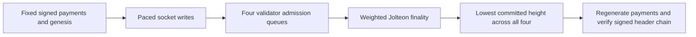

# Parallel receipt encoding at matched payment volumes

Four uninstrumented Jolteon validators ran the reference and parallel receipt implementations in serial, parallel, parallel, serial order. Each overload run wrote all 360,000 signed payments during its 120-second offer. The first pair gained 61.61 common confirmations per second with parallel encoding. The reversed pair gained 4.15. The second difference amounts to 498 payments over two minutes, less than the 2,048-payment block limit. Tail latency improved in the first pair and regressed in the second. [Per-run counts, clocks and paired transaction analysis](results.json) · [Fixed-block experiment and candidate patch](../queue-attribution/README.md#inside-follower-candidate-verification)

| Run, in order | Written by 120 s | Acknowledged by 120 s | Common by 120 s | Common TPS | Refused by full mempool | Common by 165 s | Write-to-common p99 | Four-validator CPU in offer (s) |
| --- | ---: | ---: | ---: | ---: | ---: | ---: | ---: | --- |
| [Serial A1](a1/payments.json.xz) | 360,000 | 335,099 | 245,012 | 2,041.77 | 24,709 | 335,291 | 140.444 s | 450.71–452.03 |
| [Parallel B1](b1/payments.json.xz) | 360,000 | 339,094 | 252,405 | 2,103.38 | 20,841 | 339,159 | 139.673 s | 456.74–457.79 |
| [Parallel B2](b2/payments.json.xz) | 360,000 | 339,741 | 251,505 | 2,095.88 | 20,236 | 339,764 | 140.394 s | 458.79–459.96 |
| [Serial A2](a2/payments.json.xz) | 360,000 | 338,668 | 251,007 | 2,091.73 | 21,268 | 338,732 | 137.788 s | 453.49–454.66 |

All acknowledged payments in these four runs reached the certified chain within the 45-second drain. The denominator for window throughput is 120 seconds. The p99 starts at the socket write and includes payments that finalized during drain. CPU intervals bracket the exact start and end on the driver's wall clock using the adjacent process accounting samples. Those intervals bound sampling error only. The candidate used more validator CPU during the offer in both comparisons. Dividing the CPU interval by the in-window common confirmations gives 1.840–1.845 ms per payment for A1 and 1.810–1.814 ms for B1. In reverse order, B2 used 1.824–1.829 ms and A2 used 1.807–1.811 ms. This cost ratio includes work on payments that confirmed later. [Replay and CPU bounds](analyze.py)

## How closely the offers matched

Both pairs used identical genesis, funded inputs and driver binaries. A ready sender could select a different validator for the same payment in different runs. At one-second boundaries the largest cumulative difference in socket writes was 182 in the first pair and 1,555 in the reversed pair. The maximum of those differences was about half a second of scheduled traffic. At the end of each offer the difference was zero. Local admission, the ordering of accepted payments and the resulting block boundaries could still differ.

In A1/B1, 320,028 payments were acknowledged and certified in both runs. Of these, 196,432 reached common visibility faster with the candidate. The median per-payment change was −517 ms. For A2/B2, the matched subset contained 321,846 payments. Of these, 160,189 were faster with the candidate and the median change was +3 ms. These medians compare the same signed payment across two histories. The p99 in the table describes each run's complete acknowledged and certified population. [Per-second arrivals, destination counts and matched quantiles](results.json)



## Four runs at 1,800 writes per second

The second sequence repeated the same executable order with a smaller genesis and an identical 108,000-payment corpus in each run. The offer lasted 60 seconds and the drain lasted 15 seconds. All four runs wrote, acknowledged and certified every payment. Each archive was independently replayed. [Signed workload, CPU windows and payment-level comparisons](paced/results.json)

| Run | Common by 60 s | Common TPS | Write-to-common p99 | Four-validator CPU in offer (s) | Payment blocks with ≥256 transactions / total |
| --- | ---: | ---: | ---: | --- | ---: |
| [Serial A1](paced/a1/payments.json.xz) | 106,896 | 1,781.60 | 1.373 s | 135.70–136.48 | 252 / 256 |
| [Parallel B1](paced/b1/payments.json.xz) | 107,036 | 1,783.93 | 2.104 s | 135.74–136.59 | 269 / 273 |
| [Parallel B2](paced/b2/payments.json.xz) | 106,963 | 1,782.72 | 1.045 s | 136.44–137.32 | 278 / 280 |
| [Serial A2](paced/a2/payments.json.xz) | 104,239 | 1,737.32 | 2.302 s | 133.00–134.29 | 256 / 259 |

The two candidate-minus-reference differences were +2.33 and +45.40 common TPS. End-to-end p99 changed by +0.731 and -1.257 seconds. At one-second boundaries the maximum cumulative write differences were 518 and 1,541 payments. A ready sender selected the receiving replica independently in each run. [Per-run counters and timing](paced/results.json)

The driver’s schedule-to-write p99 was 0.116–0.154 ms in the first three lower-load runs and 828.717 ms in A2. In seconds 59 and 60 the A2 driver wrote 259 and then 3,341 payments. B2 wrote 1,800 in each second. This end-of-window bunching limits interpretation of the second pair’s 45.40 TPS difference.

The node keeps serial receipt encoding by default. On fixed blocks the candidate reduced preparation time, but at 3,000 writes/s the second throughput gain was smaller than one block over the offer, and the p99 and CPU per common confirmation changed direction. At 1,800 writes/s both implementations were close to the offer rate. The storage study therefore retains the candidate as a research patch. Reproduce the smaller profile by changing the preparation arguments to `--rate 1800 --seconds 60 --drain 15`, then replay `paced/a1/payments.json.xz` through `paced/a2/payments.json.xz` and run `python3 "$study/analyze.py" "$study/paced"`.

## Reproduction

All validators shared twelve physical cores and their SMT siblings on one Ryzen 9 7950X3D workstation. The driver used two other physical cores. The four new RocksDB stores for each trial shared a Btrfs volume over two NVMe devices. Three validators retained 64 heights and one served the full archive. Auxiliary checks ran on the remaining two cores during some trials, sharing the machine's memory and storage. This experiment measures one-host throughput under two load profiles. [Storage layout](../proposal-cadence/nvme/README.md) · [Public four-validator topology](../proposal-cadence/100ms-peers.json)

Build the reference from `b808686`. Build the candidate from the same revision with only `research/storage/queue-attribution/parallel-receipts.patch` applied. Both use `cargo build --release --locked --bin stem` with `CXXFLAGS='-include cstdint'`. Use two VM workers, the 100 ms proposal interval in the public topology, 256 ready senders and persistent submission connections. Each run's `counters.json` identifies the driver, node, genesis and contract digests. The offline verifier uses a separately built stock harness. [Driver and validator commands](../external/README.md)

```sh
study=research/storage/receipt-crossover
driver=research/storage/external/drive.py
topology=research/storage/proposal-cadence/100ms-peers.json
python3 "$driver" --harness "$harness" --contracts "$contracts" prepare \
  --trial "$trial" --topology "$topology" --rate 3000 --seconds 120 --drain 45 \
  --block-transactions 2048 --block-cycles 4000000000 \
  --senders 256 --ready-senders --reuse-submissions --complete-volume
python3 "$driver" --harness "$harness" --contracts "$contracts" verify \
  --trial "$trial" --report "$study/a1/payments.json.xz"
python3 "$study/analyze.py"
```

For live measurement, use a new store on each validator and run `drive.py measure` from the driver. Collect the node and driver counters with the existing collector and sample each CPU process throughout the trial. The candidate only runs its two branches concurrently inside a pool of at least two workers on blocks containing at least 256 executions. [Archive collector](../queue-attribution/collect.py) · [CPU sampler](../submission-sessions/cpu.py) · [Receipt and header equivalence](../queue-attribution/receipt-equivalence.rs)
