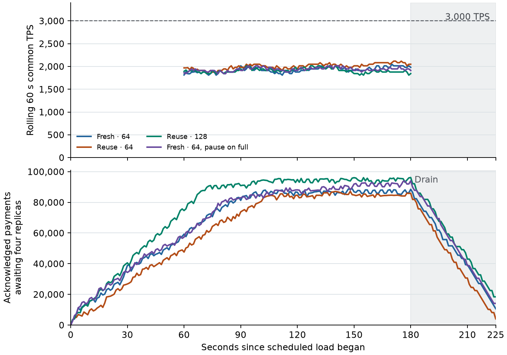
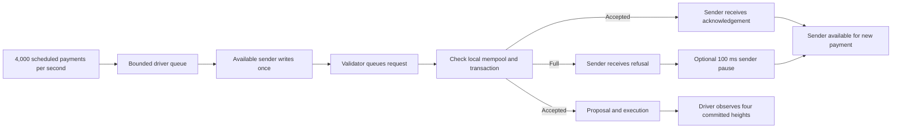

# TCP sessions and backpressure under sustained payment load

Four local Jolteon validators received 720,000 scheduled, independently funded payments per trial. The driver offered 4,000 transactions per second for 180 seconds, then observed a 45-second drain. Each row used the same signed corpus and genesis. The first pair changed TCP session reuse. The third doubled the number of senders with reuse enabled. The fourth returned to the first configuration and paused each sender for one proposal interval after an explicit full-mempool reply.

| Connections and senders | Writes by 180 s | Acks by 180 s | Full-mempool replies, total | Common by 180 s | Common TPS | Common by 225 s | Acks pending at 225 s | p99 |
| --- | ---: | ---: | ---: | ---: | ---: | ---: | ---: | ---: |
| [Fresh, 64](fresh64.json.xz) | 571,502 | 428,700 | 142,786 | 340,213 | 1,890.07 | 418,037 | 10,679 | 195.88 s |
| [Reuse, 64](reuse64.json.xz) | 550,327 | 443,656 | 106,639 | 357,718 | 1,987.32 | 439,638 | 4,050 | 189.72 s |
| [Reuse, 128](reuse128.json.xz) | 637,668 | 434,965 | 202,639 | 338,795 | 1,882.19 | 416,619 | 18,410 | 195.55 s |
| [Fresh, 64, pause on full](pause64.json.xz) | 446,267 | 434,932 | 11,333 | 340,938 | 1,894.10 | 420,810 | 14,124 | 196.76 s |

A 64-sender connection pool reused an existing socket 528,641 times. It halved the driver's CPU time and added 17,505 common confirmations by the deadline. Doubling its senders raised the socket-write rate from 3,057 to 3,543 per second, brought the first full-mempool reply forward from 97.7 to 66.5 seconds, and reduced common confirmations by 18,923. All four modes completed the first minute without a full-mempool reply.

Pausing fresh-connection senders reduced full-mempool refusals by 92.1%. The driver instead dropped 273,733 scheduled payments before a socket write, compared with 148,498 in the fresh control. The gain of 725 common confirmations during the offer was 0.21%, and 3,445 more acknowledged payments were still pending at the end. Keep the pause opt-in for overload experiments. The earlier wide-block trial at a scheduled 3,000/s reached 2,221.14 common TPS. None of these higher-pressure runs matched it. [Earlier wide-block result](../dispatch/README.md)

Common TPS counts payments in blocks that all four validators reported committed by 180 seconds. Acknowledgements are successful replies from the endpoint accepting a payment. The 225-second counts use the last common-height sample by that deadline. The latency percentile includes payments with both a socket write and common confirmation in the recorded chain. Payments still outstanding have an unknown final latency. There was one trial per configuration. [Recomputed counts, timing and CPU bounds](results.json)





## CPU, storage and queue measurements

| Configuration | Driver CPU, offer (s) | Four validators CPU, offer (s) | Queue share of total reply wait | WAL (GB) | Flush / compaction SST files (GB) | Device writes, 225 s (GB) |
| --- | ---: | ---: | ---: | ---: | ---: | ---: |
| [Fresh, 64 observations](fresh64-observations.json.xz) | 19.59–19.63 | 658.97–660.27 | 98.61% | 4.989 | 3.475 / 5.132 | 13.812–13.876 |
| [Reuse, 64 observations](reuse64-observations.json.xz) | 9.84–9.87 | 664.33–666.74 | 98.65% | 5.245 | 3.630 / 5.742 | 14.536–15.030 |
| [Reuse, 128 observations](reuse128-observations.json.xz) | 12.11–12.14 | 648.58–649.85 | 99.28% | 4.971 | 3.484 / 5.136 | 13.832–13.902 |
| [Fresh, 64, pause observations](pause64-observations.json.xz) | 15.76–15.83 | 648.89–649.86 | 98.60% | 5.019 | 3.481 / 5.135 | 13.872–13.905 |

Candidate verification took an average of 71.84–73.57 elapsed seconds per validator over the offer and drain. Proposal work averaged 22.52–23.11 seconds and commit work 8.56–9.27 seconds. The next discriminating comparison would hold the actual arrival rate constant and measure which of these operations is running when a submit frame begins waiting. The aggregate queue counters locate the wait but cannot assign it to a particular operation.

The queue fraction divides the four servers' accumulated time from receiving a submit frame to starting its handler by the driver's accumulated socket-write-to-reply time. Concurrent requests overlap, so these sums can exceed elapsed wall time. The admission and candidate counters also measure elapsed work. Process CPU uses a separate observation of Linux user and system ticks. Each phase boundary lies between two samples spaced approximately 250 ms apart. The reported range uses both bounding samples. [Replica counters](../dispatch/counters.py) · [Process sampler](cpu.py) · [Jolteon request handler](../../../src/jolteon.rs)

SST sizes come from individual table-creation events in each replica's RocksDB log. Cgroup device writes cover the driver and all four validators during the offer and drain. The scope includes WAL, tables, filesystem activity and the driver's writes. Shared devices and mixed tables limit per-namespace attribution. The pinned RocksDB build defines `NIOSTATS_CONTEXT`. Its I/O statistics macro returns zero in this mode, which accounts for zero reported flush/compaction ticker bytes alongside actual table creation. [Pinned Rust build](https://github.com/nervosnetwork/rust-rocksdb/blob/9a7a824d9468b0f631566cd371055d6d0aba3985/librocksdb-sys/build.rs) · [RocksDB I/O accounting macros](https://github.com/meta/rocksdb/blob/145a50ba007326eab90da9b12d697b35f5b60e7d/monitoring/iostats_context_imp.h) · [SST event reader](../../../tools/rocksdb_sst_report.py)

## Reproduce

The validators shared twelve physical cores and their SMT siblings on one AMD Ryzen 9 7950X3D. The driver had two other physical cores. Verification jobs used the remaining two cores. The four databases and driver directory used one Btrfs volume over two NVMe devices. Three validators retained 64 heights and the fourth retained the complete archive. Each node ran two VM workers, a 100 ms proposal interval, and blocks capped at 2,048 transactions and four billion cycles. All payments used independent inputs and had 242 signed bytes. The validator executable had SHA-256 `95d52f21d833cd00068e62d85509eec359babd005be296cd8f41517c196a2d45`. Each observation archive records the preparation and measurement harness hashes. [Public committee and cadence](../proposal-cadence/100ms-peers.json) · [Host and volume inventory](../proposal-cadence/nvme/README.md)

Use the external driver's preparation and measure commands with a new genesis directory and fresh replica stores for each trial. Pass the settings below to `prepare`. Set the sender count and switches from the table. With the packaged archives, `prepare` followed by `verify` works entirely offline. For live CPU and I/O attribution, run the validators and driver under the same measurement scope as in the on-disk cadence study. Start the CPU sampler before the measurement driver. [Build and measurement instructions](../external/README.md)

```sh
study=research/storage/submission-sessions
python3 research/storage/external/drive.py --harness "$harness" --contracts "$contracts" \
  prepare --topology research/storage/proposal-cadence/100ms-peers.json --trial "$trial" \
  --rate 4000 --seconds 180 --drain 45 --block-transactions 2048 --block-cycles 4000000000 \
  --ready-senders --senders 64
python3 research/storage/external/drive.py --harness "$harness" --contracts "$contracts" \
  verify --trial "$trial" --report "$study/fresh64.json.xz"
python3 "$study/analyze.py"
python3 "$study/plot.py"
```

For the two reuse trials add `--reuse-submissions`, selecting 64 and 128 senders respectively. The pause trial uses 64 senders and adds `--pause-on-full`. It submits each scheduled payment at most once. For newly measured data use the commands below. The run directory contains the prepared `trial/`, `measurement/` and four `node-N/` homes. The CPU example runs alongside the launcher. The collection step reads the completed report and node logs after the scope exits. Plotting requires Matplotlib. [Socket-trace compatibility and negative controls](controls.json)

```sh
python3 "$study/cpu.py" "$run" "$name-cpu.json"
python3 "$study/collect.py" "$run" "$name-cpu.json" "$name-io.json" \
  "$name.json.xz" "$name-observations.json.xz"
```
